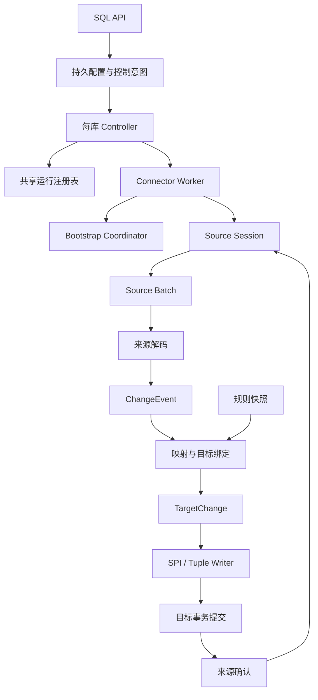

# SynchDB 最终重构方案

> 日期：2026-10-15  
> 源码基线：`f0995c8fda90aca4eccb7c8ef7838ed6dc2bc367`  
> 状态（2026-10-21 更新）：M0–M10 及追加源码审查、凭据治理、三源完整写入联调、PG16/17/JDK17 实机矩阵、新版冷恢复、配置备份、30 分钟持续负载与干净生产制品部署演练已完成，各阶段仅在声明的范围内成立。部署演练追加修复了控制账本写入与跨角色维护的权限边界。源码、六种 PG/变体生产库及验证证据已归档到项目 `.release-review/20261021-final/`；未正式安装或发布。可选 preload 已实现并完成 PG16/17/18 双模式验收：preload 自动恢复，未 preload 显式启动。后续审查又修复了跨库 controller 容量及删除数据库后的注册回收。最新归档为 `.release-review/20261022-controller-lifecycle/`，原归档保留；最新验证见 §15.43，用户操作步骤见 §19。  
> 范围：C、JNI、Java、扩展 SQL、头文件和构建入口。原有文档与测试工程不纳入改造；本文件是本次要求交付的设计文档。

**最新范围约束：只设计和交付新版本的全新部署，不考虑旧版本向新版本迁移。** 不再维护旧密文兼容、旧配置导入或 1.0→1.1 升级脚本。§15.1–15.30 保留此前实施记录；其中的旧版本迁移与升级验证属于历史结果，不构成当前交付能力。新版自身的停止/启动、同代恢复、密钥轮换及备份恢复继续属于本轮范围。

## 1. 目标与最终决策

本方案合并两轮架构设计与行为审查：以运行实例、来源批次和初始化交接为核心边界，按职责逐步拆分代码，同时修正不合理行为。

**不要求保持现有行为完全一致。** 错误值转换、静默扩大范围、隐式覆盖目标、失败后确认和假成功直接修正；新版本接口和格式不承担旧版本兼容。

### 1.1 目标

1. 明确进程、JVM、来源会话、批次、事务、缓存和文件的所有者。
2. 分离控制、采集、解码、绑定、执行、初始化和元数据访问。
3. 区分事件失败、目标提交、来源确认与 offset 持久化。
4. 明确同步范围、缺失值、行身份、冲突、映射和 DDL 语义。
5. 统一启停、暂停、重启、失败和崩溃恢复的行为。
6. 统一初始化组织方式，保留来源专用的读取与交接协议。
7. 正确性稳定后，删除多余工作并减少重复编码、解析和目录访问。

### 1.2 最终决策

| 编号 | 决策 |
|---|---|
| D01 | 行为修复与机械迁移分提交，先处理数据、内存和执行边界。 |
| D02 | 新版控制 API 写持久期望状态，SQL 提交后生效。 |
| D03 | 每个使用 SynchDB 的数据库一个常驻 controller，统一生命周期与重试。 |
| D04 | connector worker 使用 BGW_NEVER_RESTART，避免 PostgreSQL 与 controller 双重重启。 |
| D05 | 目标提交后才能确认；确认接受不代表 offset 已持久化。 |
| D06 | Debezium callback 线程独占对应 committer，JNI 只提交处理决定。 |
| D07 | 使用 ChangeEvent、TargetChange 两种事件模型，按事件顺序绑定和执行。 |
| D08 | SPI/tuple 实现同一组数据策略，不由后端开关决定业务结果。 |
| D09 | 规则快照切换，规则加载与目标结构迁移分开。 |
| D10 | 初始化默认冲突报错、失败不进入 CDC；显式替换成功加载验证后才发布。 |
| D11 | 来源读取边界、CDC 恢复材料、初始化进度和 CDC 提交进度分别表达。 |
| D12 | 来源协议独立实现；本轮支持三源 native，SQL Server 未闭合的自动交接明确拒绝，FDW 不伪造证明。 |
| D13 | 制品精确归属，增加最小持久交接记录和引擎接管边界。 |
| D14 | preload 可选：配置后自动恢复已接受的运行；未配置时显式 START/RESTART。连接器运行槽与数据库 controller 容量独立，后者按 max_worker_processes 分配；容量在本次服务器运行期间固定，仍采用全新部署流程。 |
| D15 | 普通故障重放同样可能冲突；默认明确停止，不把未知重复自动当作可忽略事件。 |

D03 调整了早先“不增加常驻 owner”的设想。提交后可靠执行 start/stop 必须有长期执行方；每库 controller 只协调 connector，不建设通用任务框架。

### 1.3 不在本轮实施范围

- OLR 协议、事件解析器和 Oracle parser 内部重写；仅允许公共接口适配。
- Debezium、Kafka、Java 依赖升级。
- 目标并行应用、来源事务聚合、通用插件平台和 SQL AST。
- 完整数据库迁移工具、通用任务调度系统。
- 旧版本到新版本的升级、旧密文和旧制品格式迁移。
- 原有文档体系更新、测试重组或新增测试框架。

## 2. 当前源码与问题分类

| 位置 | 现状 |
|---|---|
| [synchdb.c](src/backend/synchdb/synchdb.c) | 约 6,989 行，SQL API、GUC、共享状态、worker、JNI、批次、快照和文件操作混合。 |
| [format_converter.c](src/backend/converter/format_converter.c) | 约 5,879 行，规则、转换、映射、SQL、DDL 与缓存混合。 |
| [debezium_event_handler.c](src/backend/converter/debezium_event_handler.c) | 约 2,070 行，来源解码与目标目录、缓存、映射和执行耦合。 |
| [replication_agent.c](src/backend/executor/replication_agent.c) | 约 1,819 行，两种 writer、元数据 CRUD、初始化调用与 history 导出混合。 |
| [DebeziumRunner.java](src/backend/debezium/src/main/java/com/example/DebeziumRunner.java) | 约 1,351 行，配置、引擎、队列、帧、committer 和 offset 混合。 |
| [FDW SQL](src/sql/fdw/) | 约 6,031 行，已有来源分文件，公共流程、结果和资源归属仍不统一。 |
| [core.sql](src/sql/core.sql) | API、表和视图；函数属性、权限、名称类型需要调整。 |
| [Makefile](Makefile) | 从 src/sql 拼装安装脚本；修改源文件，不只修改生成物。 |

依赖固定为当前 [pom.xml](src/backend/debezium/pom.xml) 的 Debezium 3.5.2.Final、Kafka 4.1.2、Java release 17。

优先级：P0 为数据、内存和执行边界修复；P1 为主体架构或行为变化；P2 为减法与优化。附录 A 给出源码依据。静态可证问题、设计取舍和一致性缺口分别表达，不把未闭合协议写成已复现丢数据。

## 3. 总体架构



| 模块 | 职责 | 限制 |
|---|---|---|
| SQL API | 参数、目录事务、命令登记和结果 | 不操作 JVM、不提前启动业务同步。 |
| Controller | 期望状态、worker 注册、重试、命令结果 | 不解析事件、不转换行数据。 |
| Worker Coordinator | 阶段、会话、批次边界、停止清理 | 不生成来源专用 DML。 |
| Source Session | 引擎、批次、确认与关闭 | 不调用 PG 执行器。 |
| Decoder | 来源操作、字段、类型和结构变化 | 不查目标目录、不改目标。 |
| Binder / Converter | 映射、目标绑定、值转换 | 不推进 offset、不自行提交。 |
| Writer | 执行明确的目标变化 | 不隐式决定容错和来源确认。 |
| Bootstrap Coordinator | 计划、读取会话、结果和交接 | 不把位点字符串当全部恢复状态。 |
| Store / Artifact Store | 目录、归属、编解码和发布 | 不依赖调用者 search_path 或子串删除。 |

## 4. 身份、配置与所有权

### 4.1 核心类型

```text
ConnectorKey = {database_oid, connector_id}
ControllerHandle = {database_oid, registry_incarnation, generation, owner_pid}
RunHandle = {registry_incarnation, slot, generation}
WorkerAttempt = {controller_generation, run_handle, attempt_id, registration_token, owner_pid}
BatchToken = {session_epoch, batch_id}
SourceTableId = {catalog, schema, table}
```

connector 使用稳定 ID，名称是可验证和展示的属性。共享槽位不是身份；run generation、attempt、session epoch、配置 revision 分开管理。

来源名称为完整 text 组件，保留大小写；目标命名独立规范化，执行前检查碰撞。历史截断数据不能自动恢复，必要时重新发现来源。

```text
RunSpec
    connector_key / config_revision
    source_dialect / capture_backend / snapshot_provider
    connection_settings / selection
    mapping_generation / run_options
```

区分来源数据库、采集后端和快照 provider。旧 connector enum 数值在入口转换。每个运行持有完整配置快照，重启整体切换，禁止只把新配置传给 Java、其他部分继续使用旧值。

### 4.2 生命周期

| 资源 | 所有者与期限 |
|---|---|
| 实际 BGW handle | 本库 controller，覆盖对应注册存续期。 |
| 共享运行条目 | Registry，从预留到确认运行终止。 |
| JVM | worker 进程级，普通 engine restart 不销毁重建。 |
| Java EngineSession | 一次来源会话。 |
| JNI global/local ref | bridge/session 或一次 local frame。 |
| DirectByteBuffer lease | 一个 SourceBatch 的最后一次 native 访问结束。 |
| 规则和缓存 | WorkerRunContext，失效或运行结束释放。 |
| 批次临时数据 | BatchContext。 |
| 单事件数据 | EventContext。 |
| 远端事务、锁和读取视图 | SourceReadSession。 |

禁止事件指针进入长期缓存，禁止释放借用配置，禁止用 TopMemoryContext 掩盖归属不明。

## 5. 控制面与 Worker

### 5.1 提交后生效的 API

新版 API 在调用者事务中写：

- desired_state：RUNNING、PAUSED、STOPPED。
- 配置与运行选项 revision。
- 一个有界 pending command：operation ID、类型、目标 revision 和类型化参数。

可合并期望状态按 revision 协调；不可合并命令忙时拒绝，不设置无限队列。返回“命令已登记”及 operation ID，完成另行查询或有界等待。

持久命令记录执行者 controller generation。新 controller 接管旧代 EXECUTING 命令时，按类型核对运行/制品状态，再重试、完成或标失败；不能永久占槽，也不能一律改回 PENDING 重做外部副作用。

```text
PENDING → EXECUTING → SUCCEEDED / FAILED
可替代命令另有 CANCELLED / SUPERSEDED
```

不能在同一事务内等待尚未提交的命令完成。COMMIT 回调只做轻量唤醒，不执行 SPI、JNI、文件删除或 worker 启停；controller 周期扫描已提交目录，覆盖漏通知、backend 提交后退出和 COMMIT PREPARED。子事务回滚自然撤销目录修改，多余唤醒无害。

### 5.2 Controller

- 每库一个，连接固定数据库读取本库目录；单集群进程不通过 SPI 切换数据库。
- controller 自身由 PostgreSQL 按策略重启；connector worker 使用 BGW_NEVER_RESTART，由 controller 统一退避重试。
- 保存真实 opaque handle，不复制私有布局，不把指针放共享内存。
- 启动 launcher 发现数据库并注册 controller。
- 首次安装/控制调用可确保 controller 存在，但它须等待发起事务结束并验证目录；回滚不得启动 connector。
- controller 与 connector 都纳入 BGW 预算；容量不足明确等待或失败，不静默跳过。
- 每库 controller 在 Registry 原子认领身份，防止 launcher 与首次调用创建重复控制者。
- controller bootstrap 在 bgw_extra 携带数据库 OID、协议版本等独立于共享槽的信息；共享区重建后按数据库重新认领再读目录。
- worker bootstrap 携带 controller 代次、运行身份与注册 token，以值复制并检查 ABI、长度和对齐，不保存指针。

### 5.3 状态和共享注册表

| 维度 | 状态示例 |
|---|---|
| 期望状态 | RUNNING、PAUSED、STOPPED |
| 实际运行 | STARTING、RUNNING、RETRY_WAIT、RECOVERING、STOPPING、STOPPED、FAILED |
| 阶段 | PREFLIGHT、BOOTSTRAP、CDC、PAUSED、CLEANUP |
| 活动 | 解码、绑定、写入、确认等诊断信息 |
| 命令 | PENDING、EXECUTING、SUCCEEDED、FAILED |

STOPPED 严格表示没有活 attempt 且资源已清理。Registry 提供 reserve/claim/finish、request_stop、submit/copy/complete_request、publish/read_status，不暴露可写共享指针。

所有写入检查 slot 范围、generation 和 owner。锁内只检查和复制，不做 SPI、JNI、分配或可能 ERROR 的操作。

### 5.4 命令与恢复

- 重复 start/pause/resume/stop 幂等，已经满足时返回 already_satisfied。
- 无 PID 的 stop 仍取消后续自动启动。
- pause 在批次边界生效并持久保存；resume 保留原快照/CDC 计划。
- restart 验证完整候选 RunSpec，结束旧会话后整体切换；JVM 参数变化重启 worker。
- 超时保留 STOPPING，不提前清槽和删资源。
- 自然结束、用户停止、可重试失败、永久失败分别记录。

BGW 启动成功不代表业务 READY；在旧自动重试模式下，BGWH_STOPPED 也不代表注册永久消失。[PG-BGW]

controller 崩溃后，新代 controller 要求旧代 worker 在安全边界退出；确认旧进程结束前不启动同 connector 第二个运行。丢失的 opaque handle 不可伪造；无法确认退出时保持 RECOVERING/STOPPING。connector 无自动重启，退出后不会反复由旧注册唤醒。

还要处理“BGW 已注册、worker 尚未认领或发布 PID”的窗口：PID 为零不表示没有注册。旧 bootstrap 在数据库/JVM 初始化前校验 controller/run 代次，过时代次正常退出；新代必须确认旧运行已退出或旧未认领注册已被隔离为不可取得写入权，不能仅凭无 PID 复用。

集群恢复从已提交目录重建配置、期望状态和选项；完整重启由 launcher 发现。维护命令按 operation ID 和实际制品状态恢复，不承诺外部副作用 exactly-once。

P0 阶段暂保留旧 API 的即时控制时机；v2 同时切换 controller、目录意图、结果和等待语义，禁止同一个返回 0 混合表示两套契约。

## 6. 来源会话、JNI 与确认

### 6.1 Debezium 线程模型

按 3.5.2.Final 的异步引擎设计，不提供旧 EmbeddedEngine 选项。committer 按精确实现约束，不直接套用系列文档的线程安全表述。[DBZ-ENGINE] [DBZ-ASYNC]

```text
callback:
    保存原始 records 与 committer
    发布批次，等待 TARGET_COMMITTED / ABORT
    在 callback 线程逐条确认并返回结果
native:
    poll → apply → settle → release_buffer
```

等待期间不持有阻止 poll/settle/stop 的全局锁。原始记录保留 Java，过滤 tombstone 不改变逐条确认责任。[DBZ-API]

### 6.2 状态

```text
DELIVERED → APPLYING → TARGET_COMMITTED → ACK_ACCEPTED
                └→ APPLY_ABORTED
                              └→ ACK_FAILED / ACK_UNKNOWN
```

ACK_ACCEPTED 不代表 offset 持久化。确认未知时停止新批次，不重执行已提交批次；重复 settle 查询原操作，不重做部分 mark。无法确定时结束会话，从持久 offset 恢复，允许重放。

目标已提交后的 ACK_FAILED 同样冻结后续批次，不允许通过后续确认跨过失败位置；与 ACK_UNKNOWN 一样结束或恢复该会话，不重新应用目标事务。

本方案按至少一次设计；交付批次不自动等于完整来源事务，不承诺跨系统 exactly-once。

普通 commit→ack/flush 窗口的故障也会重放，并不限于快照重叠。首版默认严格冲突策略：重放 INSERT 冲突、UPDATE/DELETE missing 等明确停在可诊断状态，controller 不将永久冲突无限重试。自动重启不等于所有故障都能自动消除冲突。

如需自动跨故障去重，另行实现来源稳定事件标识与目标提交账本，或受限的来源权威重放策略，明确确定性转换、表归属和触发器影响；不能用新 session 的 batch_id 当永久去重键，也不能把所有冲突改为 DO NOTHING。

接口示意：source_poll、source_settle、source_query_settlement、source_release_buffer、source_begin_stop、source_poll_stop。缓冲区释放不暗含确认。

### 6.3 关闭与背压

自然结束排空已接受工作；明确停止可放弃未提交批次但不得确认，并解除 callback 等待。已提交确认不确定进入 ACK_UNKNOWN。

关闭不能形成 native 等 close、callback 等 native 的循环；使用可轮询、有截止时间的关闭过程，超时不谎报停止。

队列同时限制数量与字节，单条超限明确失败。future 完成不能越过未处理队列直接报告终止。

### 6.4 JNI 与帧

正常构造 Java 对象，替换不调用构造器的 AllocObject；管理 global/local refs、异常和 DirectBuffer lease，容量用 jlong。PG ERROR 路径也释放 lease 并清空 g_eventStr 等借用指针。JVM 与 engine 分生命周期。[JNI-FUNCTIONS] [JNI-INVOCATION]

先完整验证帧，再开始目标事务：

1. 地址、最小头、字节序。
2. 长度与剩余空间，拒绝负值、溢出和截断。
3. 实际数量、NUL 和帧结束位置。
4. 有效长度与分配容量。
5. 终止标志按布尔值解析。

V1 native 事件序号不等于过滤前原始记录序号。零输出事件仍可对应有效批次。V1 先保留；确需 record key 等信息再版本化升级，不让 C 猜测缺失信息。C/JAR 启动检查协议兼容性。

## 7. 事件模型与目标语义

```text
ChangeEvent
    source_identity / operation
    before / after / source_fields_and_logical_types
    schema_changes / available_source_position
TargetChange
    target_relation / identity_fields / write_fields
    target_bindings / converted_values / execution_policy
```

Decoder 只解释来源，Binder 查询目标并应用映射。不整批提前绑定，保留批内 DDL 对后续 DML 的影响。

| 场景 | 最终语义 |
|---|---|
| NULL/空串/字符串 NULL | 独立保存，不按字符串猜空值。 |
| 缺失字段 | 独立于 NULL；unavailable 只按适配器确认的语义识别。 |
| INSERT 缺失列 | 按目标默认/生成规则处理；缺必需数据失败。 |
| UPDATE 缺失列 | 保留原值，不补 NULL。 |
| before/after | 独立按列身份处理，不依赖等长或相同顺序。 |
| 完整 key | 验证所有必需字段；禁止部分复合 PK。 |
| UPDATE/DELETE 零行 | 默认报告一致性错误/missing；容忍重放须明确策略。 |
| 精确 key 多行 | 回滚失败。 |
| 无 PK | 显式完整 before 单行匹配，不变成删除全部同值行。 |
| 重复 INSERT | 默认暴露；仅在明确快照重叠条件下去重。 |
| 坏编码/缺必需字段 | 失败，不猜成 0、空坐标或 NULL。 |
| 时间/decimal | 保持单位、精度和范围，无法表示明确失败。 |
| 表达式 NULL | 正常可空结果，不解引用空指针。 |
| TRUNCATE | 支持后默认同步；不支持失败，显式忽略须可观测。 |

SPI/tuple 实现同样策略；不支持时明确拒绝。来源自动 DDL 默认关闭，replica identity 先验证，自动设置为显式选项，不能隐式把 FULL 改为 DEFAULT。[DBZ-PG-IDENTITY]

结果区分 APPLIED、CONTROL、NOOP、SKIPPED、UNSUPPORTED、FAILED。默认失败或不支持回滚整批、不确认。显式 skip 使用事件子事务恢复 PG 资源状态；其余结果与诊断提交后才确认原始批次，不支持跨未处理空洞的任意范围确认。[PG-SPI]

## 8. Batch Apply、DDL、规则与缓存

### 8.1 执行与事务

```text
完整帧验证 → 开始目标事务
    → 顺序 decode/bind/convert/execute
    → 目标提交 → 发布提交统计 → 来源确认 → 释放资源
```

只有 Batch Apply 协调者控制事务、snapshot 和提交；转换、表达式、writer 不自行提交。所有 PG API 位于所属 backend 线程。

SPI 使用参数化值、正确引用的标识符和影响行数检查。tuple 建立 ApplyExecutionContext，统一 relation 写锁、EState、ResultRelInfo、snapshot、trigger scope、slots、indexes、EPQ 和 ResourceOwner。

ExecSimpleRelation 系列会执行部分约束和行触发器逻辑，既不能说完全绕过，也不能承诺普通 SQL 全部语义；对照上游 logical worker 补齐环境。主版本差异集中 pg_compat，不支持的关系种类明确处理。[PG-REPLICATION] [PG-WORKER]

skip 子事务回滚后，销毁或重建受影响 relation/executor/EPQ/index 状态，不能继续复用已由子事务 ResourceOwner 释放的对象。每事件结束先清空 slots 和借用 Datum，再回收 EventContext；缓存失效不能代替执行状态恢复。

### 8.2 规则与 DDL

默认规则只读；connector 覆盖形成带 generation 的不可变快照，删除/禁用通过重建真正生效。

```text
读取候选规则 → 编译验证 → 批次边界激活
需要结构迁移：
    候选规则 → 迁移计划
    → DDL 与属性元数据同事务
    → 提交 → 激活并失效绑定
```

reload 不暗含改表。FDW/CDC 共享语义，不强求共用逐行执行代码。

规则迁移的目标 DDL、属性元数据及“已应用 mapping generation/迁移完成标记”同事务持久化。提交后仅做内存激活；若此时崩溃，重启按持久代次恢复，不能重复推测或重做迁移。

DDL 处理完整 tableChanges，按身份计算真实 diff，不按列数猜测重命名或增删，不重复 ALTER 无变化列。既有表验证结构，不能将 IF NOT EXISTS 当成功。

DDL 成功后同事务后续 DML 立即重新绑定；abort 也清理失真绑定。默认值采用等价表达式/显式映射/明确目标管理策略，不伪造 DEFAULT NULL。

schema 能力分为基础复制与结构保真：基础模式明确报告不复制的来源默认/约束，验证 DML 所需结构；保真模式不支持的必需结构失败。默认不自动增加全部 FK/索引。

### 8.3 缓存

来源 schema、目标目录、映射绑定分离；键包含来源身份、结构签名、规则代次和目标有效性。完整构造后发布，独立上下文整体回收。

规则/来源结构变化、目标本地 DDL、事务回滚、运行结束都有失效路径；relcache 回调只标脏不执行 SPI。初期只保留必要目标缓存，禁止 EventContext 指针逃逸。

## 9. 初始化计划、范围与失败

### 9.1 模式

是否复制数据与完成后动作分开表达：

| 意图 | 复制 | 完成后 |
|---|---|---|
| initial | 按有效完成状态决定 | CDC |
| initial_only | 按有效完成状态决定 | 停止，禁止 CDC |
| no_data | 不复制 | 必需准备后 CDC |
| schemasync | 不复制 | 暂停并保留后续计划 |
| always | 明确的新一代初始化 | 按配置动作 |
| never | 不初始化 | 验证恢复前提后 CDC |

来源不支持的组合 preflight 拒绝，不回落其他模式。原生 PostgreSQL 不提供现有代码所假设的 DDL 同步步骤时，不能直接标记 schemasync 成功；选择实际 schema provider 或显式 validate_existing。

### 9.2 选择范围

```text
SelectionSpec
    AllEligible
    ExplicitTables<TableIdentity>
    ConnectorFilter<dialect, expression>
```

文件只是输入载体；Debezium 正则不直接当 FDW 名称列表。非法、显式空、合法无匹配、全量分别表达。计划保存实际表集合；不支持多 schema/正则时明确拒绝。内部 helper 按完整身份排除，不误排除同裸表名业务对象。

### 9.3 计划、读取会话和结果

```text
BootstrapPlan
    generation
    frozen RunSpec / selection / mapping / schema
    copy_data / after_bootstrap
    failure_policy / target_policy / history_policy
    source_read_policy
SourceReadSession
    live connections / locks / transactions / read view
BootstrapResult
    COMPLETE / PARTIAL / FAILED
    per-table required-stage results
    source_read_boundary / cdc_resume_material
    retry_disposition / artifact_requirements
```

区分四类信息：

| 信息 | 意义 |
|---|---|
| 来源读取边界 | 数据实际来自哪个读取视图。 |
| CDC 恢复材料 | connector 从哪里、携带何种完整状态恢复。 |
| 初始化进度 | 表、阶段、成功失败和生成代次。 |
| CDC 提交进度 | 目标提交与来源确认，不能冒充持久 offset。 |

现有 OffsetData 的带类型 union 可保留；复杂 seed 由来源适配器提供，不把所有 C 状态改成无类型 JSON。SourceReadSession 是活跃资源，不假装可序列化恢复。

### 9.4 公共流程与提交粒度

```text
preflight
    → 建立真实来源读取会话、冻结元数据
    → 编译最终目标、列映射与类型计划
    → 建立私有 staging / 目标
    → 数据复制
    → 必需约束、属性绑定与结果验证
    → 目标提交
    → 制品发布和所有权交接
    → 按计划暂停 / CDC / 停止
```

保留“复制前形成正确列映射、复制后完成目标属性身份”的语义，不能在提取公共函数时丢失 staging OID 到最终目标 OID 的转换。

默认 fail-fast，整次初始化一个外层目标事务。显式 continue_tables 可用表级子事务保留成功表并提交 PARTIAL：成功对象在外层提交后可见，失败对象不替换旧有效目标；全部所选表达到要求前不得 CDC。

表级异常隔离不是逐表持久提交，不承诺复制中途崩溃后的逐表断点。逐表提交单独设计。

必需的建表、类型、主键、复制、绑定、history 失败进入结构化结果；warning 不代表成功，查询失败不代表零错误。schema-only 成功重试也要关闭相应旧错误。

### 9.5 目标冲突与替换

- 默认 on_exists=error，提前检查最终身份，不先操作无关中间同名目标。
- validate_existing 显式使用既有目标，验证结构与行匹配能力。
- replace 显式允许覆盖，先加载私有表并验证，再在目标事务内发布。
- identity mapping 无操作；禁止隐式 DROP CASCADE。
- 目标冲突、大小写折叠、列映射碰撞和对象归属在 DDL 前检查。

改名交换不保留旧表 OID，不会自动重绑定 view/FK。首版拒绝不支持的外部依赖；授权、触发器和关联对象明确处理。保留 OID 的原表重载另设策略，不能把交换称为无损替换。

发布步骤锁定预期旧目标，重新核对 OID、归属、结构和依赖；加载期间发生变化则中止发布，保留旧目标。首版 replace 仅允许同 owner 的 SynchDB 自有表，表/列 ACL 纳入重建计划；自定义触发器、RLS、未处理外部依赖或目标自定义关联对象明确拒绝。

### 9.6 重试

结果关联 generation、实际表集合、映射和 schema 版本，不以 max(err_offset) 代替共同边界。

```text
RETRY_SAME_BOUNDARY
RETRY_IN_LIVE_READ_SESSION
RESTART_BOOTSTRAP
NOT_RETRYABLE_UNTIL_CONFIG_CHANGE
```

仅在来源证明可重读时使用旧边界。持久错误行不能恢复已经丢失的 PG exported snapshot、MySQL/SQL Server 读取事务；Oracle 受 undo 和 DDL 限制。

同代 PARTIAL 结果仅在读取条件与指纹有效时复用。新一代不能无条件接纳旧成功表；必须重新验证或按明确重建策略处理。

PARTIAL 的外层提交可能同时结束远端读取事务，例如当前 postgres_fdw 的远端事务随本地事务结束。worker 还活着不代表旧读视图还活着；RETRY_IN_LIVE_READ_SESSION 必须由 provider 在该生命周期下明确证明，否则重新 bootstrap。

## 10. 来源专用一致性交接

| 来源 | 当前能确认的部分 | 需要补齐 |
|---|---|---|
| PostgreSQL | postgres_fdw 有远端一致事务快照 | 实际远端读取连接与 slot consistent point/exported snapshot 协调。 |
| MySQL | 能读取 binlog 坐标和表数据 | 锁、schema、实际读取事务与 binlog 坐标形成共同协议。 |
| SQL Server | CDC max LSN 与普通数据查询 | 区分 capture lag 与业务提交，协调隔离、重叠事件和 history recovery。 |
| Oracle | AS OF SCN 明确读取视图 | 完整 LogMiner 恢复材料，验证跨 cutoff 长事务，不能只写几个 SCN。 |

PG FDW 不是没有快照；问题是它与 CDC 起点是否对应。目标事务 SET SNAPSHOT 不会自动作用于 FDW 远端。trust_slot 不代替协议，也不补回丢失日志。[PG-FDW] [PG-SNAPSHOT] [DBZ-PG-OFFSET]

MySQL 原生快照、SQL Server 隔离与 CDC、Oracle LogMiner 各有协议，不用一个通用 capture_offset 函数替代。[DBZ-MYSQL] [MS-CDC] [DBZ-SQLSERVER] [DBZ-ORACLE]

实施原则：

1. 先统一组织与错误处理，逐来源完成严格交接。
2. 严格一致性场景优先使用具备相应协议及配置的原生快照。
3. FDW 保留明确兼容范围，不静默切 provider，不因改名扩大保证。
4. 无法控制真实读取连接时，不承诺用本地 SQL 包装完成远端快照导入。
5. 每来源独立列出权限、日志保留、读取视图寿命、DDL 与长事务前提。

## 11. Offset、History 与制品恢复

### 11.1 归属

```text
ArtifactKey = {database_oid, connector_id, artifact_kind, generation}
```

唯一生成器管理路径；旧文件名有显式解析映射。禁止名称子串删除和不具唯一性的下划线拼接。

这里的 generation 是持久 bootstrap/artifact generation，不是每次 worker/run/attempt 代次。目录保存 active artifact 引用；普通重启重新打开原引擎拥有的制品，不重新分配路径或制造 seed。新 bootstrap 切换前确认旧引擎终止。

offset/history 编解码与协调分开，保留各自现有格式；其中 offset 使用 Java 序列化，不能顺手改普通 JSON。适配器按固定引擎版本生成必要恢复材料。

删除配置默认保留恢复材料；purge、位点重置、普通启停分别提供。已停止状态可离线校验和修改位点，不要求仅为维护启动 JVM/来源引擎。

### 11.2 持久交接

BootstrapHandoff 位于目标数据库，与目标结果同事务提交：

```text
connector_id / generation
outcome / after_bootstrap / per_table_result_reference
config / selection / mapping fingerprints
source boundary / versioned resume material
artifact format versions / history references
phase / offset_owner
```

```text
TARGET_COMMITTED → ARTIFACTS_READY → ENGINE_OWNED
```

发布步骤：

1. 与已提交目标结果同事务保存 outcome、完成后动作及逐表结果/引用，含来源身份、阶段、目标 OID 和对象归属。
2. 只有 COMPLETE 且计划需要时写可启动制品，检查 write、flush、close、sync。
3. 替换制品；多文件以 generation/readiness 门控，不宣称 rename 整体原子。
4. 标记 ARTIFACTS_READY。
5. **仅在实际需要启动引擎时，启动前持久转移 ENGINE_OWNED。**
6. 引擎验证制品后启动，发布业务 READY；READY 不代表 offset 已持久化。

ENGINE_OWNED 前，仅在确认无引擎使用制品时可重新发布同代 bootstrap 制品。接管后禁止重写旧 seed，否则可能倒退已前进的 CDC offset/history；恢复使用引擎当前制品，缺失/损坏须专用恢复而非盲目重置。

成功验证前保留 history 来源。此记录只解决本地提交与发布窗口，不能修复来源读取边界，也不能复活远端会话。

PARTIAL 仅保留诊断与可验证的逐表结果，不发布可启动 seed、不转移引擎所有权；暂停/停止也不转移 ENGINE_OWNED，后续 resume 再验证并接管。全事务回滚的 FAILED 由控制面另行记录，不伪造 TARGET_COMMITTED。

## 12. 元数据、权限与配置

### 12.1 Store

ConnectorStore、ControlStore、MappingStore、AttributeStore、BootstrapHandoffStore 集中目录访问：

- 值参数化，动态标识符正确引用。
- 自身对象按 extension namespace/OID 解析，实现 relocatable 声明。
- SPI 结束前复制到明确调用方上下文，不统一塞入 TopMemoryContext。[PG-SPI-MEM]
- 显式限定 connector、来源身份和 generation。
- 数据库约束与代码验证配合，检查修改行数。
- 来源全名使用 text 组件，旧截断内容必要时重新发现。

### 12.2 SQL 契约

副作用与动态共享状态函数使用 VOLATILE；依赖配置/映射的转换函数不直接 IMMUTABLE。[PG-VOLATILITY]

可选参数使用真实 SQL NULL，移除字符串 null 哨兵。边界拒绝截断、负统计、非法端口、坏 offset、过长 snapshot mode。新结果使用命名类型/RETURNS TABLE；新部署直接采用新签名。

### 12.3 权限和秘密

- 默认收紧控制/维护函数 PUBLIC EXECUTE，明确管理、观察和执行权限。
- 控制操作检查角色/归属，共享内存可访问不等于授权。
- SECURITY DEFINER 固定可信 search_path 并限定自身对象。
- worker 执行身份显式配置、验证，不隐藏依赖 bootstrap superuser。
- C/Java/SQL 日志统一脱敏，禁止 keystore/truststore 等密码。
- 删除编译期固定密钥，使用受权限保护的外部密钥文件、带版本和 key ID 的密文，以及事务内轮换；不读取旧格式密文。实施见 §15.32。

部署 ACL 可能已额外收紧，不能仅按源码断言已发生越权；默认授权及 SECURITY DEFINER 约束依官方规范。[PG-FUNCTION]

### 12.4 生效边界与监控

| 配置 | 生效 |
|---|---|
| 诊断、部分等待 | 明确即时读取。 |
| Debezium 属性 | 新来源会话。 |
| JVM/JMX | 新 worker。 |
| 共享容量 | PostgreSQL 重启，PGC_POSTMASTER。 |
| 规则/大小写 | 新规则与绑定边界，必要时结构迁移。 |

展示当前 revision 与 pending revision。共享头记录 ABI 和实际容量，扫描不依赖可重载值。

状态以目录配置为全集，不只展示曾占槽对象；记录期望、实际、阶段、最近错误、命令、重试原因和背压。

统计区分 received、attempted、applied、missing/noop、skipped、failed、target_committed、ack_accepted；成功统计提交后发布。历史 SQL 字段若含义变化，通过新版本明确迁移。

## 13. 删除冗余与性能优化

| 项目 | 调整 |
|---|---|
| Java | 单次 UTF-8 编码，删除每批 System.gc；单 engine.run 不使用多线程外层池。 |
| 队列 | 数量和字节双上限，释放引用，不靠强制 GC。 |
| 表达式/DML | 参数化计划复用，每个逻辑值求值一次；不缓存 volatile 结果。 |
| tuple 状态 | 批次/relation 内安全复用，DDL 后重建，不重排事件。 |
| FDW 元数据 | 只创建所需对象，删除无用迁移评估/test_error 对象和重复索引。 |
| 远端发现 | 使用同一冻结元数据，避免 PK 等重复远读。 |
| DDL | 真实 diff，移除无变化 ALTER。 |
| 清理 | 正常路径定点更新，orphan 全表清理放维护操作，缓存整体释放。 |
| 伪分批 | 删除无稳定顺序 row_number 分批，或另做同视图稳定键分块。 |
| 等待与日志 | 可取消且有期限，请求主动唤醒，正常日志不滥用 WARNING。 |
| 环境 | 运行前检查依赖，CREATE EXTENSION 为显式管理操作。 |

不承诺未经测量的提升，也不以优化改变顺序、错误或数据语义。

## 14. 目标目录与接口迁移

文件随职责迁入建立，不一次创建空壳：

```text
src/backend/
  synchdb/
    synchdb.c       注册与入口
    guc.c / sql_api.c / controller.c / worker.c / registry.c / launcher.c
  catalog/
    connector_store.c / control_store.c / mapping_store.c / attribute_store.c
  debezium/
    jni_bridge.c / batch_frame.c / 现有 Java 工程
  converter/
    dbz_decode.c / binding.c / mapping.c / type_map.c / value_codec.c / ddl_plan.c
  executor/
    batch_apply.c / spi_apply.c / tuple_apply.c / expression.c / pg_compat.c
  snapshot/
    bootstrap.c / fdw_bridge.c / checkpoint.c / artifact_store.c
```

Java 保留原 JNI 类外观，拆出 ConnectorConfigBuilder、EngineSession、BatchExchange、BatchFrameEncoder、OffsetCodec。

公共头“基础身份 → 来源事件 → 目标变化 → 模块接口”单向依赖，不暴露 JNI、可写共享指针和 HTAB 私有布局。

OLR 所需 fc/ra 旧入口保留薄适配，维持 WITH_OLR 可构建；不强制其采用 Debezium 确认协议。共享修复应审查 OLR 调用，但不扩展为 OLR 内部重构。

## 15. 实施顺序

阶段内部机械迁移和行为修复分提交，每次结果可审查：

| 阶段 | 内容 | 完成门槛 |
|---|---|---|
| M0 基线修复 | P0 越界、无效索引、函数属性、秘密日志、错误转换、覆盖/范围扩大/假成功、明显编译问题 | 错误明确失败，提供所需 SQL 升级；旧控制时机暂保留。 |
| M1 存储与类型 | Store、参数化、身份/RunSpec、SQL 入口变薄 | 入口不直接拼目录 SQL，长来源身份可表达。 |
| M2 运行所有权 | Registry 原子操作、代次、资源上下文、停止与清理 | 旧运行不覆盖新槽，清理完才终态。 |
| M3 来源批次 | 帧、lease、Batch Apply、callback committer、确认与关闭 | 失败不确认，逐条确认，ACK_UNKNOWN 不重执行。 |
| M4 事件/Writer | 两种模型、decode/bind/codec、identity、缺失/冲突策略 | 后端切换不改结果，不静默跳过。 |
| M5 规则/DDL/PG | 快照、diff、属性、缓存、pg_compat | 同批 DDL 后重新绑定，abort 缓存有效。 |
| M6 初始化组织 | Plan/Result、范围/最终目标、失败、精确制品 | PARTIAL 不 CDC，失败替换不破坏旧目标。 |
| M7 新版控制 | 每库 controller、持久意图、结果、重试、执行角色、preload/容量 | 整体 COMMIT 生效，controller/集群可恢复。 |
| M8 本地交接/维护 | Handoff、制品所有权、幂等发布、离线维护 | 接管后不重发旧 seed，同代恢复和精确维护可操作。 |
| M9 来源一致性 | 三源 native 读取/CDC 协议、SQL Server 未实现交接的拒绝及 FDW 能力边界 | 每来源满足实际声明前提，不扩大未实现保证。 |
| M10 减法/优化 | 编码、计划、元数据、清理、等待日志 | 不改变既定语义，按瓶颈推进。 |

M2/M3 可在 M1 后部分并行；M4 基于稳定批次，M5 基于绑定模型。M6 可与 M4/M5 部分并行。M7 整体替换旧控制契约；M8 依赖 M6 generation 与 M7 所有权。M9 各来源独立，不阻塞明确兼容范围内的结构工作。

完成以行为契约为准；工期在实施拆分后估算，性能收益以实际测量为准。

### 15.1 实施记录（2026-10-15）

M0 按可审查批次推进。当前首批包含以下改动，**不代表 M0 全部完成，也不代表 M1–M10 已实施**：

- 控制入口：共享槽位索引保护、文本容量边界、负统计和负内存大小校验、slot 0 删除检查；容量 GUC 限制为启动时配置；修复 snapshot mode 的所有权，避免主循环释放 worker 持有的字符串。
- JNI/Java：构造器初始化、部分初始化后的清理、批次帧完整校验、先提交后提供可确认的 batch ID、检查确认失败；Java 确认包含 tombstone 的原始 records，非法批次和范围明确失败。committer 线程所有权留到 M3。
- 值转换：抽出 `value_codec.c/.h`，统一大端有符号整数、任意长度 Decimal 和整数日期/时间转换；修复负 epoch、精度、时区依赖、固定缓冲区和非法输入处理。其余来源类型解码留到 M4。
- FDW：非法、空和无匹配的过滤配置明确失败；提前检测大小写归一化冲突；表映射自身不再删除自身，目标冲突报错，失败表不执行最终映射；PK 按来源 owner 读取已冻结的本地元数据；修复 datatype 覆盖中的变量歧义和大小写问题。
- 错误传播：读取快照错误表失败不再按成功处理；元数据准备失败明确报错；history 使用临时文件完整写入后替换，导出失败保留原文件。
- SQL/发布：31 个 C API 改为 `VOLATILE`；撤销扩展函数对 PUBLIC 的默认执行权限；固定 SECURITY DEFINER 搜索路径；生成 1.1 新安装和 1.0→1.1 升级脚本。

当前兼容性变化：默认目标冲突策略为 `error`；`replace` 在安全替换机制实施前以 `0A000` 拒绝；非法过滤配置不再回退为全量；失败事件不再允许整个批次正常确认；非 owner 调用需要显式授权。

已完成验证：PostgreSQL 18.6 下默认和 `WITH_OLR=1` 的 C 编译与链接、Java 离线打包、暂存目录安装打包；Java 临时 harness 的 42 项断言、值转换的 221 项断言及伪 JNI 帧解析的 39 项断言。隔离 PostgreSQL 中还验证了最终 1.1 新安装、1.0→1.1 升级、31 个 C API 属性、PUBLIC 默认权限撤销、旧 PK 显式授权和 grant option 迁移、迁移后的 SECURITY DEFINER 搜索路径、普通后端错误、129 个配置枚举、history 失败保护、快照错误表读取异常，以及 FDW 的范围/冲突/PK/映射局部行为。

验证脚本和隔离数据库位于 `/tmp`，现有测试工程未改；没有替换现有服务的扩展或 JAR。帧验证使用伪 JNI，FDW 验证未覆盖真实来源 COPY 的完整流程；尚未验证四来源真实 CDC 的端到端行为，也未验证其他 PostgreSQL 大版本。临时验证实例在本批结束时停止。

接下来先处理 M0 余项：初始化模式的完成语义、显式 `skip` 的完整行为、非子事务路径的一致大小写处理及剩余错误返回/状态迁移，再进入 M1 的 Store、参数化元数据访问与类型拆分。generation、提交后启停、callback 确认、NULL/缺失值模型、安全替换和持久交接仍按对应阶段实施。

### 15.2 第二批实施记录（2026-10-16）

本批完成初始化流程的边界修复，尚未实施新的 controller、运行代次或持久交接协议：

- 统一 FDW 启动判定。initial_only 成功后保留现有 cutoff/history 写入，清理资源并设为 inactive，不启动 CDC；旧 completed offset 不能盖过后来未解决的快照错误。Debezium 的 initial_only 等待成功 K 帧，不要求有最后一条 snapshot 数据事件。
- Java 成功结束后继续交付 queued batch，只有 queue 和 active batch 都排空才发 K true；异常/取消的 Future 覆盖旧 success，不再误报成功；兼容空批次、tombstone 和 NULL 完成消息。callback/committer 线程所有权仍待 M3，ACK 接受不等于 offset 已持久化。
- resume/restart 保留模式和本地配置。schema-sync 先停止引擎、完成 metadata 动作，再清 flags 和发布 PAUSED；OLR 仅调整这一共享适配层的返回值检查和状态发布顺序。清理幂等，Destroy 失败不清空 JNI 指针；完成时先清理再 inactive。启动侧提前写 active，避免短任务的完成状态被稍后的 active 写回覆盖；提交后启停仍待 M7。
- PostgreSQL + Debezium 的自动 schema-sync 明确拒绝，可使用 FDW 路径；不支持的 FDW/OLR snapshot mode 返回 22023，不再默认为 initial。
- 公共快照/schema-sync 以及目标物化入口只接受 error。skip/replace/drop 返回 0A000，未知或 NULL 策略返回 22023，不把跳过的旧目标伪装成在新 cutoff 上初始化完成。现有 offset-only 结果无法表达安全的 SKIPPED/validate_existing；完整策略留待 M6。
- 每次工作先用普通 CREATE SCHEMA 认领全新 source/stage/metadata schema，拒绝复用和目标别名；同名 FDW server 不再被 DROP CASCADE。冻结本次 stage FT 的 name[]，PK、列映射、表映射都显式接收该范围，空数组不会回退为全范围。最终映射不能落入将被清理的工作 schema；非法/过长目标名明确报错。
- 无子事务路径增加显式 case strategy 重载，两条复制路径统一源名称匹配、保留显式目标列大小写，歧义不再任取一项；旧七参数入口保留 lower 行为。db/schema scope 统一精确匹配。PK/datatype 执行失败不再仅记录 NOTICE/WARNING 后继续成功。
- 保留旧 SQL 签名和默认参数，新重载的显式 EXECUTE/grant option 经升级迁移。workflow 保留原始 SQLSTATE。partial 提示要求先检查错误记录并人工处理失败目标，不自动覆盖残留目标。

验证结果：

- 默认与 WITH_OLR=1 的完整 C 编译/链接、Java 离线打包；旧 Java 42 项断言回归通过，新增完成门 91 项断言通过。
- 伪 JNI/WaitLatch 调用真实 C 函数，15 个状态案例、112 条断言通过；包括真实 FDW 错误表对已完成 offset 的覆盖，以及 stop/metadata/Destroy 失败的状态保护。
- 临时 PostgreSQL 18.6 内以 postgres_fdw 实际读取本地来源表，完成有/无子事务初始化、upper/asis、精确目标列名、表达式、旧入口复制及 schema-only 流程；未选表保持不变，空/含 NULL 的工作集不放开范围，歧义和 schema 错误明确失败。
- 实际触发 COPY 投影失败，验证错误记录保留、失败表不执行最终映射、残留目标重试返回冲突；验证旧工作 schema、同名 server 及依赖对象保留。
- 1.0→1.1 升级及四类兼容包装函数的非 owner 显式权限、grant option 迁移通过，新函数仍未开放 PUBLIC。

所有验证产物仍在 /tmp；SQL 工作流验证中的统计函数使用测试替身，C 状态检查使用伪 JNI，未运行真实 Debezium 或进程级 BGW 并发场景，也未验证四来源 CDC 一致性交接。现有测试工程未改，临时 PostgreSQL 在本批结束时停止。

第二批结束时的独立余项是两个数据复制 helper 的正 rows_per_tick 分支：它仍有重复投影、无稳定分区和反复源扫描问题。第三批按 A36 的删减方向处理，见下节。M2/M3/M6–M9 的所有权、确认和恢复协议仍未实现。

### 15.3 M0 第三批：删除伪分批并修正整表失败边界（2026-10-16）

- 删除两个数据复制实现中的 COUNT、反复 row_number 分页、内外层重复转换和分块错误分支，净减约 200 行。每张表使用一条 INSERT SELECT，统计取实际 ROW_COUNT。
- 保留三个历史入口的签名和默认值；NULL、0、负 rows_per_tick 继续单次复制。正值在任何目录查询、写入和逐表异常处理之前返回 0A000，不能被 continue_on_error 吞成成功。p_batch_subxact 保留为兼容参数，当前无分批作用。
- 公共 snapshot workflow 原本固定传 0，继续走单次复制。需要真正分块读取、失败结果及交接的实现归 M6/M9，不用本地暂存补丁引入另一套临时快照协议。
- TRUNCATE 失败交给共同的逐表错误处理，不再带着旧行继续追加。TRUNCATE 和 INSERT 位于同一个逐表回滚边界，后续 INSERT 失败会恢复此前的旧行。
- 子事务模式且 continue_on_error=true 时，失败表回滚并留下错误记录，其他表继续；false 和 nosubs 继续向外抛出原始 SQLSTATE，调用事务回滚，错误记录也随之回滚。

验证：临时 PostgreSQL 18.6、真实 postgres_fdw 回环源，74 条断言通过。用独立序列分别记录远端行访问和本地非幂等转换次数，覆盖三个入口、正值写入前拒绝、NULL/0/负值单次扫描、列重命名、源自带 rn 列、TRUNCATE 失败不追加、INSERT 失败恢复旧行、失败表隔离和整次回滚。另实际执行 1.0→1.1 升级，核验正值拒绝及旧包装函数显式权限/grant option 保留。

此处保证的是不再由分页逻辑重复扫描或套用转换；不承诺跨重试只求值一次，也不承诺来源读取与 CDC 位点已经一致。

### 15.4 M1 第一批：连接配置 Store（2026-10-16）

- 新增 src/backend/catalog/connector_store.c 和对应头文件，集中连接配置读取、活动名称枚举及 isactive 更新。原 ra_getConninfoByName/ra_listConnInfoNames 保留薄包装；start/stop 与 snapshot-only 完成路径调用 Store 更新活动状态。
- Store 只拥有 SPI 连接，调用者拥有事务和快照；旧包装只创建并结束自己拥有的事务/快照。返回字符串和数组复制到明确的结果 context，SPI 结束后仍有效；异常释放已发布结果并重抛，不提交调用者事务。
- 按 extension OID 查实际 schema，验证配置表与 pgcrypto 函数的扩展成员身份；表名、函数、PG 内置函数、类型和比较运算符显式限定，不依赖调用者 search_path，也不缓存迁移前的 schema。名称、活动值及解密参数绑定，不嵌入查询字符串。
- 移除仅为旧配置读取服务的裸 Datum helper、TopMemoryContext 临时读取区和 atoi；检查 SQL NULL、必填空值、数值范围、结果列类型和字节容量，坏配置明确报错，不把超长字段静默截断。列表先完整校验再复制，使用实际条数而非 worker 容量。
- launcher 只有扩展缺失时静默跳过；其他枚举失败记录 WARNING 和实际原因，避免把坏目录误报为未安装。

验证：用当前全部 C 对象链接隔离验证库，64 条数据库断言通过；覆盖全部 42 个返回字段、六个密文字段、引号名称、缺失行、NULL/超长/非法数值、超过 worker 容量的 257 个活动名称、结果 context 归属及结束 SPI 后再次分配、调用者权限、只读事务和子事务回滚。扩展与 pgcrypto 分别安装在带空格的 schema，显式将 pg_catalog 放在恶意 schema 后，再次迁移两扩展，核验查表/解密/比较不受同名对象遮蔽。还实际更改目录列类型、移除成员归属，验证明确失败且子事务回滚后可继续访问。

额外启动专用 PostgreSQL 后台进程，45 条断言及结果内存归属检查通过：覆盖后台无事务调用时的自建事务、缺失行后恢复空闲、调用者已有事务但没有快照、已有活动快照、内部或外部提交后的返回内存存活，以及坏端口触发 22P02 后包装层自行终止其事务并恢复后续读取。该进程不启动实际 connector 或 JVM，不代替 M2/M7 的并发控制验证。

最终默认构建、WITH_OLR=1 的十个 C 对象完整编译/链接和 PGXS 临时目录安装均通过；OLR 构建在独立临时目录进行。现有测试工程和 OLR 内部源码未改，临时验证产物保留在 /tmp，隔离 PostgreSQL 在本批结束时停止。

第一批结束时，创建/删除配置、附加参数、属性和映射写入尚未迁移；第二批继续完成连接配置写入，见下节。固定 ConnectionInfo 布局、可选文本的历史 null 哨兵及现有密钥机制仍保留。严格的 JSON 原生类型模型、长来源身份、ConnectorKey 和完整 RunSpec 尚未实施。控制接口的提交时机仍按 M7 整体切换，不能据 Store 参数化宣称已解决 worker 并发和恢复问题。

### 15.5 M1 第二批：连接配置写入与删除边界（2026-10-16）

- 14 个连接配置 SQL 入口改为校验参数后调用 Store，移除这些路径的目录 SQL 拼接。Store 提供创建、删除及 extra/FDW/JMX/exporter/OLR/Infinispan 六组类型化设置和清除接口；未改 OLR 内部采集代码。
- 公共接口不接受任意 SQL 或 JSON patch；私有固定字段列表绑定名称、字段键、值和加密参数，显式限定目录、PG 函数/运算符及实际 pgcrypto schema，验证加解密函数成员归属。保留现有密文格式、SQL 签名、STRICT、参数容量及成功返回 0。
- 连接删除在调用者事务中检查并锁住三张扩展目录，按连接、属性、映射顺序执行精确名称删除；父连接行未实际受影响时，不继续删子目录，也不清共享槽或外部文件。Infinispan 设置清除也只有实际更新后才删除缓存。缺失记录仍返回 0；RLS/触发器零行修改不再成为资源清理的许可，不绕过调用者权限或 RLS。
- 修正 JMX 清除范围：只清 12 个 JMX 字段，保留独立的 3 个 exporter 字段；两组设置及清除互不覆盖。保留 SSL mode 空串/字面 null、可选字段原有大小写敏感 null 哨兵、JMX 禁用选项及缺失更新的兼容行为。
- 删除连接改为要求先停止并确认退出；不再在删除过程中自动 terminate worker。PID 非空，或状态仍在初始化、运行/暂停等阶段时，在目录写入前返回 55006。删除目录后、清槽前再次在锁内核对身份、槽位、PID 和状态；发现晚出现条目、重复身份或状态变化，则释放锁并报错，回滚目录写入，保留新状态和文件。这样避免持有 worker 可能需要的目录行锁时同步等待它退出。
- SQL 失败先于文件操作，但后续文件失败仍不能撤回已经删除的文件；孤儿制品清理不再借助一次零行配置删除执行。资源归属、完整 generation 栅栏及提交后控制继续归 M2/M7/M8。

验证：隔离 PostgreSQL 18.6 中，把真实扩展 C API 绑定到当前全部 C 对象构建的验证库。配置写入 68 条、受控共享状态/删除期间变化 39 条、兼容/RLS/触发器/外部文件边界 17 条，共 124 条断言通过。覆盖引号和反斜杠、standard_conforming_strings=off、六组设置的全部读回、独立 schema 与恶意 search_path、精确清除、重复创建、缺失调用、三表成员/权限/触发器失败回滚、初始化无 PID 和非空 PID 拒删、删除中晚发布状态保留，以及权限拒绝/零行修改时测试缓存与元数据文件不变。

受控共享状态由临时 C harness 设置，没有启动真实 connector 或 JVM；删除期间变化用触发器在两次检查之间发布状态，不能替代多进程 generation/owner 协议验证。旧元数据清理仍按名称子串扫描，重叠名称可能误匹配；验证夹具曾直接暴露此问题，未把它算作本批已修项目，精确制品归属仍须在 M8 解决。共享槽清理与文件动作尚不能随 SQL 回滚恢复，也仍存在最终解锁后的并发启动窗口。

默认及 WITH_OLR=1 的完整 C 编译/链接、PGXS 临时目录安装通过；所有验证产物在 /tmp，现有测试工程未改，隔离 PostgreSQL 在本批结束时停止。下一批优先迁移映射与属性目录访问，再推进长来源身份和 RunSpec 类型拆分；M1 尚未整体完成。

### 15.6 M1 第三批：映射与属性目录 Store（2026-10-16）

- 提取 catalog_access.c，统一三个 Store 的事务/活动快照要求、SPI 连接及实际扩展目录解析。每次按扩展 OID 查 schema，核对表的扩展成员、名称和 namespace，持有关系锁至事务结束；不缓存旧 schema、不提权，关系 rename/move 受关系锁保护，并发 namespace rename 仍非完整保证。
- 新增 mapping_store.c。映射添加/禁用 SQL 入口改为绑定参数调用 Store；只有规则类型关键字规范化，连接名与来源身份保留精确大小写，来源仍兼容旧的首尾空格清理。修正添加时 lower(name)、禁用时 lower(srcobj) 的不对称行为。保持现有 SQL 签名、STRICT 和成功/缺失返回 0。
- ra_listObjmaps 改为事务与快照的薄包装，数组归属调用者指定 context，空列表是正常成功；只结束自建事务/快照，异常清空输出并重抛。Store 先完整解码和校验规则，再查询绑定，全部成功后才发布结果；不借视图读取内部规则，绑定只读当前连接的属性目录，多列同表去重，多个真实目标明确报 21000，禁用规则不解析失效 destination 或触发目标绑定。
- 对 legacy 固定字段增加长度和 NULL 检查；校验 datatype 分隔组件、flag、原始类型 token 长度及整数范围，加载与校验统一用 pg_strtoint32，带 |flag 的列规则先剥除 flag 再绑定。对象名称 hash 查询先检查 key 容量，修复按输入 strlen 直接 strncpy 的越界；加载完成释放规则数组，读取失败不再伪装为没有规则。
- 现有 ALTER helper 尚未有完整标识符解析。与当前目标逐字节相同的 table/column 规则只加载 hash、不生成 ALTER，允许已有可用的原始大小写及空格名称再次加载；未绑定规则仍保留原有 CREATE 路径。真实重命名涉及复杂目标、引号或当前表示无法容纳的名称时明确拒绝，避免错误折叠/截断。table 身份比较不接受组件内部点号或双引号的歧义拼接；简单标识符校验不受 quote_all_identifiers 影响。这不代表已完成任意来源/目标名称支持。
- 新增 attribute_store.c，提供批量 upsert、来源表删除、按完整物理键标记 drop 和按连接/type 清理失效表；值全部绑定。转换器按实际目标 OID 和 get_attnum 生成 bindings，不再依赖新列的预测 position；drop 使用来源表加目标 OID/attnum，修正映射后目标列名与来源名混用。批次预校验后再写入，DDL 与目录更新由调用者同一事务负责。当前 source NAME 字段超容量明确失败，不悄悄截断。
- synchdb_att_view 单独放入 catalog_views.sql，同时进入新安装和 1.0→1.1 升级脚本。转换表达式按连接、来源表/列和 enabled 精确匹配，修正跨连接串用或同名多行报错；保留十列布局、已有 OID、owner、ACL、依赖及原始 table 展示格式。
- 一并修复两处已确认的转换器内存问题：没有 ALTER 子句时不再写空缓冲区前一字节；convert2PGDDL 在使用 Relation/TupleDesc 期间保持关系打开，全部正常出口关闭句柄并保留锁至事务结束。未改 OLR 内部源码，仅公共转换器依赖使用修正后的实现。

验证：隔离 PostgreSQL 18.6 中，用当前全部 C 对象和临时 wrappers 链接验证库，映射 103 条、属性及实际转换器 44 条、专用后台进程 62 条（原有配置读取 45 条及新增映射 17 条）、视图 13 条，共 222 条断言通过。覆盖规则大小写、引号参数、结果 context 与分配干扰、多个 SPI 查询、无事务/已有事务/活动快照、错误后恢复、坏 datatype、NULL、歧义绑定、禁用规则、复杂名称无操作、hash 禁用与容量、恶意 search_path、quote GUC、权限/RLS、真实 attnum、drop 空槽后 ADD、重命名后 drop、写前全批校验及 SQL 错误回滚。新安装及真实 1.0→1.1 升级另行通过，核验视图标识/权限/列签名/依赖和跨连接隔离，扩展迁移后 Store 仍能读取和写入。

默认完整构建、WITH_OLR=1 的十三个 C 对象编译/链接、PGXS 临时目录安装及 diff 检查通过。验证没有启动实际 connector 或 JVM，没有修改现有测试工程；临时产物保留在 /tmp，隔离 PostgreSQL 在本批结束时停止。

边界与后续：SQL 的 name 参数本身仍会在进入 C 前按 PostgreSQL name 规则处理，目录与旧运行结构仍有 63 字节及固定数组限制，尚未完成长来源身份迁移、ConnectorKey 或 RunSpec。完整规则快照发布、datatype 禁用后恢复默认、手工删除规则后的缓存清理、规则目标 DDL 与事务回滚后的缓存一致性归 M5；不能因 Store 全量校验而宣称旧 hash 更新已原子化。旧转换器的 NULL 同时表示无需执行和不支持，事件入口目前均按失败处理；本批只验证无操作转换不越界，不宣称其整批处理成功。后续 M4/M5 必须显式区分 NOOP/UNSUPPORTED/FAILED，再调整批次处理，不能简单把所有 NULL 视为成功。通用类型化目标绑定、标识符转义和来源 DDL 的真实 diff 仍待实施。

### 15.7 M1 第四批：运行配置快照与重启一致性（2026-10-19）

- 新增 runtime/run_spec.c 和两个头文件。将来源方言、捕获后端、快照提供者分开表示；旧 TYPE_OLR 明确适配为 Oracle 方言与 OLR 捕获，转换器和 Java 边界继续使用原枚举值。RunSpec 构造器只校验、规范化和复制值，不读 GUC、目录、共享内存或 JNI。
- 新增无指针、有版本的 RunOptions，包含 15 个引擎选项、2 个 JVM 内存选项及 FDW 子事务/目标大小写两项执行选项。发起启动或显式重启时完整捕获，字符串检查容量并复制；验证各项范围、queue 大于 batch、heap 大于零。ConnectionInfo 保留兼容布局用途并追加运行选项，共享启动记录和待处理重启请求携带完整副本。
- WorkerRun 将已接受 RunSpec 与可变的 ConnectionInfo 执行进度、当前 snapshot mode 分开。FDW 阶段可更新 offset/执行标志和当前模式，不能改写原始运行请求。setup_environment 在同一把排他锁内读取完整启动记录并认领 PID，成功认领后才注册退出清理；不再分别无锁读取类型、模式和连接信息。prepare_bgw 拒绝覆盖已有 PID 或活动状态的槽。
- worker 不再用自身 snapshot_engine GUC 覆盖发起端已选择的 provider。JNI 引擎参数、JVM 内存、公共 FDW 入口和 C 端 CDC 延时直接使用已捕获选项；暂停恢复、后继自动重试沿用已接受配置。SIGHUP 仍处理原有可动态配置，但转换器大小写策略按运行快照重新固定，避免目标绑定在运行途中漂移。
- 显式 restart 从最新目录和发起端选项构建完整候选，SQL 发布端与 worker 消费端均验证：来源类型/捕获后端、provider、连接名称/目标库、兼容模式、JMX 全部 15 字段、JVM 两项及大小写策略的变更须停止并创建新 worker，返回 0A000。不会把新目录配置按旧方言或旧 JVM 参数执行。连接及其他可切换引擎选项仍按原有显式 restart 接受。
- restart 的类型、模式和连接/选项在一把锁内整体发布，发布前再次核对 PID、当前配置快照和 pending 状态。worker 先校验，再停止旧引擎；停止失败保留旧配置及原先 SYNCING/PAUSED 状态。停止成功后，先发布新 accepted 配置，再启动新引擎；若启动失败，自动重试使用同一个新配置，发布不表示引擎已经成功运行。
- accepted 配置发布与对应旧重启请求的消费在同一个临界区完成。只有 pending 仍与已复制请求完整相同时才清除它；消费后不再在函数末尾无条件清请求，既避免启动异常后的旧请求重放，也保留启动过程中排队的不同新请求。在线日志级别只有 Java 调用成功且没有待处理异常时，才同步更新 accepted、执行副本和共享记录，恢复后不会退回旧级别。
- 修复三个 CONNFLAG 宏的括号，清除 INITIAL 标志不再连同 NO_CDC 一起清除；公共 FDW initial_only 完成后保持禁止 CDC 并正常完成。模式缓冲区改由 WorkerRun 拥有，相应移除旧的 pfree，转换和恢复始终使用完整容量。

验证：隔离 PostgreSQL 18.6 按本批新共享布局重新启动，当前全部对象链接验证库。52 个运行/故障/SQL 入口场景的 955 条断言，以及独立 SIGHUP 场景 74 条断言，共 53 个场景、1029 条断言通过。覆盖五种旧 connector 与两个 provider 的映射、19 项选项完整复制和 JNI setter 参数、JVM 启动参数、全部 JMX 字段的逐项重启限制、非法/未终止输入、真实 Store 解密及 restart C 入口、启动记录跨不同 GUC 的传递、占用槽拒绝、FDW initial_only 受控完成路径、暂停和恢复、在线日志级别、停止失败状态保留、启动失败后的自动重试，以及启动回调中新排队请求的保留。

验证使用真实扩展 C 代码、真实目录和 PostgreSQL 事务，但 JNI、JVM 创建、来源引擎、FDW 完成输入、信号/数据库连接与后台退出回调采用临时受控适配；没有启动实际来源或 JVM，也不能替代多进程所有权和来源交接验证。所有夹具在 /tmp，现有测试工程未改。默认全量构建、WITH_OLR=1 的十四个 C 对象编译/链接、PGXS 临时目录安装及 diff 检查通过；隔离 PostgreSQL 在本批结束时停止。

**部署要求：本批改变了 ConnectionInfo/SynchdbRequest 的共享内存布局，必须停止旧 worker 并重启 PostgreSQL，不能将新旧二进制同时用于同一共享区。** SQL 目录及 Java 方法签名没有变化。

边界与后续：RunSpec 尚未包含稳定 ConnectorKey、持久 config revision 和 mapping generation，长来源身份仍未迁移，M1 未整体完成。请求消费使用旧单槽记录的精确快照比较，没有 command ID 或 generation；完全相同的新请求、槽复用及多进程竞态仍须在 M2/M7 闭合。accepted 不表示 SQL 已提交或来源引擎已经就绪，启停提交时机未在本批替换。更改来源实例/数据库沿用旧制品的风险仍归 M8；完整缓存代次及目标重绑定归 M5。

原生 OLR 内部代码未改：其 TRUNCATE skip 与 SCN flush interval 等仍读取既有全局 GUC，不能将公共 JNI/FDW 的快照保证扩大为所有原生 OLR 参数均已固定。worker 等待、错误处理策略等现有动态控制仍保持原行为。本批后继续推进完整 TEXT 来源身份、目录升级和映射缓存键的同步迁移，避免只扩目录类型而继续在 C 侧截断。

### 15.8 M1 第五批：完整来源文本与缓存键迁移（2026-10-19）

- 将 objmap.srcobj、attribute 的 ext_tbname/ext_attname/ext_atttypename 四列统一为 TEXT COLLATE C。来源编码最多 2400 字节，按 UTF-8 字节计数；活属性的表名、点、列名合计也不得超过 2400 字节，删除哨兵豁免组合检查。这个边界为默认 8KB PostgreSQL B-tree 主键留出余量，不承诺非标准小块尺寸下绕过原生索引行大小限制。全局 datatype token 继续使用 63 字节注册表，列级规则另用完整字符串；datatype 编码中的可选自增标志计入来源编码上限。
- 保留原 NAME 参数的映射增删函数及其 OID，增加独立 C 符号的 TEXT 重载，避免函数按错误 varlena 布局解码参数。复制旧入口的显式 EXECUTE 授权及 grant option，并维持扩展函数不向 PUBLIC 开放的既有约束。未知字符串字面量和文本表达式可选择文本入口；显式 NAME 实参进入 C 前已经截断，无法恢复。
- 新增共用的 catalog_identity.sql，安装及升级均在视图定义前执行。升级先检查扩展归属并锁定旧视图和目录，通过保持列描述的空投影暂时解除自身视图依赖，再修改列类型、恢复定义。保留旧视图 OID、owner、表级和列级 ACL、reloptions、十列类型/typmod/collation 及其外部依赖；直接依赖待改基列的外部视图、非主键索引或 CHECK 会使升级整体失败，不自动删除。兼容 PostgreSQL 18 将 NOT NULL 独立登记为约束的布局。
- 旧 synchdb_att_view 保留三个来源输出的 NAME 类型，长值展示仍遵循旧类型限制；新增 synchdb_att_view_text 完整展示三个来源文本。两者内部的 transform 查找和排序都使用完整、精确大小写的来源文本，兼容展示截短不会造成表达式串配。两个片段解析真实扩展 schema、保留调用者 search_path，支持扩展迁移 schema 和重复执行。
- ObjectMap.srcobj 改为动态字符串。MappingStore 完整校验并绑定全部规则后，将记录数组和来源字符串尾区一次深拷贝到调用者 context，仍由一次 pfree 释放；检查加法、乘法及最大分配大小。AttributeStore 的写入、按源表删除和删除标记同样按完整来源参数匹配。FDW 元数据写入移除来源字段的 NAME 转换。
- 对象名、transform 和列级 datatype 的 hash 改为按字符串内容比较的动态键，独立 context 拥有键和规则。四种方言先查完整列级规则，再按原优先级回退到全局类型。reload 在 Store 整批校验成功后重建规则及当前方言默认类型，禁用或手工删除的规则不再残留，禁用全局覆盖会恢复默认；成功 reload 同时清除 DML 缓存。deinit 补齐 PostgreSQL 分支及所有子缓存释放。
- DBZ/OLR 的来源列元数据使用独立 SourceColumnCache，消除固定数组溢出和强制转小写造成的别名冲突。创建、删除、更新路径均用原始来源列名查找；坏结构、重复列名和错误 scale 明确失败。构建失败删除未完成缓存，事件发现 schema 缺列时也定点清除该表缓存，后续合法事件可以重试；目标名称超过 PostgreSQL 标识符容量则明确拒绝。目标元数据跳过已删除属性槽并保留真实 attnum；移除未被读取且生命周期不正确的 tuple descriptor 副本，并初始化 OLR 非主键标志。

验证：隔离 PostgreSQL 18.6 共通过 286 条断言，其中 Store/四方言转换 186 条、真实 DBZ/OLR 解析 70 条、1.0→1.1 升级 18 条、依赖阻断/幂等/边界 12 条。覆盖相同 63/128 字节前缀、长列名及 Case/case 区分、2400 字节与多字节边界、单块结果内存、实际 DDL datatype 和 SPI transform、禁用和删规则重载、已删除属性槽、insert/delete/update 解析、坏结构/缺列/空 schema 后重试、旧视图完整兼容描述、依赖回滚、权限迁移、扩展迁移 schema 和删除哨兵。默认完整构建、WITH_OLR=1 十四个对象编译/链接、PGXS 临时目录安装及 diff 检查通过。临时验证文件在 /tmp，未修改现有测试工程、未连接真实来源或启动 JVM；隔离 PostgreSQL 在本批结束时停止。

部署须配套更新二进制并执行 ALTER EXTENSION synchdb UPDATE TO '1.1'；仅替换安装脚本不会迁移既有目录。旧数据此前经 NAME 截掉的后缀无法推导，须重新提供完整规则。preload 场景按既有部署要求停旧 worker 并重启 PostgreSQL。

边界与后续：本批完整保留旧点分来源编码，不等于结构化 SourceTableId，组件含点/引号的消歧仍未完成；FDW 的 NAME 入参、远端导入至 PostgreSQL 的名称限制及原生 OLR 的其他名称处理也未整体改造。目标仍使用既有绑定和命名规则；DML 缓存尚无来源 schema generation，不能因键不截断而宣称所有 schema 演进已安全。reload 仍会执行目标 DDL，规则内存发布与事务回滚并不原子，完整代次模型仍归 M5。ConnectorKey、持久配置 revision 和 command/run generation 尚待完成，M1 未整体结束；下一批先收敛稳定 connector 身份与配置版本，再接 M2 的所有权及命令模型。

### 15.9 M1 第六批：持久 connector 身份与配置版本（2026-10-19）

- 新增 SynchdbConnectorKey，由目录所属数据库 OID 和 UUID 组成，不使用名称或共享槽位作为逻辑身份。ConnectionInfo 末尾追加 key、config_revision，RunSpec、共享启动记录和重启请求携带同一份完整值；构造器拒绝无效数据库 OID、全零 UUID 和非正版本，比较 key 只比较字段、不比较结构体 padding。重启必须保持同一 key，拒绝配置版本倒退；同一配置版本仍可重新捕获可变 GUC，版本不能替代原有完整配置快照比较。
- 新增 catalog_connector.sql，安装与升级均在其余目录片段前执行。在原 name/isactive/data 三列之后追加 connector_id UUID 和 config_revision BIGINT，默认分别为内建 gen_random_uuid() 与 1，并添加 NOT NULL、UUID 唯一/非零及版本正值约束。已有行在升级事务中各分配一次 UUID，重复片段不重新生成或重置；保持表 OID、owner、旧表/列授权、旧三列位置与类型，以及原有外部视图依赖。
- 配置表使用 BEFORE INSERT/UPDATE、ENABLE ALWAYS 触发器统一管理版本，普通 Store 写入和直接 SQL 都适用。UPDATE 拒绝改 UUID、手工改 revision 及直接改名；名称按 C 比较，避免仅大小写变化绕过检查。data 的 canonical JSONB 文本变化才递增一次，捕获现有 Store 文本解码器能够感知的数值显示尺度变化；对象 key 顺序相同化、data 无操作及 isactive 变化不推进版本。版本溢出导致该次修改回滚。对加密字段重复写入同一明文会生成不同密文，因此保守计作配置变化。
- 合法显式 UUID/revision 的 INSERT 保留原值，以支持备份恢复与逻辑导入；普通创建 API 不提供这些字段，删除再创建会生成新 UUID。显式导入旧 UUID 表示恢复原逻辑身份，不承诺在拥有表/DDL 权限的操作者主动重用身份时仍把它识别为新 connector。名称改动目前拒绝，因为属性、映射及制品仍按旧名称挂靠；正式 rename 和恢复制品协议待后续实现。
- ConnectorStore 新增不解密凭据的 identity 读取、按 key 更新 active 及按 name+key 删除接口。active 的 expected_revision 为零时只匹配身份，大于零时还必须匹配版本；所有 name 查询使用 C 比较，不因默认排序规则而读错大小写别名。启动用 UUID+捕获版本更新 active，显式停止用 UUID 更新，快照完成仅清除同 UUID、同接受版本的 active；目录已变化时不误停后继配置。删除只在匹配的父记录实际删除后清理子目录，并保留调用者权限和 RLS。
- 槽位分配和控制入口改为按持久 key 查找，按名称的 SQL 签名保持原样。分配器不合并大小写不同的 connector，不按数据库名称忽略大小写匹配；同一数据库存在旧 UUID、同名称的活 worker 时拒绝启动新身份。不同身份复用空槽时清除旧请求、统计、错误和 offset，每次新启动清除旧 pending 请求。删除检查按数据库 OID 隔离并核对 key，保留旧的停止/确认退出条件；不同已停止身份的槽不会被当成本次删除对象清除。
- BGW 注册的 bgw_extra 保存版本化 key 和注册时配置版本。setup 在认领 PID 前核对注册身份与槽位，拒绝旧 UUID、错数据库、无效启动包和共享配置版本倒退；允许同一身份在成功接受更高版本后的自动重试。worker 按数据库 OID 建立连接，状态/统计过滤及 DROP EXTENSION 活动检查也按数据库 OID 隔离。

验证：隔离 PostgreSQL 18.6 共通过 1410 条断言。79 个运行、故障及删除场景通过 1158 条，独立重载场景通过 74 条；Store/版本/CAS/权限 124 条，目录直接 SQL 17 条，真实 1.0→1.1 升级 16 条，冲突/幂等/元数据列权限 14 条，两个真实数据库中的相同 UUID/名称隔离 7 条。覆盖所有六组选项、active 与 no-op 不改版本、配置及版本一起回滚、同名重建、合法显式恢复、溢出拒绝、身份不解密、RLS、旧视图/ACL 保留、外部同名函数/触发器拒绝及升级回滚、schema 迁移、replica 模式下触发器、旧启动身份拒绝、较新接受版本重试和完整重启快照。

运行测试使用当前全部 C 代码、真实目录和 PostgreSQL 事务；JNI、JVM 创建、来源传输、信号/连接/退出钩子采用临时受控适配，没有启动真实来源或 JVM。默认完整构建、WITH_OLR=1 十四个对象编译/链接、PGXS 临时目录安装和 diff 检查通过；所有夹具在 /tmp，原有测试工程未改，隔离 PostgreSQL 在本批结束时停止。

部署要求：本批再次改变共享内存布局，须停止旧 worker 并重启 PostgreSQL，成套安装二进制和目录迁移。现有升级入口是基线 1.0→尚未发布的 1.1 候选；不能对已安装旧候选的临时 1.1 库执行同号 UPDATE 来补迁移，须重建验证库或在正式发布时提供匹配版本的迁移。旧三值 INSERT 继续由尾列默认值补全；依赖完整表行描述或不列出字段的 COPY 消费者须适配新列。控制操作需要读取 name/connector_id/config_revision 的权限，不需要解密配置；升级不会自动扩大旧的列级授权。

边界与后续：持久配置版本不是 run generation、attempt 或 command ID；同一 UUID、同一 revision 的新旧运行尚不能据此完全隔离。槽位选择到预留、请求发布到消费、PID/退出回调和最终清理仍需要 M2 的原子操作及代次栅栏，启停仍未改为提交后由 controller 执行。isactive 只是既有控制意图，不是完整运行状态。按名称的制品、备份恢复和跨实例归属继续归 M8；默认 collation 的旧名称主键仍可能拒绝排序规则视为相同的两个别名，C 精确查询避免串配，不承诺改变该唯一性契约。结构化来源组件及完整规则 generation 仍待后续，因此 M1 未整体结束。下一批推进 M2 的槽位预留、运行代次与退出所有权。

### 15.10 M2 第一批：原子预留、运行代次与退出所有权（2026-10-19）

本批完成 M2a 的运行所有权切片，M2 尚未整体完成。新增 runtime/run_registry.c/.h，将物理槽位与一次显式后台注册区分开：RunHandle 为 registry incarnation、slot、generation；WorkerOwner 另含 attempt 与 PID。共享内存重建生成新的随机 incarnation，显式启动推进全局 generation，PostgreSQL 自动重试沿用 generation、每次成功 claim 推进 attempt。计数耗尽拒绝继续分配，不回绕；删除或清空槽位不重置全局分配器。

启动在一次锁内完成身份/同库同名查重、选择槽位、分配代次、发布 accepted 配置和 RESERVED 标记。RESERVED、RUNNING、RETRY_WAIT、STOPPING 都占用槽位；PID 无效不再等同于空闲。启动包携带完整 run token、connector key 和最低配置版本，旧 incarnation、generation 或已取消包正常退出 0，避免被 postmaster 无限重试。自动重试期间保留 accepted 配置与占用。

两种 SQL start 共用注册流程，并加入最小事务提交门槛：worker 可先 fork/claim，但提交前等待，不连接目标数据库、不启动引擎。COMMIT 放行；ABORT、子事务回滚通过本 backend 持有的 PostgreSQL 公共 handle 取消原生注册并撤销准确代次的预留；子事务提交将待启动记录归属转移给父事务。有待启动记录时明确拒绝 PREPARE TRANSACTION。注册容量不足、启动失败和 SQL 取消同样进入回滚清理；重复/满槽 reserve 失败不泄漏 TopMemoryContext 记录。完整的提交后 controller 仍归 M7，此门槛不是整个控制面事务化。

worker 使用进程静态所有权及私有配置记录；退出回调不引用可能被 ERROR 展开的栈帧。公共状态、错误、阶段、统计、offset 写入与 accepted 发布均核验完整 owner；请求消费同时核验 generation、attempt、command_id，旧 ACK 不清除后续命令。主循环和重新启动引擎的边界检查取消状态。清理按私有 type/name/dstdb 处理 JVM、缓存及 OLR 连接，结束后才条件释放所属槽位；未成功 claim 的退出不清理未初始化资源。JVM 未能销毁时保留 owner，显示 STOPPING 和错误，不能把该槽位作为空闲接管。

stop 改为取消准确 generation 并唤醒 worker，取消期间不由 SQL backend 清 PID，也不再按裸 PID 发送终止信号。正在清理的 owner 继续占槽，停止等待上限沿用既有 100000ms；无 owner 的预留/重试等待可取消，旧原生注册后续启动时因 token 失效正常退出。inactive 写入放在清理等待之后，避免与 snapshot-only 完成写入相互等待；在持有目录行写锁时再复核原 generation/key，若新 start 已先接管则旧 stop 抛 40001、回滚 inactive，不能关闭新运行的 active 意图。

pause/resume/offset/memdump/reload/loglevel/restart 统一捕获控制目标，并在最终同一锁内复核身份、run、attempt、PID、生命周期、允许状态和空请求，分配不回绕的命令号后整包发布。resetstats/snapstats 同样防止查询后槽位替换；保留外部 FDW SQL 对已停止展示记录写统计的用途，但旧 worker 不能借名称解析给继任者写入。状态/统计按数据库过滤并锁内复制整行，取消嵌套加锁及借用共享字符串。DROP EXTENSION、删除 connector、Infinispan 清理按生命周期判忙；删除前后复核代次。状态视图保留原列结构，增加 reserved/retry_wait/stopping 状态文本。

验证：隔离 PostgreSQL 18.6，单 connector 槽位、真实多 SQL 会话、真实动态 BGW 注册及 postmaster 自动重试。临时入口调用当前 core 的真实共享内存初始化、reserve、setup/claim、事务回调和退出回调，只将引擎主体替换为受控等待，并在指定交错点加入屏障。48 项运行调度检查、28 项 registry 白盒、39 项 controller 白盒和 26 项 SQL 检查通过，合计 139 项独立检查及 2 项汇总断言。覆盖同 key/唯一槽位竞争、真实原生 worker 容量耗尽、提交/回滚/savepoint/拒绝 PREPARE、自动重试 attempt 推进、retry 间隙 stop、旧启动包与旧退出回调、清理期间禁止复用、旧 stop 与已提交新 start 竞争、JVM 清理失败保留所有权、请求/ACK ABA、状态统计和删除保护。最终重新耗尽并释放原生 worker 容量，确认旧注册全部注销。初版临时夹具在连接数据库前等待 heavyweight lock 触发 PostgreSQL timeout 断言，已改为非阻塞探测后完整重跑；该问题不在产品路径。默认完整构建、WITH_OLR=1 十五个对象编译/链接、PGXS 临时目录安装及 diff 检查通过。没有启动真实 JVM/来源，不宣称完成端到端 CDC 验证；原测试工程未改。

隔离实例在最终复验后已停止，夹具与安装产物均保留在 /tmp 供复查，没有安装到正式 PostgreSQL 目录。部署仍要求停止旧 worker、成套安装并重启 PostgreSQL；本批再次改变共享内存布局和启动包。JVM 清理失败或无法证明进程退出时采取保留占用的方式；当前尚无跨 backend 持有原生 BGW handle 的常驻 owner，不能自动回收所有异常残留。协作 stop 不能立即中断长时间阻塞的 JNI、网络或单条 FDW SQL；超时、SQL 回滚也不撤销已发布的取消或其他控制请求，isactive 仍只是目录意图。可靠强制停止、控制请求完整提交语义、异常进程回收与 controller 归 M7。规则 generation、来源组件、制品及删除的事务一致性继续按 M1/M5/M8 推进。下一批继续 M2 的运行时接口收拢，减少 core 对共享槽位布局和内部锁的直接依赖。

### 15.11 M2 第二批：Registry 封装、值快照与共享内存初始化（2026-10-20）

本批完成 M2b，进一步收拢运行时边界，M2 尚未整体结束。新增 runtime/run_state.h，独立放置 lifecycle、RunHandle、WorkerOwner；synchdb.h 不再公开 ActiveConnectors、SynchdbSharedState 的字段，也不再依赖共享锁头文件。布局与要求持锁的内部辅助函数移至 run_registry_internal.h，项目中只有三个 registry 实现文件包含它。公开 run_registry.h 返回自有值记录，不返回共享指针或要求调用者持有 LWLock。core 已无 sdb_state 字段访问、ActiveConnectors、LWLock 或内部 _locked API，文件从上批 6982 行降至 6400 行。

run_registry.c 管理初始化、预留、claim/release、commit gate、取消和运行身份检查；新增 run_registry_worker.c 管理报告、复制读取、按数据库迭代、请求 poll/ACK 及 accepted 配置发布；新增 run_registry_control.c 管理控制目标捕获、请求提交、统计及目录操作 fence。core 保留 catalog/SPI、SQL 参数与结果构造、引擎调用及私有资源清理；这些操作不在 registry 锁内执行。旧 get/set_shm 接口保留为兼容适配层，内部只调用公开原子 API。

报告使用不含密码、完整 ConnectionInfo 或请求载荷的 SynchdbRunView；需要重启比较时才使用含 accepted 配置的专用控制快照，worker claim 则只复制 AcceptedRun。next_view 在同一次锁内筛选数据库、忽略空名称并复制整条报告，保留已停止的展示行。返回值与共享内存不互相别名，不依赖临时 MemoryContext 的生命周期。gate 在同一锁内返回 STOP/WAIT/READY，等待循环先 ResetLatch 再读取 gate；commit/cancel 在锁内确定当前代次，锁外唤醒 owner。取消针对整个 registration，不绑定某个可被自动重试更换的 PID 或 attempt。accepted 发布成功后才更新 worker 本地运行配置，仍只 ACK 精确匹配的命令，不清除后续请求。

控制提交内部统一检查 target、可选 worker caller、允许状态、空 pending 和命令计数；新增明确拒绝 UNDEF/未知/非命令状态，报 22023，拒绝时不改计数或 pending。统计沿用既有合并语义和负数/溢出保护，旧 worker 不可借名称解析写入继任者。删除 connector 和 Infinispan 清理共用 CatalogFence，支持 FREE 记录及尚无槽位记录的情况；Store 写入在 prepare/finish 之间，finish 同锁复核 incarnation、同名占用、唯一 key、slot/generation/attempt/PID/lifecycle，合法统计变化不误判为运行变化，清展示仍保留分配计数。stop 的最终检查继续接受同 generation 已释放的 FREE 记录，避免将临时无 PID 误作新运行或错误完成。

检查源码发现此前没有 RequestAddinShmemSpace，请求较大容量会依赖 PostgreSQL 默认余量。本批按 PostgreSQL 的 request/startup hook 机制修正：preload 定义容量 GUC 后注册 hook，保留原 hook 链；使用受检乘加及 cacheline 对齐预留 header 与完整槽数组，在 startup 阶段一次初始化并生成 incarnation。attach 只连接既有、容量匹配的 registry，不再在普通 SQL backend 中临时创建。未 preload 的运行查询/启动等返回 55000 并给出 preload/重启提示。try_attach 仅在真正未注册 preload 时允许返回 NULL；已有注册的初始化或容量异常仍严格报错。离线目录增删、Infinispan 配置清理及 DROP EXTENSION 不因此被禁止；预载时依旧执行完整占用/fence 检查，没有用捕获任意初始化错误来跳过保护。

验证使用最终生产逻辑、隔离 PostgreSQL 18.6、真实动态 BGW、postmaster 重试、多个 SQL 会话及两数据库。48 项运行调度检查、28 项 registry 白盒、42 项 controller 白盒、26 项 SQL 入口检查、39 项值复制/上下文/槽复用/CatalogFence 检查、42 项实际跨库与容量检查、7 项未 preload 行为检查通过，共 230 项独立检查及 2 项汇总断言；重复执行同一组不另计。复验了旧 stop/new start 竞争、真实注册容量恢复、相同 UUID/63 字节名称跨库隔离、两个真实 worker、255 字节错误和 offset、中文长名称、各类统计隔离，以及另一库 worker 不阻止本库 DROP/ROLLBACK。128 槽实际分配 1568768 字节，pg_shmem_allocations 的 size/allocated_size 与布局计算吻合，验证较大容量由显式预留覆盖。未 preload 时实际验证配置创建、配置和缓存设置删除、运行查询/启动报错、DROP 与回滚恢复。临时 controller 白盒最初把空 owner 当成 worker caller，已修正为生产代码相同的可选 caller 语义后重跑；这次失败不在产品路径。

默认十三个对象完整构建、WITH_OLR=1 十七个对象编译/链接、新 registry 模块额外 -Werror 编译、PGXS 临时目录安装及 diff 检查通过。临时 fixture 仅替换真实 worker 的引擎主体并加交错屏障，保留实际共享内存 hooks、注册、claim、事务回调和退出回调；未启动真实 JVM、来源或端到端 CDC。所有夹具、日志和安装产物在 /tmp/synchdb-m2b-run 与隔离实例目录，原测试工程未改，隔离 PostgreSQL 已停止，没有安装到正式目录。

本批没有新增 SQL 目录迁移，累计改动部署仍需成套安装、应用前述迁移并重启 PostgreSQL；不能热替换已加载二进制。运行时公共接口已收敛，但 worker 的私有资源上下文与启动/退出编排仍在 core，完整提交后 controller、可靠强制停止、异常进程回收和长阻塞调用的中断边界沿用 M2a/M7 约定；规则和制品的事务一致性仍属 M5/M8。下一批继续收拢 worker 资源上下文与生命周期，再逐步进入来源会话拆分。

### 15.12 M2 第三批：Worker 资源上下文与退出编排（2026-10-20）

本批完成 M2c。新增 worker_runtime.h/.c 与 java_runtime.h/.c，core 持有一个静态 SynchdbWorkerContext，统一保存 registry、owner、accepted/execution、命令号、Java 资源、本地资源标志及清理阶段。退出回调直接引用此上下文，不引用可能被 ERROR 展开的栈帧。移除分散的 worker_connection/worker_type 镜像、JNI 全局变量和 cleanup_done 标志；core 从 6400 行降至 6243 行。初始化禁止覆盖已有资源或清理状态，claim 先持久保存 owner 与 accepted 身份，再做运行配置校验；publish 成功后才更新本地执行配置，poll/ACK 保留精确命令语义。清理开始后 gate 返回 STOP，拒绝继续 claim/publish/poll/ACK。

Java 生命周期区分 runner stop、VM close 和整个 worker exit。暂停和同 VM 重启只停止 runner，保留 VM、类/对象引用及三类方法缓存；OLR 快照交接关闭 Java 会话，保留 worker/native 资源上下文；最终退出才关闭所有资源。类与对象改为明确持有的 GlobalRef，部分绑定失败时已取得的引用仍归上下文所有，关闭时统一释放并清空方法缓存。按本地 JDK 25 核对了 [JNI 引用规则](https://docs.oracle.com/en/java/javase/25/docs/specs/jni/functions.html) 和 [VM 调用约定](https://docs.oracle.com/en/java/javase/25/docs/specs/jni/invocation.html)。

VM 创建仍由 core 的选项适配层发起，但 JVMINIT 临时上下文改用 PG_FINALLY，在创建/绑定 ERROR 后也恢复并释放。一个 worker 只允许一次创建尝试；创建失败时不把非空输出指针当作可调用接口。Destroy 只尝试一次，先释放有效全局引用、清空绑定与方法缓存；销毁失败保留 VM 所有权，不重试旧接口，也不在同一进程重建 VM。OLR handoff 复用同一关闭函数，成功后才继续写快照完成标记。

worker cleanup 按 prepare_close、Java stop、Java destroy、close_local 顺序执行，每步独立捕获 PostgreSQL ERROR，恢复调用方内存上下文，保存首个错误并继续其余安全步骤。stop 失败仍尝试 destroy 和本地清理；同一 cleanup 重入被拒绝，重复调用返回已记录的结果。明确区分“操作成功”和“资源确认关闭”：SCN 持久化或 stop 失败但资源已关闭时，记录错误并按真实 exitcode 释放；VM 仍存在或本地关闭未确认时，保留 owner/PID 并进入 STOPPING，禁止槽位复用。退出回调有最后一层异常隔离，不再因 cleanup ERROR 跳过所有权处理；不伪造 exitcode，避免 postmaster 认为正常退出而 registry 等待不存在的自动重试。converter/cache 在初始化调用前标记归属，覆盖部分初始化失败。

OLR 内部实现没有重写，只接入公共生命周期。原生 SCN 最终持久化的结果进入 cleanup outcome；真实 forced writer 在无法打开目标路径时抛出 ERROR，现在会被记录且继续关闭本地资源，不再直接中断退出回调。资源已关闭但持久化失败不被当作 snapshot-only 成功，也不会据此写正常完成意图。

验证使用隔离 PostgreSQL 18.6。原有 230 项独立检查全部通过，覆盖真实 BGW 注册/重试、事务回调、多 SQL 会话、旧运行竞争、跨库、128 槽位及未 preload；重复运行和两项汇总断言不重复计数。新增 98 条合法 JNI 表/worker 生命周期断言，覆盖 GlobalRef、部分绑定、同 VM 重启和方法缓存、stop 异常、Destroy 失败与幂等、清理 ERROR/重入/继续关闭、真实 finalize 释放/隔离、真实 initialize_jvm 创建失败后的未知输出与上下文恢复。WITH_OLR 另有 22 条检查，调用真实 SCN writer 制造路径 ERROR，并验证清理继续、真实退出码释放和 Java 会话关闭不结束整个 worker。共 350 项独立检查通过；没有运行真实 JVM、来源或端到端 CDC，也没有执行 main_loop 内联的完整 OLR handoff，后者只完成编译及会话资源操作验证。

默认十五个对象完整构建及最终增量构建、WITH_OLR 十九个对象编译/链接、新增两个 runtime 模块额外 -Werror 编译、PGXS 临时目录安装、diff 检查通过；core 既有 31 项全局声明警告仍在，不宣称整体零警告。OLR 临时夹具最初因 protobuf 链接顺序错误无法加载，修正夹具后重新构建并通过全部 OLR 检查，产品 Makefile 的链接顺序未受影响。原测试工程未改；夹具与日志保存在 /tmp/synchdb-m2c-run，OLR 构建与临时安装位于隔离实例目录。隔离 PostgreSQL 已停止，没有安装到正式目录。

本批不新增 SQL 迁移或共享布局变更，累计版本部署仍须停止旧 worker、成套安装并按前述要求迁移/重启。未知资源或关闭失败的残留占用仍需 M7 的原生 owner/reaper 闭合；长阻塞调用的中断、控制请求完整提交语义未在本批解决。JNI 的逐操作局部引用、UTF/buffer 释放、批次 lease 和提交/确认状态继续归 M3；core 暂保留 Java 参数构造、引擎操作和来源编排。下一阶段进入来源会话及批次边界拆分。

### 15.13 M3 第一批：V1 帧、JNI lease、Batch Apply 与确认冻结（2026-10-20）

本批完成 M3a 的 C 侧边界拆分，M3 尚未整体结束。新增 source/debezium_frame.h/.c、executor/batch_apply.h/.c、runtime/java_batch.c。core 从 6243 行降至 5947 行，普通 Debezium 消费与 OLR 的 Java 快照共用 process_debezium_batch；原生 OLR CDC 协议未改。沿用 Java getChangeEvents() 返回 ByteBuffer、markBatchComplete(int,boolean,int,int) 的 V1 接口，没有改变 C/JAR 帧格式或新增 SQL 迁移。

Frame decoder 只处理线上的结构：标记、网络字节序、ID/数量、剩余长度、记录末尾与内部 NUL、精确帧尾及 completion true/false。全部校验完成才发布 FrameView，RecordCursor 借用同一块不可变字节，不分配逐条 JSON 副本。保留零输出记录的 B 帧：传输数量不等于 Java 原始记录数量，也不等于目标写入行数。坏线框在事件 SQL 前失败；JSON 语法及事件语义仍逐条解析，后续事件失败时回滚整批，不宣称预先验证了全部 JSON 内容。

Java poll 在 runtime 中持有 DirectBuffer 的 GlobalRef，返回的 frame/record 指针只在显式 release 前有效。检查容量、地址与 Java 异常后才解析，不把裸地址脱离对象引用保存，不释放 Java 内存。正常、坏帧、应用 ERROR、关闭路径均释放 frame 引用；释放本身不提交、不确认，core 先清 g_eventStr。offset 读取也移入 java_batch.c，以明确字节长度复制，UTF 获取失败返回 NULL，PG_FINALLY 分别释放已取得的 UTF 指针及 LocalFrame；未引入 JDK 24 的新长度 API。引用与字符串接口按 [JNI 25 规范](https://docs.oracle.com/en/java/javase/25/docs/specs/jni/functions.html) 核对，本地实际构建使用 JDK 25，没有进行 JDK 17 实编验证。

Batch Apply 要求 backend 没有调用方事务或活动 snapshot，独占 StartTransactionCommand、snapshot、顺序 record callback 与 CommitTransactionCommand。它不依赖 JNI、registry 或转换器的具体事件语义，不发送 ACK；core 的适配 callback 继续调用现有转换器。持久 progress 位于 worker context，不随目标事务内存回收；记录 RUNNING、COMMITTING、COMMITTED，ERROR 时保留 ABORTED 或保守的 COMMIT_UNKNOWN 并原样重抛，由外层 backend 执行 abort。只有目标提交返回后才把 Java 批次标为 TARGET_COMMITTED 并公开可确认的 batch ID。

Java runtime 持久保存批次阶段、ID 和 frame 引用。未交付、未提交、ID 不匹配的确认被拒绝；查找失败且未调用确认时为 ACK_FAILED，进入 Java 确认调用前先记录 ACK_UNKNOWN，正常返回才记 ACK_ACCEPTED。同一批成功确认的重复请求不重复调用 JNI；失败或未知状态禁止当前会话继续 poll/start/reset，停止 runner 不清掉冻结，VM 销毁失败也保留它。正常已确认/已完成会话才可随正常引擎重启重置。本批只冻结当前 VM 会话，不改变 postmaster 的新 attempt 重试政策；新进程从持久 offset 恢复仍可能重放，不提供跨会话去重或 exactly-once，也不把 ACK_ACCEPTED 当作 offset 已持久化。

统计改为目标提交后先发布 target delta，来源确认成功后再更新 batch completion。审查发现第二份只有 ACK 计数的全零统计会覆盖四个事件时间戳，因此新增 registry 原子 report_batch_completion，只更新确认计数并检查 owner，其余时间、快照状态和计数均保持。这样 ACK 失败时仍能看到已提交目标工作，同时不伪报批次完成，也不因 ACK 更新恢复并发 reset 前的旧时间值。

隔离 PostgreSQL 18.6 验证通过原有 350 项独立检查，新增 146 条帧/cursor、101 条合法 JNI lease/确认/offset 故障、6 条 ACK 统计隔离，以及 9 组真实 BGW 场景的 89 条断言，共 692 项独立检查；重复执行和两项历史汇总断言不重复计数。真实 BGW 调用当前 core 的完整 poll/apply/commit/ACK 路径及现有 converter/SPI writer，第二个 SQL 会话在 ACK 屏障前看到目标行和提交统计。覆盖坏帧从未执行事件 SQL、后续 CHECK/JSON 失败回滚首条写入、延迟唯一约束在 commit 失败、ACK 异常后不重新 poll/apply、空批次和 completion。用序列/触发器区分“没有执行”与“执行后回滚”，并检查缓冲区引用释放、g_eventStr 清空、成功 ACK 保留时间戳和失败 ACK 保留已提交统计。来源输入为受控 JNI 表，没有启动真实 JVM/来源或端到端 CDC；未执行完整 OLR main_loop 交接。临时夹具的初版来源库/目标 schema 映射、SQLSTATE 静态缓冲复用和 record 查询声明问题已修正后重跑，不属于产品路径。

默认十八个对象完整构建及最终增量构建、WITH_OLR 二十二个对象编译/链接、六个新增/修改模块额外 -Werror 编译、PGXS 临时目录安装和 diff 检查通过；core 原有 31 项全局声明警告未在本批清理。原测试工程未改，夹具、日志和 OLR scratch 构建在 /tmp/synchdb-m3a-run，临时安装在隔离实例目录。隔离 PostgreSQL 已停止，未安装到正式目录。本批不改变 registry 共享布局；累计代码部署仍遵循成套安装、迁移与重启要求。

后续 M3 必须补齐 Java callback 线程中的 committer 交接、原始 records 所有权、关闭排空/截止时间与背压，不能以 C 侧 ACK 状态替代 Java 线程契约。core 暂保留启动参数、offset 写入及其它诊断 JNI 接口；逐操作引用与编码处理仍需继续收拢。事务回滚后的 converter/cache 一致性沿用 M5；跨进程恢复、可靠回收和永久冲突重试策略沿用 M7。下一批先推进 Java callback 确认与关闭协议。

### 15.14 M3 第二批：Java callback 确认、单批背压与异步关闭（2026-10-20）

本批完成 M3b，M3 尚有其它 JNI 操作待收拢。新增 Java BatchBridge、EngineSession，将 DebeziumRunner 中的共享队列、activeBatchHash、跨线程 committer 和全局 engine/future/completion 拆成每次 start 独立持有的会话。Runner 从 1311 行降至 1015 行；core 仅调整两处停止失败分支，当前 5945 行。原生 OLR 内部实现未改，继续适配公共 Java 生命周期。

实现依据本地实际依赖 Debezium 3.5.2.Final 的 API/embedded sources 与 [3.5 Engine 文档](https://debezium.io/documentation/reference/3.5/development/engine.html)。精确版本的自定义 ChangeConsumer 绕过 record.processing.order 对普通记录消费者的调度路径，故显式设置 tasks.max=1，每个会话只交接一个批次；不把 ORDERED 配置当作自定义 callback 的并发保证。API 文档与该版本内部 committer 的并发说明存在差别，本实现主动将 markProcessed、markBatchFinished 串行放回原 callback 线程，不宣称 API 普遍要求线程亲和。snapshot.max.threads 等来源配置保持原用途，执行 engine.run 的外层 executor 固定一个线程。

BatchBridge 从 admission、编码、READY、DELIVERED 到确认完成及 callback finally 均占据同一个 slot。复制输入列表的容器，保留每个原始 ChangeEvent 的对象身份和顺序，不清空或改写 Debezium 的列表；null value 的 tombstone 不在线上传输，但仍逐条参与来源确认。完整编码并检查成功后才发布 DirectBuffer，发布后生产者不再修改其字节；每条 value 读取、UTF-8 编码各一次。线框仍为原有 V1 B/K 格式，新增 64 MiB 单帧和 1,000,000 条原始记录上限，检查累计长度、ID 溢出、空记录及内部 NUL。这里限制的是线框和桥接中的批次，不能解释为整个来源、JVM 或瞬时 UTF-8 编码的堆内存预算；超限为明确失败。

JNI 的 markBatchComplete 只验证批次、发布完整确认请求并等待 receipt；实际逐条 markProcessed 和最终 markBatchFinished 由仍在等待的原 callback 执行，调用 committer 时不持有桥接 monitor。同一会话只缓存最近成功 ID 的幂等 receipt，更旧 ID、错误 ID、未交付及重复进行中的请求被拒绝，局部确认明确不再支持。Runner 的 ID 以 AtomicLong 在正常重启之间继续递增，只发布 0..Integer.MAX_VALUE，耗尽后失败，不回绕复用。确认最多等待 30 秒；committer 失败、等待被中断或超时冻结当前会话，晚到的成功不能覆盖已报告的未知结果。确认成功仍只表示 Debezium 接受完成，不表示 offset 已持久化，不改变跨进程重放边界。

每次 start 的 callback 和 completion 固定捕获当次 Session/Bridge，旧会话不能修改新会话。EngineSession 分别保留 engine、executor、Future、completion、启动中和关闭状态，启动或提交 executor 失败也保留已取得的资源。正常 completion 必须等待真实 Future 结束、executor 终止、callback 退出且无待交接批次才返回成功 K；较早的失败不能被后续成功覆盖。正常重启只允许已经明确关闭且未冻结的会话。

关闭改为 requestStop() 短请求和 stopStatus() 状态查询。先禁止发布并唤醒尚未确认的 callback；已经接纳的确认优先完成，再由独立 daemon closer 调用 engine.close，等待真实 executor 和 callback 结束。正常停止取消使用专用异常标记，精确识别 Debezium 的因果包装，避免将正常暂停变为永久失败；确认阶段的普通中断或异常仍冻结。针对精确 3.5.2 引擎，只识别其自身 close/setEngineState 发出的已知启动、正在停止、已停止及单向 CAS 竞争诊断，未知关闭异常一律保留失败状态。升级 Debezium 时必须复核这一版本适配。

C 绑定新增 getProtocolVersion()==2 握手，在运行引擎前拒绝旧 JAR；线上数据帧仍为 V1，C/JAR 必须成套更新。runtime 持有 request/confirmed/failed，使用单调时钟与 WaitLatch 将 Runner 关闭等待限制为 5 秒；失败后再次清理只查询一次迟到的关闭结果，不重新取得等待窗口。关闭中拒绝 poll、ACK、offset 读取和 reset；正常暂停并确认关闭后允许只读持久 offset，避免状态页和后续 SQL Server recovery 判断使用旧值。缺少停止方法、关闭失败或超时且没有独立 CLOSED 证据时，destroy 不进入 JNI，VM 和 worker owner 保留；迟到的确定关闭可以释放资源，但不抹掉之前的失败或恢复复用。暂停/重启停止失败现在抛 ERROR，不能恢复旧 SYNCING 状态。

5 秒只限制 Runner 的关闭轮询。确认 Runner 关闭后，DestroyJavaVM 仍为同步 JNI 调用，[Invocation API](https://docs.oracle.com/en/java/javase/25/docs/specs/jni/invocation.html#destroyjavavm) 没有超时参数，还可能等待其它非 daemon 线程和 shutdown hooks；本批没有加入跨线程销毁或宣称整个 VM 退出有硬截止时间。未知资源持有者的最终回收仍归 M7。

验证使用隔离 PostgreSQL 18.6、JDK 25、javac --release 17 及本地 163 个依赖 JAR，无下载、无真实来源数据库。既有 692 项检查按新关闭契约迁移后通过：缺少停止方法时改验禁止销毁，异常停止请求改验必须有独立 CLOSED 证据。新增 40 条原生版本/关闭/截止时间断言、122 条真实 JVM Bridge/Session/Runner 检查、3 组真实 JNI 调用的 51 条断言，以及实际 Debezium AsyncEmbeddedEngine 的 31 条独立断言，共 936 条。实际引擎使用内存 SourceConnector/SourceTask 和内存 offset store，验证确认返回原始 SourceRecord、callback 线程、未 ACK 停止不推进来源确认、正常停止可重启、自然完成、STARTING_TASKS 及启动即停；启动即停另重复 12 次，额外 44 条重复竞态断言和两项历史汇总不重复计数。真实 JNI 检查生产 C 绑定、DirectBuffer/UTF-8 cursor、tombstone、确认失败冻结及物理关闭后 VM 销毁，并启用 -Xcheck:jni。既有九组真实 BGW 仍使用受控 JNI 输入验证真实目标事务，不能将分层检查宣称为外部来源端到端 CDC。

默认十八个对象完整构建、最终增量构建、WITH_OLR 二十二个对象编译/链接、三个修改的 runtime 单元及两个 Java helper 额外严格编译、PGXS 临时目录安装和 diff 检查均通过。Runner 的既有 offset 反序列化 unchecked 提示、core 既有 31 项全局声明警告未在本批清理；未执行 Maven 打包或真实 JDK 17 运行。夹具初版 JNI classpath 使用了只有 Java launcher 才会展开的通配符，改为显式依赖路径后真实调用通过；切换私有实例时的沙箱套接字权限问题已通过同一隔离实例的外部执行解决。这两项属于验证环境，不是产品错误。

原测试工程未改，夹具、源码指纹、结果及 OLR scratch 构建在 /tmp/synchdb-m3b-run，临时安装在隔离实例目录。隔离 PostgreSQL 已停止，未安装到正式目录。本批没有 SQL 迁移或 registry 共享布局变更。下一批继续处理启动参数、offset 写入和诊断 JNI 操作的局部引用、编码与异常边界，尚不推进 M5 的转换器事务缓存或 M7 的跨进程恢复。

### 15.15 M3 第三批：JNI 操作与编码边界、offset 文件修复（2026-10-20）

本批按依赖关系继续 M3c，同时修复当前阶段直接暴露的正确性问题；不提前重写 M5 的缓存代次、M7 的控制事务/异常回收或 M8 的制品协议。新增 runtime/java_jni.h/.c、runtime/java_operations.h/.c 和 Java OffsetStore。core 从 5945 行降至 5256 行，DebeziumRunner 从 1015 行降至 864 行。engine 启动参数、offset create/set、memdump、loglevel 的原始 JNI 调用全部移出 core；JVM 创建及 JMX VM options 暂留原进程级入口。OLR 内部实现和原有 FDW cutoff/history/recovery 编排保持原归属。

启动参数使用一个操作级 LocalFrame，逐步构造原始 MyParameters，setter 每次检查方法、异常、非空返回及 IsSameObject，成功返回引用立即删除；缺少方法、返回新对象或任一失败均不再继续启动。去掉重复 watermark setter，保留 SSL/OLR/Infinispan 的 null 哨兵及条件、现有 LogMiner adapter 选择和 snapshot 线程选项。参数完全就绪后才 reset 正常批次状态，在实际调用 startEngine 前置 engine_start_attempted，异常也保留可能已创建线程的事实；禁止对活动来源再次 start。两个恢复请求分支现在区分“参数准备失败，仍正常暂停”与“已经调用 start、关闭未确认，抛 ERROR 进入资源清理”，避免带着可能仍存活的线程继续显示 PAUSED。

公共 JNI helper 按 [JNI 字符串接口](https://docs.oracle.com/en/java/javase/25/docs/specs/jni/functions.html#string-operations) 使用 NewString/GetStringChars/ReleaseStringChars，不再把 PostgreSQL UTF8 四字节字符直接交给 NewStringUTF，也不把 modified UTF8 当作数据库文本返回。输入按数据库编码转换、验证 UTF8，再生成 UTF16；输出正确合并 surrogate pair，拒绝内部 NUL、未配对 surrogate 或目标编码无法表示的字符。LocalFrame、chars 和转换 scratch 均覆盖 PostgreSQL ERROR 的 PG_FINALLY 清理，异常检查共用一个 helper，停止在 pending exception 下继续调用 JNI。

非 UTF8/SQLASCII 数据库不能在空闲 BGW 中直接调用需要目录访问的 pg_do_encoding_conversion。本批为双向默认转换函数准备进程级 FmgrInfo 缓存：已有事务内只读准备；事务外仅自行开启短事务准备元数据并结束，再执行 JNI。转换使用缓存，不在引擎 start 或文件副作用外围开启事务，也不提交/回滚调用方事务；候选缓存失败删除，临时缓冲按操作回收。UTF8/SQLASCII 输入严格验证 UTF8，SQLASCII 不承诺猜测其它字节编码。空串无需转换缓存。

offset mutation 同时受 C 和 Java 会话边界保护：允许尚未 start 的 FDW 初始制品创建、正常确认关闭后的修改；活动来源、未确认关闭及失败/未知批次拒绝写入。Java 写入口与 startEngine 同步，避免检查后并发启动绕过门禁；只读 offset 继续允许正常暂停。OffsetStore 修复 set 时丢失其它 key、空 map 不插入、缺文件假成功、US_ASCII 损坏 Unicode 和 SQL Server 数据库名未转义；key 与值统一 UTF8，JSON key 与精确版本四种 Debezium Partition/Kafka converter 对齐。

保留 FileOffsetBackingStore 的 Java HashMap<byte[],byte[]> 格式及合法 null value，先验证并复制映射，拒绝重复内容 key、错误结构和非允许反序列化类型；限制文件/数组/累计 payload 64 MiB、100 万条目、深度 32 和 400 万反序列化引用。写入改为同目录临时文件、关闭流、force 文件后 ATOMIC_MOVE 替换，失败不退回截断覆盖。这里不承诺目录 fsync 的崩溃持久性、offset/history 跨文件原子性或制品所有权，仍归 M8。

真实 JNI 联调发现并明确保留一项限制：本私有 PostgreSQL 的 C LC_CTYPE 使嵌入 JVM 使用 ASCII 文件名编码，含中文/emoji 的制品路径会抛 InvalidPathException；文件内容 UTF8 与此不同。[OpenJDK 文件名编码初始化](https://github.com/openjdk/jdk25u/blob/master/src/java.base/unix/native/libjava/java_props_md.c)依据 native locale，不能靠设置 file.encoding 或不受支持的 sun.jnu.encoding 覆盖来可靠修复。独立 Linux/JDK25 实验中，临时线程 UTF8 locale 可以改变 JVM 缓存，但尚无平台及旧路径兼容保证。本批没有修改生产进程/线程 locale，交由 M8 的 ASCII UUID 制品命名和旧路径迁移处理。最终实际 JNI 文件测试使用 ASCII 唯一路径，完整保留 Unicode/LATIN1 参数和文件内容检查；不能把最初的路径失败归为夹具错误，或宣称生产非 ASCII 路径已修复。

隔离 PostgreSQL 18.6、JDK25 和本地 163 个依赖下，共通过 1735 条独立检查。M3b 的 936 项按新编码契约迁移，其中旧 24 条 modified-UTF 检查由 51 条 UTF16 检查替换，基线净增 27；新增 411 条参数/方法/确认暂停/offset/诊断/编码故障、26 条真实 core 恢复分支、199 条实际 JVM offset/会话/Kafka 互操作，以及真实 JNI 的 136 条（UTF8 SQL backend 67、无事务 LATIN1 BGW 69）。验证完整 38 个 Java 参数字段、BMP/非 BMP 和 LATIN1 字节往返、坏 UTF16、不可映射字符、调用方事务 ID 不变和独立 BGW 准备转换后仍无事务；新版文件与旧 ObjectInputStream、真实 Kafka 4.1.2 offset reader/writer 双向互操作。936 项中的真实 JVM 批次、实际 AsyncEmbeddedEngine、三组真实 JNI 及九组真实目标事务 BGW 均重新运行；两项历史汇总和额外 44 条重复启动竞态断言不重复计数。未连接外部来源，也未验证完整 OLR main_loop 交接或端到端 CDC。

默认二十个对象、WITH_OLR 二十四个对象编译/链接通过，五个修改/新增 runtime 模块额外 -Wall/-Wextra/-Werror、四个 Java 产品类 javac --release 17 -Xlint:all,-path -Werror、PGXS 临时目录安装和 diff 检查通过。-path 仅排除第三方 Oracle JAR manifest 的可选缺失路径提示；原 offset unchecked 提示已随结构校验移除，core 既有 31 项全局声明警告仍在。未运行 Maven 打包或实际 JDK17。原测试工程未改，结果、夹具和源码指纹位于 /tmp/synchdb-m3c-run；隔离 PostgreSQL 已停止，未安装至正式目录。C/JAR 协议仍为 2，数据帧仍为 V1，本批没有 SQL 迁移或 registry 共享布局变更。后续进入 M4 的事件/Writer 边界；关闭硬截止、控制事务、跨进程重放/回收与缓存事务一致性继续分别由 M7、M5 处理。

### 15.16 M4 第一批：来源 envelope、明确结果与严格分类（2026-10-20）

本批建立事件入口边界，不宣称已经完成 ChangeEvent/TargetChange 的完整行模型或 Writer 重写。新增 source/debezium_event.h/.c 和 executor/event_result.h；Debezium handler 从本批开始前的 2097 行减至 1797 行，来源解码器为 568 行。来源解码不访问目标关系或 Registry；旧 handler 暂以独立的 schema/row 适配函数衔接原有 parse/bind/convert/write，保留批内 DDL 对后续 DML 的可见性。每事件 scratch 使用 PG_FINALLY 回收，原 PostgreSQL ERROR/SQLSTATE 穿透给 Batch Apply，不再吞掉坏 JSON 错误后改报通用错误。

事件结果明确区分 APPLIED、CONTROL、NOOP、UNSUPPORTED、FAILED，另保留尚未启用的 SKIPPED。core 只接受前三种结果；UNSUPPORTED 回滚整批、不确认，SKIPPED 和未知枚举也不能通过。旧 converter 的 NULL 继续视为失败：其“no column altered”可能实际遗漏 PK 变化或重命名，不能据此宣称目标已一致。真正的 schema equality 与完整 diff 留 M5。

按项目固定的 Debezium 3.5.2.Final、Kafka 4.1.2 实际 SchemaFactory/Envelope/JsonConverter 核对并实现：

- op 按完整单字符解释，不再将 create/metadata 等字符串当作 c/m；来源 connector、JSON 容器、db/table、可空 schema、before/after 和时间戳先校验，再进入目标绑定。时间戳只接受非负整数，拒绝小数舍入及越界；缺失/可空的来源时间保留为 0。
- 事务和心跳依据精确 schema.name 及各自必需字段识别，不再因缺少 source 就猜测事务。混入行或 schema-change 字段的控制消息拒绝。BEGIN/END 验证 id、状态、时间和计数字段；心跳不增加事务计数，也不打断 snapshot。
- 仅对 mysql/oracle/sqlserver 精确匹配的 SchemaChangeValue、确实为空的 tableChanges 返回 NOOP；缺少协议证据或混入行数据的消息不能走此路径。单项 schema change 验证 id/type/columns、字段类型、重复列名/位置后处理；多项 tableChanges 暂返回 UNSUPPORTED，整批回滚，避免继续只执行第 0 项。完整多表规划与 DDL diff 尚待后续批次。
- PostgreSQL 逻辑消息仅接受项目源端脚本定义的 synchdb_ddl 前缀，其它合法消息明确不支持。检查 Base64 返回值、解码内容中的 NUL、UTF8、完整 JSON 对象和列结构，再将单项 tableChanges 规范化；不再直接处理任意前缀或截断的 JSON。逻辑内容从 UTF8 显式转换到目标数据库编码，不能表示则失败，不能悄悄损坏标识符。
- 七种 snapshot 字符串全部识别：true、first、first_in_data_collection、last_in_data_collection、last 属于初始快照边界；false、incremental 保持 CDC 阶段，后者的 read 仍单独统计行数。兼容历史 bool 标记；可空/缺失标记按来源 optional 默认值 false 处理。单条 last 也能记录开始/结束；CONTROL/NOOP 的批首批尾时间一致更新。拆分中一度漏掉 DML 总数累加，真实批次断言发现后已恢复，并重新通过两条写入路径。

隔离 PostgreSQL 18.6 下，255 组解码输入全部通过，其中包含 23 个由固定依赖实际生成的来源格式，以及畸形类型、未知操作、混合消息、重复列、Base64/NUL/编码/范围边界。SPI/Tuple 各 28 组真实 core BGW 批次共 534 条断言通过：控制与空 schema 正常提交确认，前条写入后遇未知事件/多表 DDL/坏输入整批回滚、不确认，合法逻辑 DDL 后可绑定并写入新表，旧 converter 的不确定 NULL 仍阻止确认，七种 snapshot 阶段和统计一致。另两组真实 LATIN1 BGW 的 10 条断言验证 café/élève 精确落库，以及无法表示的字符使先前 DDL 一起回滚。上述为受控来源消息和真实本地目标事务，不是外部数据库端到端 CDC。

相关 Registry/控制、JNI、frame、关闭、跨库隔离及原九组批次提交/ACK_UNKNOWN/commit-failure 检查重新通过；坏 JSON 现在保留 22P02，相关旧夹具已按新契约迁移。默认 21 个 C 对象、WITH_OLR 25 个对象完整编译/链接，新解码器和 handler 额外严格编译、PGXS 临时目录安装及 diff 检查通过。没有修改 Java/来源帧协议、共享 Registry 布局、扩展 SQL 或原测试工程；没有正式安装。夹具、结果与来源生成器位于 /tmp/synchdb-m4a-run，隔离实例完成后停止。

尚未解决的 M4/M5 内容明确保留：DBZ_DML 仍夹带目标元数据，字符串 NULL/空串/缺失字段尚未完整分离，SPI/tuple 的身份、影响行数和冲突策略尚未统一，DDL diff 与缓存 abort 一致性尚未完成。OLR 内部不重构；现有最后 snapshot 的 SCN 交接仍沿用原路径，不承诺它与目标事务原子提交，也未验证完整 OLR main_loop 或外部 CDC。下一批优先建立来源行字段和目标绑定模型，再迁移值编码及 Writer。

### 15.17 M4 第二批：来源行模型、实时目标绑定与值语义（2026-10-20）

本批将 Debezium 行处理拆成来源解码、目标绑定、转换和写入四步。新增 source/debezium_row.h/.c、converter/debezium_bind.h/.c 和 source/json_input.h/.c；handler 从本批开始前的 1797 行减至 607 行，来源行解码器 395 行，目标绑定器 441 行。来源模型不访问 PostgreSQL 目标关系或映射规则；DBZ_DML 暂作为绑定后的过渡结构，尚未完成最终 TargetChange/Datum 模型。

- 来源 before/after 各自按名称查找 schema，独立保留字段名、wire type、logical name、parameters 和 optional；不再假定 schema 第 0 项是行字段，也不按两幅图的相同位置配对。缺失 image、显式 null image、缺失字段、JSON NULL、空串、文本 NULL、数字、布尔和结构值分别表示。重复 schema 字段、未知 payload 字段和 wire type 不匹配明确失败；int8/16/32/64 校验精确整数及范围，拒绝小数舍入。Kafka JSON 的 NaN/Infinity/-Infinity 字符串保留交给目标浮点输入。
- 每条 Debezium 行按当前目标关系描述绑定，持有 RowExclusiveLock 到批次事务结束，不再依赖旧 DataCache 推测目标列。按 live attnum 独立排序每幅图，检查映射碰撞、字段类型与 typmod、已删除列、生成列和 GENERATED ALWAYS identity；目前支持普通表。显式目标映射用 parse_ident 保留完整标识符，超长目标名直接失败；三段名称只允许当前数据库，列名和 SQL 标识符统一引用。
- UPDATE/DELETE 要求完整、非 NULL 的目标主键，且主键非延迟、与选用的 replica identity 一致；before 对象缺少键时不能拼接 after 补齐。UPDATE 的 before 显式 null 时允许使用 after 中完整主键，缺失 before 则拒绝。两条 Writer 均只按完整键定位，找不到目标行使整批失败；不再用全 NULL slot 或截断的 forboth 继续处理。完整非主键 identity、FULL before 的定位策略尚待下一批。
- DBZ/PG 列值增加显式 null 位；OLR 的三条行解析分支仅适配此共享字段。所有 DML 类型转换先生成 PostgreSQL 输入文本，再交给 Writer；SPI 对非 NULL 值统一引用一次，Tuple 不再接收预先加 SQL 引号的文本。空字符串和文本 NULL 均作为普通数据，bytea Base64 统一生成十六进制输入，支持空值和内嵌零字节。JSON/JSONB 可保留嵌套数组/对象；非空 PostgreSQL 数组和已识别的 unavailable 值暂明确拒绝，不能猜成 NULL。数组 NULL 及省略后的目标默认值允许。
- Tuple INSERT 为省略字段计算目标默认值，显式 NULL 不触发默认值；UPDATE 先保留现有行再覆盖 after 提供的列。补齐普通行级 BEFORE/AFTER 触发器的查询边界和清理；BEFORE 返回 NULL 取消写入时按失败回滚，不能把未写入的来源事件确认为成功。BEFORE 修改 NEW 只执行一次，UPDATE OF 按来源实际提供字段判断，依赖省略字段的生成列仍按 PostgreSQL 原关系触发器信息重算。SPI 校验受影响行数，默认必须恰好一行；SQL Server 既有 create 去重例外暂保留。
- transform 的 SQL 失败、零行、多行、多列均失败，合法 SQL NULL 明确替换原值；转换后定位键变成 NULL 也拒绝。Debezium 外层 JSON 和 Base64 内层 JSON 统一先校验 wire UTF8，再转换为数据库编码；避免非 UTF8 目标库将原始 UTF8 字节当作本地字符保存。转换不能表示的字符使目标事务回滚。Java 线框协议不变。

隔离 PostgreSQL 18.6 下，原 255 组 envelope 解码和新增 166 组行解码全部通过。SPI/Tuple 各 59 组真实 core BGW 值语义批次，共 118 批、1304 条断言通过，覆盖 NULL/空串/文本 NULL、Unicode/引用、bytea、浮点特殊值、结构 JSON、默认值、稀疏更新、主键变化、畸形整数、映射边界、生成列、行触发器、转换表达式及前条写入后的整批回滚。另 6 个真实 LATIN1 BGW 批次、64 条断言验证原始 UTF8 线框中的 é 字段名和 café 值精确落库，不可表示的中文与非法 UTF8 在已处理前条记录后仍整批回滚、不确认。

原 M4a 的 56 个 SPI/Tuple 事件批次、534 条断言，以及跨库隔离 42 条、原九组目标提交/ACK_UNKNOWN/commit-failure 的 89 条、Registry/控制、JNI/frame 和关闭检查重新通过。历史最小行夹具在临时验证器中补上独立 after schema，产品不做 schema 猜测回退；原测试工程未修改。默认 24 个 C 对象和 WITH_OLR 的 28 个对象完整编译/链接，七个改动单元额外通过 -O0 -Wextra -Werror（旧 converter 的 sign-compare 警告单独豁免）；PGXS 暂存安装及 diff 检查通过。未正式安装、未修改 Java/扩展 SQL/Registry 布局。夹具、结果和构建记录位于 /tmp/synchdb-m4b-run；未连接外部来源，也未验证完整 OLR main_loop 或端到端 CDC。

M4 后续范围：SPI DML 与 transform 参数化、目标 Datum/codec 边界、非主键及 FULL identity、非空数组和复杂 logical struct/unavailable 策略、statement/transition-table triggers、SQL Server 两条 Writer 的冲突语义。当前 transform 仍用旧模板插值，不能宣称已完成参数绑定；本批也不宣称 Tuple 与普通 SQL 执行器全部行为一致。DDL diff、规则代次和缓存 abort 一致性继续归 M5。OLR 内核继续暂缓；复核确认其原生 JSON 入口仍直接按数据库编码解释来源字节，非 UTF8 数据库的转码问题待带长度的入口及 NUL 校验一起适配；最后 snapshot 的 SCN 交接、关闭/reaper 和跨进程重放保证沿用前述遗留边界。

### 15.18 M4 第三批：类型化目标值、SPI 与表达式参数绑定（2026-10-20）

本批将绑定后的 PG_DML_COLUMN_VALUE 改为目标 Datum、NULL 位、OID、typmod、byval 和精确列身份，两条 Writer 消费同一份目标值。转换先执行来源 codec 和可选 transform，再调用目标类型输入函数及 live typmod；目标 varchar/numeric 限制不会阻止 left('%d',3) 等修复型规则先工作。最终 NULL 同样调用类型输入函数，使非 strict 的 domain_in 检查 NOT NULL/CHECK；输入文本不再由 Tuple Writer 二次解析。类型输入函数返回 expanded 对象时，以 datumCopy 规范为独立的 flat 存储，避免清理时释放对象内部指针；普通目标值不额外复制。PG_DML 移除 dmlquery，converter 不再按 synchdb_dml_use_spi 分支构造 SQL。

新增 executor/spi_writer.h/.c：从当前关系元数据生成正确引用的表/列标识符，按 after、before 顺序生成 $1…$N 和独立 OID/Datum/NULL 数组，使用 SPI_execute_with_args 执行。影响行数与完整非 NULL 主键契约沿用 M4b，SQL Server create 的既有零行例外不扩展。UPDATE/DELETE 使用 ONLY，使绑定的关系 OID 不会因普通继承而扩展到子表；父表没有匹配行时，不能因为子表碰巧匹配一行就成功确认。Tuple Writer 继续核对列身份与目标描述，直接填入 Datum；目标值及其元数据由当前行/事件内存上下文拥有。

新增 converter/transform_expression.h/.c，删除 replication_agent 的旧 swap_tokens 与表达式实现。模板使用 PostgreSQL SQL scanner 识别字符串、标识符、操作符和注释，不将来源值写入 SQL 文本：

- 含占位符的普通、E、dollar、Unicode 字符串及跨行续接字符串，由 PG 先解码，再将完整替换结果绑定为 TEXT；支持 '%d'、'prefix-%d-tail'、重复占位和 %%。来源内容里的引号、反斜杠、Unicode、SQL 片段和百分号不会被再次当作模板或 SQL 解析。
- 裸 %d 延迟按目标基类型、无列 typmod 构造参数，%w 为 TEXT，%s 为 int4；只有实际使用裸参数才执行这一步。最终值仍在表达式之后执行目标 typmod/domain 检查。缺失参数作为 SQL NULL 传播，不再给缺失 geometry wkb/srid 捏造字符串 0。原始 source NULL 仍按既有规则绕过 transform，但不绕过最终 domain 输入检查。
- 注释原样保留且不替换占位符；标识符、bit string 内的占位符以及模板自行提供的 $n 明确拒绝。动态 StringInfo 和绑定参数代替固定长度的数据拼接缓冲区。执行前 raw parser 验证单个 SELECT，并递归拒绝 SELECT INTO、修改型 CTE 和多语句；仍用只读 SPI、最多读取两行，检查恰好一行一列，结果复制回调用者上下文，SQL NULL 是正常标量结果。表达式依赖调用者已拥有事务，不自行提交。

这是明确参数类型后的模板契约，不能宣称任意旧模板完全兼容：裸 %d 不再依靠 SQL literal 自动推导 int4/int8/numeric，字符串参数明确为 TEXT；依赖旧隐式类型选择的规则需要显式 cast。scanner token 前缀与 PG16/17/18 官方 gram.y、已安装 scanner.h 的公共契约逐项核对；本机实际编译和执行版本为 PG18.6。

补充真实场景发现并修复了遗漏值的 domain 漏检：无列默认值和类型默认值时，build_column_default 返回 NULL，原 Tuple 默认值填充直接跳过，导致省略 NOT NULL domain 字段后仍提交并确认。修复前已复现 SPI 返回 23502、Tuple 返回成功且 ACK 一次；现在参照 PostgreSQL 普通 INSERT planner，以 coerce_null_to_domain 构造隐式 NULL，再执行表达式，NOT NULL/CHECK 失败整批回滚，不确认。nullable domain 的隐式 NULL 保持允许。

隔离 PostgreSQL 18.6 中，SPI/Tuple 各 94 组共 188 个真实 core BGW 批次、2104 条断言通过，其中保留 M4b 的 118 批并新增 70 批，覆盖 typed/quoted 参数、修复型转换、domain 输入与遗漏值、typmod、SQL 片段作为普通数据、多语句无副作用拒绝、继承 ONLY、expanded Datum 和已有行触发器。受控变长 UDT 的输入强制返回 expanded RW 数组表示，验证两条 Writer 的存储、输出和清理。临时 UDT 夹具首次误用 DirectFunctionCall 调用需要 FmgrInfo 的数组 I/O，曾导致隔离 worker 崩溃；已改为 OID 输入/输出调用后串行重新通过完整矩阵，项目代码没有为夹具错误作特殊处理。54 个直接表达式场景通过，包含无 PostGIS 的 geometry 参数、续行/Unicode/UESCAPE、14336 字节长值、standard_conforming_strings on/off 的原始引号与反斜杠、NULL 和基数错误。无事务 25P01 分支仅做静态核对，SQL 直调用本身已在事务内，不将其计入运行验证。

原 255 组 envelope、166 组行解码、56 个事件批次的 534 条断言、6 个 LATIN1 批次的 64 条断言、跨库隔离 42 条、原九组提交/ACK_UNKNOWN/commit-failure 的 89 条，以及 Registry/控制、JNI/frame/关闭检查重新通过。补查的六批 omitted-domain 和两批 expanded UDT 均为完整 188 批的子集，不额外累加。默认 26 个 C 对象和 WITH_OLR 的 30 个对象完整编译/链接，四个改动单元额外通过 -O2 -Wextra -Werror（仅旧 converter 的 sign-compare、旧 converter/agent 的 clobbered 警告按文件豁免）；PGXS 暂存安装与 diff 检查通过。没有正式安装或修改 Java、扩展 SQL、Registry 布局、原文档和原测试工程。夹具与构建记录位于 /tmp/synchdb-m4c-run；未连接外部来源，未验证完整 OLR main_loop 或端到端 CDC。

M4 后续仍包括：非主键/FULL identity、非空 PostgreSQL 数组、复杂 logical struct 与 unavailable 策略、statement/transition-table triggers、SQL Server 冲突语义和执行上下文整理。参数化 SPI 已完成，但跨事件持久 prepared plan/cache 暂不引入，必须先与 M5 的规则代次及 DDL/abort 失效契约一起设计；本批不宣称已完成全部类型 codec 或两条 Writer 与普通 SQL 的全部等价行为。M5 的 DDL diff、规则发布和缓存一致性，以及 OLR 编码、SCN 交接、关闭/reaper、跨进程重放遗留项继续保留。

### 15.19 M4 第四批：共享索引身份与精确比较语义（2026-10-20）

本批新增 executor/row_identity.h/.c，由 Debezium Binder、目标转换器和两条 Writer 共用实时身份解析。选择 PostgreSQL 的 GetRelationIdentityOrPK：优先显式 replica identity，否则采用可用的非延迟主键。选中的索引必须是本表有效、就绪、存活、立即唯一的普通 btree，无表达式、谓词或 exclusion；键列必须为普通、非生成、非 NULL 列。索引键列集合必须恰好等于目标主键键列集合，不把 INCLUDE 列算作身份；索引中的键顺序和重复键则完整保留。允许同主键列集合的显式 RI，以及 DEFERRABLE PK 配合独立的即时唯一 RI，后者由所选 RI 保证定位唯一；没有即时 RI 的单独 DEFERRABLE PK 仍拒绝。目标 FULL/NOTHING 配有可用主键时仍按主键定位，不代表实现了整行扫描。

未按最初设想直接开放任意非主键/FULL 定位。核对项目固定的 Debezium 3.5.2.Final 本地 source JAR 后发现：PostgresChangeRecordEmitter 先为完整表结构创建 old Object[]，仅填入来源实际交付的列；TableSchemaBuilder 对所有 schema 列执行转换，JdbcValueConverters 对 NOT NULL 的空输入可补 schema default 或类型默认值，例如整数 0。因此，JSON before 中“有字段、非 NULL”仍不能证明这是实际旧值。该结论来自精确版本源码核对，未连接真实 PostgreSQL 来源复现。当前 value-only 帧也没有携带足够的旧列可用性/来源 replica identity 证据；只添加 record key 仍不能自动解决来源 RI、PK 和 message.key.columns 不同的情况。本批维持既有的目标主键映射前提，非主键 RI、无主键及无索引 FULL 继续明确 0A000，后续须先设计来源证据再放开，不能以静默匹配或猜测默认值替代。

- 绑定时持有目标表 RowExclusiveLock，并为所选身份索引取得 RowExclusiveLock，索引关系关闭时保留锁直到批次事务结束。锁后及解析完成前复核所选索引；DBZ_DML 和 PG_DML 保存 identity_index_oid，转换器与两条 Writer 再解析并核对，检测到身份改变即拒绝旧绑定。OLR 只经公共的零初始化过渡结构和转换器适配，没有修改其内部协议或 parser。
- UPDATE 的 before 为显式 NULL 时，只保留 PostgreSQL、同主键列集合的既有 after-key 回退；MySQL、Oracle、SQL Server 不再继承这一假设，缺失 before 或不完整/NULL 键仍失败。before 对象内缺少键不能用 after 拼补。
- SPI 的 WHERE 不再使用普通列等号：逐个索引键生成独立绑定参数，按实际 opfamily 的 strategy 3 equality、opclass input type 和索引 collation 比较，与 Tuple 的 RelationFindReplTupleByIndex 使用相同身份。重复键保留全部比较项，INCLUDE 不参与定位；domain/varchar 等二进制兼容输入保留正确的基类型比较。enum 等多态 opclass 使用原始 anyenum 输入查 family operator，SQL cast 使用具体列基类型；再校验限定 namespace 的 SQL 运算符解析结果必须恰为 family operator OID，具体类型重载抢匹配时两条路径统一拒绝，避免 SPI 与索引查找分歧。enum 主键继续支持。
- 最终审查发现，上述预检查与 SPI 真正解析之间仍可新增具体类型运算符重载，极端情况下可能定位另一行。本批继续补齐实际解析检查：仅在 U/D 的单次 SPI_execute_with_args 内临时链入 post_parse_analyze_hook，先调用原 hook，再核对实际 Query 的目标关系、每项索引比较的 OpExpr OID/input collation、键 Var 和对应外部 Param 编号，项数必须完整。任一不一致返回 0A000；根本未执行检查也不能成功。PG_FINALLY 恢复原 hook 和外层 guard，支持触发器中的嵌套 Writer，不增加持久 plan/cache。已核对 one-shot SPI 的实际分析、规划顺序：检查后 OpExpr 已携带固定 OID，后续新增重载不会改变该树。hook 签名按 PG16/17 官方头文件及本机 PG18 核对一致。
- Tuple 使用 PG16–18 已有的五参数 RelationFindReplTupleByIndex，不按主版本误调用仅较新 stable 分支才加入的 Ext 接口。DML 不再直接调用各版本签名不同的 RelationGetPrimaryKeyIndex；既有 DDL 条件分支保留。相关兼容 API 已按 PG16/17 官方头文件及本机 PG18 源码静态核对；实际编译/执行仍仅为 PG18.6。

最终构建在隔离 PostgreSQL 18.6 中通过 SPI/Tuple 各 24 组、共 48 个真实 core BGW 身份批次和 584 条断言，覆盖同列 RI 的更新/删除/主键变化、NULL before 来源限制、复合键重排、INCLUDE、重复键、domain/varchar/enum、自定义 anyenum opclass、实际索引 collation 和自定义 equality；具体类型运算符重载、无 PK 与不等价 RI 等失败场景验证整批回滚、不确认。另 3 个直接检查在绑定后改选同列 RI，分别验证转换器、SPI、Tuple 返回 55000，目标行不变，临时 RI 更改随子事务回滚；这些是实际执行的失效检查，不宣称已覆盖跨进程并发 DDL 的全部时序。

另 5 个确定性解析检查先用普通 SQL 实际复现具体类型重载使 before=one 错误修改 code=two，再以临时夹具的单次 barrier，在身份校验与 SPI 实际解析之间创建相同重载；新保护返回 0A000，两行及临时 operator 均随子事务回滚。后续普通成功、触发器中嵌套 Writer 的失败/成功均验证数据、外部 hook 链和 guard 栈恢复。注入使用同进程可控目录变更固定时序，不把它写成已通过真实双进程并发压力测试。临时 core 和 SPI adapter 分别仅插入原有停止 barrier、默认无操作的解析前 barrier，实际身份与执行逻辑保持与当前产品源码一致。

原 188 个值语义批次的 2104 条断言、54 个表达式场景、255 组 envelope、166 组行解码、56 个事件批次的 534 条断言、6 个 LATIN1 批次的 64 条、跨库 42 条、九组提交/ACK_UNKNOWN/commit-failure 的 89 条，以及 Registry/控制、JNI/frame/关闭检查全部重新通过。默认 27 个 C 对象和 WITH_OLR 的 31 个对象编译/链接通过；五个身份相关改动单元额外通过 -O2 -Wextra -Werror，仅沿用旧 converter 的 sign-compare、旧 converter/agent 的 clobbered 按文件豁免。PGXS 暂存安装二进制与本次默认产物完全一致，diff 检查通过。没有正式安装或修改 Java、来源帧协议、扩展 SQL、Registry 布局、原文档与原测试工程。夹具、构建和验证记录在 /tmp/synchdb-m4d-run，隔离实例已停止；使用受控消息和真实本地目标事务，未连接外部来源，未验证完整 OLR main_loop 或端到端 CDC。

并发目录 DDL 的其它边界仍需 M5 闭合：索引 RowExclusiveLock 防止旧索引物理删除，但不阻止 concurrent reindex 先切换有效 OID，当前保证的是各检查点的漂移检测。因此不能把身份锁与 OID 复核写成整个事务冻结任意目录变化；本批已单独关闭新增运算符重载改变实际解析的窗口，完整 DDL/abort 失效协议仍归 M5。

下一批继续非空 PostgreSQL 数组、复杂 logical struct 和 unavailable 策略，再收敛 statement/transition-table triggers、SQL Server 冲突与执行上下文。任意非主键/FULL identity 依赖上述来源证据，不能仅扩展目标端查找器；持久 prepared plan/cache 仍与 M5 的规则代次、DDL/abort 失效一起设计。OLR 编码与 SCN 交接、关闭/reaper、制品路径及跨进程恢复等既有边界继续保留。

### 15.20 M4 第五批：严格逻辑值与明确的 unavailable（2026-10-20）

本批先修已有错误转换，没有直接开放非空 PostgreSQL 数组。新增 source/debezium_logical.h/.c、source/debezium_unavailable.h/.c；逻辑 schema/value 校验和来源占位符识别全部先于目标绑定，不访问目标目录、规则、SPI 或事务。来源值模型增加独立的 UNAVAILABLE，保留原始 JSON，不再靠 Binder 对少数标量临时猜测；array 字段保留 items schema，用其 wire/logical 类型区分占位表示。Binder 对 UNAVAILABLE 明确报 0A000，不把它改成 NULL、默认值或普通目标数据，也不因 before 最后只用主键就忽略其中的坏值。

源码核对确认两类静默错误：旧 VariableScaleDecimal 用 atoi 处理 scale，缺失、NULL 或文本可能变成 0，小数可能被截断；value:null 经旧字符串提取成为文本 null，而 null 本身又是合法 Base64，可能被当成真实负整数。Point 则把缺失坐标默认为 0。新路径按项目固定的 Debezium 3.5.2.Final/Kafka 4.1.2 实际 schema 校验，删除默认猜测、atoi 和吞掉 JSON ERROR 的处理；合法 Base64 文本 null 仍是实际字节值，与 JSON NULL 分开。

- Connect Decimal 必须是 bytes，并具有 Java int32 十进制字符串 scale；VariableScaleDecimal 必须是 struct，scale 为必需的精确 int32，value 为必需的非空合法 Base64。允许负 scale 和任意精度有效字节，不用浮点数中转。已识别逻辑 schema 的嵌套 fields 必须完整、无重复/未知成员、wire type 和 optional 正确；非 NULL payload 必需成员缺失、NULL、类型或范围错误，以及额外未知成员均拒绝。整个列为 NULL 仍保留，但不能绕过 schema 校验。
- Point 必需 x/y 为有效 FLOAT64，兼容 Kafka 的 NaN/Infinity/-Infinity 字符串；wkb/srid 可缺失或 NULL。Geometry/Geography 必需 wkb 为合法 bytes，srid 为可空的精确 int32；空 wkb 是合法 wire bytes，不在这里宣称已验证 OGC WKB 或 PostGIS 几何有效性。没有默认坐标、wkb 或 SRID。
- 转换器只对声明的空间逻辑 struct 提供 %w/%s，不再因普通 JSON/文本里出现 wkb 就猜成 geometry。可空 SRID 传 SQL NULL，数学上为整数的 4326.0 先规范为 int32 文本，裸 %s 不再误报整数输入错误。domain 按真实基类型走来源 codec，最终仍用原 domain 的输入函数检查约束；不再依靠 domain 名称含 date/timestamp 等词猜转换。结构展开使用自有副本，不修改或释放绑定后的来源 image。
- unavailable 按当前项目实际配置识别：PostgreSQL 的默认标量 text/bytes、text/json/bytea/int4/int8/date/uuid 数组的精确完整占位表示，以及 HSTORE 的单键 map、固定 converter 输出的完整紧凑 JSON 字符串。数组根据 items.type/name 区分，text[] 中普通的单个 UUID/Base64 字符串、double[] 中与整数占位字节相同的数值仍保留；缺少 items 的旧通用数组 schema 遇到已知占位形状则保守拒绝。既不递归搜索任意 JSON，也不把包含 marker 的普通对象或多键 map 判为不可用。
- PostgreSQL UPDATE 改主键可由固定版本 RelationalChangeRecordEmitter 拆成 delete/create，after 仍可能带未恢复的 TOAST 占位。因此 c/u/d 都执行上述识别，不能把 create 一概当真实 INSERT；r 快照中的同值数据保留。Oracle 按当前配置的 __synchdb_unavailable_value 及其 bytes 表示，对 c/r/u/d 保守拒绝；没有宣称真实 Oracle DELETE 都会产生占位。已知占位仍可能与真实同值数据碰撞，当前帧无法区分时选择失败，因此 PostgreSQL 的真实 INSERT 若恰好等于已知占位也会失败。这是明确的行为限制，不能称为完全兼容。

本地固定依赖实际构造了 21 份 Decimal、VariableScaleDecimal、Point、Geometry/Geography 和数组占位 schema/value，供本批夹具使用。另核对 PG JDBC 42.7.7 和固定 PostgresValueConverter：部分未专门支持的数组占位在 Kafka ARRAY 编码阶段会直接失败，不能虚构 boolean[]/numeric[] 的合法占位；本地多维数组转换探针也不能保真。因此本批只承诺上述 wire 识别和已有通用 JSON 的原样处理，不承诺来源多维数组、下标边界或全部容器元素的保真；开放非空目标数组前须先处理来源转换协议，不能仅在 C 端把 JSON 列表拼成数组。

隔离 PostgreSQL 18.6 中，两条 Writer 共通过 188 个新增逻辑值批次、1972 条断言；另 103 个来源解码场景、105 条断言通过。覆盖必需成员/类型/范围/Base64/schema 错误、完整 NULL、负 scale、大精度、Point 特殊浮点、domain 基类型、真实/伪 geometry 参数、精确整数 SRID、占位来源/操作/类型、HSTORE 和相似普通数据。所有失败批次均置于已有成功记录之后，验证整批回滚、无 ACK、会话冻结和引用清理。原 188 个值语义批次的 2104 条断言、48 个身份批次的 584 条、3 个旧索引绑定和 5 个实际解析检查全部重新通过。旧 text case 仅移去 PostgreSQL create 的占位同值数据，并用新矩阵分别检查其拒绝、MySQL 普通值与 PostgreSQL 快照保留；原 case 数不变。夹具的完整行观察改为显式 t.*，避免目标恰有 t 列时被解析成单列，产品没有为观察错误作特殊处理。

原 255 组 envelope、166 组行解码、54 个表达式场景、56 个事件批次的 534 条断言、6 个 LATIN1 批次的 64 条、跨库 42 条、九组目标提交/ACK_UNKNOWN/commit-failure 的 89 条，以及 Registry/控制、JNI/frame/关闭检查重新通过。默认 29 个 C 对象和 WITH_OLR 的 33 个对象完整编译/链接，五个来源/绑定/转换改动单元额外通过 -O2 -Wextra -Werror；仅旧 converter 的 sign-compare/clobbered 沿用原按文件豁免，没有新增豁免。PGXS 暂存安装与默认二进制相同，diff 检查通过。Java、来源帧、扩展 SQL、Registry 布局、原文档和原测试工程未改，原生 OLR 入口不纳入本批来源校验；夹具和记录位于 /tmp/synchdb-m4e-run，隔离实例已停止。验证采用固定依赖构造的消息和真实本地目标事务，未连接真实来源数据库、未验证完整 OLR main_loop 或外部端到端 CDC。

下一批优先继续 statement/transition-table triggers、SQL Server 冲突和执行上下文，非空数组与非主键/FULL identity 按已记录的来源协议前提推进。通用递归容器 schema、其它复杂 logical type、占位碰撞的无歧义来源证据、缓存/DDL/abort 一致性及此前跨阶段遗留项仍未闭合，不把本批扩大成完整来源 codec 或普通 SQL 等价保证。

### 15.21 M4 第六批：Tuple Writer 语句触发器与执行上下文（2026-10-20）

新增 executor/tuple_writer.h/.c，将 replication_agent.c 中三套 Tuple DML 执行器抽出为一个独立的语句执行模块。replication_agent 只保留分发、统计和一次错误报告，不再包含目标槽构造、默认值、物理写入与触发器编排。默认值、domain 隐式 NULL 检查、稀疏 UPDATE、实时身份和类型漂移检查继续沿用；直接调用 Writer 的列校验也拒绝显式 identity-always 值，与当前 Binder/SPI 的限制一致。

源码确认 PostgreSQL 的 ExecSimpleRelation* 不执行 statement trigger，AFTER ROW 调用也没有 transition capture；不能只在外部补一遍 AFTER ROW，否则既可能重复触发，也无法为已排队的 ROW REFERENCING 事件补上转换表。本批改为窄的 table/index API 写入，每个来源 c/r/u/d 事件对应一条独立目标语句，不跨事件合并触发器范围：

- BEFORE STATEMENT 先于默认值、行定位及 BEFORE ROW；设置实际 SET 列集合后才触发 UPDATE OF。保留 TriggerDesc 的 BEFORE 标志，使生成列依赖分析能正确处理触发器改写的字段，不再通过关闭标志防止重复调用。
- 目标 INSERT/UPDATE 在 BEFORE ROW 之后计算 stored generated 列，检查普通约束和分区约束，再写表和索引。AFTER ROW 仅排队一次，并携带真实的 deferred-index recheck 列表及 TransitionCaptureState；随后排队 AFTER STATEMENT，在全部槽和执行状态仍存活时调用 AfterTriggerEndQuery。
- transition OLD 来自完整的实际目标旧行，NEW 是 BEFORE ROW 改写和生成列计算后的最终行；同时支持 AFTER ROW REFERENCING 与 AFTER STATEMENT 转换表。多个来源事件以及触发器内递归 SQL 分别拥有各自的语句范围。触发器的启用状态、字母顺序、session_replication_role 和延迟约束仍由 PostgreSQL 处理。
- BEFORE ROW 返回 NULL 仍明确报 P0002，避免来源变化未应用却被确认；BEFORE STATEMENT 返回 NULL 按 PostgreSQL 语义不抑制语句。BEFORE 触发器另行修改同一个目标 tuple 时，固定原语句 output CID，使用 table_tuple_update/delete 返回的状态报 27000，不用 simple_table_tuple_* 丢失失败信息，也不覆盖嵌套修改；已经失效的定位结果保守失败。

执行上下文按语句隔离。Writer 自身获取 RowExclusiveLock，关闭关系时保留锁到事务结束；对非临时目标执行只读事务检查，全部写入在进入 command-counter 工作前检查 parallel 模式。每条语句前推进 command counter，再取得自己的 GetTransactionSnapshot；output CID 在 BEFORE 触发器前固定，语句完成后再推进 counter。受控 READ COMMITTED 并发场景验证：上一条来源语句的 AFTER STATEMENT 阻塞期间，另一连接提交的 lookup 更新会被下一条语句的 STABLE 默认值看到；同一语句在 BEFORE STATEMENT 阻塞期间出现的并发提交，不会改变该语句默认值使用的快照。此证据不扩展为任意并发 DDL 或完整 SQL 等价保证。

语句内存放在事务上下文下，成功时先完成触发器，再关闭索引、EPQ、触发器目标关系、槽与 executor，最后弹出自己持有的快照并释放语句内存。ERROR 时仅恢复调用者内存上下文并重新抛出，交外层事务/子事务回滚释放失败资源，不调用带成功回调的 FreeExecutorState，也不错误执行 AfterTriggerEndQuery。嵌套触发器 SQL 可能留下自己的快照，因此 ERROR 分支不盲目 PopActiveSnapshot。提交时延迟 UNIQUE/FK 失败实际回滚、无 ACK；现有提交边界仍统一保守记录 COMMIT_UNKNOWN，本批未重新定义提交失败分类。

隔离 PostgreSQL 18.6 中，新增 50 个双 Writer 触发器批次、602 条断言，覆盖 I/U/D 全部时序、ROW/STATEMENT transition tables、默认值与生成列、稀疏 OLD/NEW、UPDATE OF、同值 SET、嵌套/递归 SQL、origin/replica/local 与 REPLICA/ALWAYS/DISABLED 组合，以及 BEFORE/AFTER 失败、抑制、提交时约束失败和成功的延迟约束重检。另 12 个同 tuple 自修改批次、132 条断言通过，确认 27000/P0002、整批回滚与无 ACK；四个受控并发快照批次、72 条断言通过。六个直接链接当前生产 Writer 对象的执行保护场景、14 条断言通过：持久表只读失败先于故意报错的 BS 触发器，临时表在只读事务中实际插入并提交，受控 parallel 模式报 25000 且退出后状态平衡。parallel 探针只验证保护入口，没有运行真实并行目标应用。

原 188 个值语义批次的 2104 条断言、48 个身份批次的 584 条、3 个旧索引绑定和 5 个解析检查、188 个逻辑值批次的 1972 条及 103 个来源解码场景的 105 条全部通过。原 255 组 envelope、166 组行解码、54 个表达式场景、56 个事件批次的 534 条、6 个 LATIN1 批次的 64 条、跨库 42 条、九组提交/确认边界的 89 条，以及 Registry/控制、JNI/frame/关闭检查重新通过。默认 30 个 C 对象与 WITH_OLR 的 34 个对象编译链接，新增 Tuple Writer 额外通过 -O2 -Wextra -Werror，无新增警告豁免；replication_agent 旧代码仅沿用原按文件豁免。PG16/17 的相关接口按官方源码静态核对，实际构建与运行仅验证 PG18.6。

PGXS 暂存二进制与默认产物相同，diff/新增文件空白检查通过。临时 core 与 SPI adapter 仍分别仅增加停止 barrier 和默认无操作的解析 barrier，Tuple Writer 使用未修改的生产对象；另保存对象与夹具摘要，便于核对验证来源。夹具和记录位于 /tmp/synchdb-m4f-run，隔离实例已停止。没有正式安装，Java、来源帧、扩展 SQL、Registry 布局、OLR 内部、原文档和原测试工程未改；采用受控来源消息和真实本地事务，未连接真实来源数据库或验证外部端到端 CDC。

M4g 下一步处理明确的冲突结果、实际影响行数、统计与 SQL Server create 去重的两路差异；本批保留其旧的 precheck 策略，不能宣称它与 SPI ON CONFLICT 的 ROW trigger 行为已一致。M4h 再整理事件/目标值过渡结构、规则/RLS/权限等目标支持边界并整体复核。非空数组、任意非主键/FULL identity、缓存/DDL/abort 代次一致性，以及 OLR 交接、关闭/reaper、制品归属等此前遗留项继续按已记录的前提推进。

### 15.22 M4 第七批：严格冲突策略、实际行数与统计（2026-10-20）

本批移除 SQL Server create 的两条隐式跳过路径：SPI 不再追加无冲突目标限定的 ON CONFLICT DO NOTHING，Tuple 不再在 BEFORE ROW 前按 RI/PK 命中就跳过。旧 SPI 会掩盖次级 UNIQUE、EXCLUDE 和 BEFORE ROW 抑制，旧 Tuple 则连同键但不同内容也直接接受，二者都没有当前事件的可靠重放证明。现在所有来源的绑定 c/r/u/d 使用同一条严格策略：受支持的目标写入必须恰好影响一行；零行 P0002，多行 21000，真实唯一/排他等约束错误保留 PostgreSQL SQLSTATE，整批失败回滚且不确认。不将主键或 payload 相同解释为已证明的重复投递，也不增加无来源依据的通用 skip GUC。

这是有意的行为变化：SQL Server FDW 初始化后若 CDC 与已复制内容重叠，现在可能明确停止，不能继续依靠长期忽略 create 冲突进入 CDC。M6 需要用可验证的初始化 cutoff/交接或明确策略处理这段重叠，不能将本批称为已解决一致性快照或跨进程重放。没有唯一性约束的目标仍按普通 INSERT 逐次插入；本批保证一次写入的结果，不推断无键表的数据是否重复。

新增 executor/writer_result.h，定义 SynchdbRowApplyResult.affected_rows 和共享的严格单行检查。两条 Writer 均只接收已绑定 PG_DML，不再接收 ConnectorType、allow_zero 或 skip_existing。SPI 在执行返回后立即捕获外层 SPI_processed；Tuple 仅在物理写入成功后增加行数，索引、约束或触发器失败不返回成功结果。replication_agent 统一 DML 分发和错误报告，校验结果后按实际行数增加本地操作统计；保留成功返回 int 0 的旧 DBZ/OLR 接口，不把目标行数 1 误当成事件状态。纯行 Writer 不提交事务、确认来源或发布共享统计。

行数是顶层目标语句的操作计数。同值 UPDATE 仍为一行，嵌套触发器另写其它行不增加该结果；AFTER ROW 再删掉刚插入的行，也不会将原 INSERT 改成零行。CDC create/update/delete 注释同步明确为应用的目标操作行数，字段类型、SQL 视图和 Registry 布局不变。DBZ 的 records_applied 仍表示已成功处理的来源 callback 数，可能包含 CONTROL/NOOP，且在提交前只是暂定进度；没有改成目标行数。共享统计仍在目标提交后发布，随后确认失败保留已提交计数但不增加 batch completion；行执行或延迟提交失败都不发布成功统计。原生 OLR 的 parse 前 DML 尝试计数与 main_loop 发布流程仍是单独遗留边界，本批未重写。

复核同时修正零行语句的执行时序：SPI 完成 AFTER STATEMENT 和 Executor 清理后才检查行数，而旧 Tuple 在 BEFORE ROW 返回 NULL 或目标行缺失时提前报错。现在 Tuple 对这些情况只跳过行工作，不计算生成列、写表/索引或排队 AFTER ROW，但仍执行 AFTER STATEMENT 与空 transition table；完成查询和清理后统一以零行报 P0002。AFTER STATEMENT 自行抛错时保留其原错误，不能被提前的 P0002 掩盖。同一 command 的 TM_SelfModified 零行出口也走此范围；其它 command 修改同 tuple 的 27000、并发失效的 40001 及真实约束错误仍立即抛出。普通失败仍由事务回滚清理，DML 的 SPI ERROR 分支不再盲目 SPI_finish，避免结束嵌套失败栈中的错误连接。

隔离 PostgreSQL 18.6 使用四种真实 connector 配置和匹配的来源消息，两条 Writer 共通过 136 个冲突/统计批次、2544 条断言。覆盖同 PK 同/异 payload、次级 UNIQUE、即时/延迟 EXCLUDE、延迟 UNIQUE、无键 INSERT/read、同值 UPDATE、目标缺失、BEFORE ROW 抑制、主键改写、完整 ROW/STATEMENT/transition 时序及顶层操作统计。BEFORE ROW 可将已存在的来源键改成未占用的新键后真正插入，证明没有残留 precheck；无实际冲突的延迟约束目标也能正常插入。所有失败场景均有更早成功记录，确认整批回滚、无 ACK、会话冻结、引用释放及操作统计为零；提交时失败保留既有 COMMIT_UNKNOWN 分类。

另四个真实并发批次、100 条断言通过：先固定第二条来源语句的 BEFORE STATEMENT 时序，再让另一连接插入冲突键，实际检查 Writer 对该事务的唯一索引等待。竞争事务提交时返回 23505、撤销前一条来源写入；竞争事务回滚时两条来源写入正常提交。此证据只覆盖两个确定性时序，不宣称已做并发压力测试。另 12 个零行批次、216 条断言通过，用不会随事务回滚撤销的 sequence 证明 AFTER STATEMENT 真正执行，并验证空转换表、P0001/P0002 优先级、整批回滚与统计为零。直接链接当前三个生产对象的 16 个行数场景、48 条断言，以及六个执行保护场景、14 条断言通过。

最终二进制重新通过 M4f 的 66 个触发器/同 tuple 修改/快照批次、806 条断言，原 188 个值语义批次的 2104 条、48 个身份批次的 584 条、3 个旧索引绑定及 5 个实际解析检查、188 个逻辑值批次的 1972 条和 103 个来源解码场景的 105 条。原 255 组 envelope、166 组行解码、54 个表达式场景、56 个事件批次的 534 条、6 个 LATIN1 批次的 64 条、跨库 42 条，以及 Registry/控制、JNI/frame/关闭检查通过。九组批次提交/确认检查保留原 89 条断言，另加 12 条操作统计检查，共 101 条；确认 ACK_UNKNOWN 不丢已提交计数，回滚与提交失败不残留成功操作计数。

默认构建链接 30 个 C 对象，WITH_OLR 的 34 个对象编译链接通过；三个修改单元通过 -O2 -Wextra -Werror，新 Writer/结果头无警告豁免，replication_agent 仅沿用旧 clobbered 豁免。PGXS 暂存二进制与默认产物相同，diff/新增文件空白检查通过，保存当前源、对象、adapter 与夹具摘要。实际运行仍仅验证 PG18.6，没有新增版本专用 API。夹具在 /tmp/synchdb-m4g-run，隔离实例已停止；仅受控消息、受控 JNI 和真实本地事务，没有正式安装、连接真实来源数据库或验证外部端到端 CDC。Java、来源帧、扩展 SQL、OLR 内部、原文档与原测试工程未改。

下一批 M4h 整理事件与目标值过渡结构、公共输入契约及目标规则/RLS/权限等支持边界，再整体复核 M4；本批不把 SPI_processed 的检查扩大为任意 rewrite rule、行安全策略或普通 SQL 的完整等价保证。非空数组、任意非主键/FULL identity、缓存/DDL/abort 代次一致性及此前跨阶段遗留项继续按已记录的前提推进。

### 15.23 M4 第八批：独立目标模型、绑定与目标能力边界（2026-10-20）

新增 source-free 的 `SynchdbTargetChange` / `SynchdbTargetColumn`。Debezium 主行路径从不可变来源行直接绑定目标变化，不再构造旧 DBZ_DML 行；旧 PG_DML 名仅作为 OLR/兼容接口的别名。两条 Writer 只依赖目标模型和结果模型。before 非身份字段仍严格验证来源格式与元数据，但不执行无用途的转换；PostgreSQL 空 before 身份回退复用已经求值的 after 键，再独立复制 Datum，避免 volatile 表达式重复求值及共享释放。

新增公共目标验证：普通持久目标、表/列元数据、稀疏行形状及 INSERT/UPDATE/DELETE/SELECT 列权限共同检查。rewrite rules、RLS、系统目录和虚拟生成列明确拒绝；存储生成列继续支持目标自主计算。权限检查发生在 codec 和用户表达式之前；Tuple 不再通过底层 executor 绕过这些边界。直接 Writer 输入另行检查完整 Datum 存储，来源绑定的预检只验证元数据。

新增真实验证通过：20 个绑定批次、234 条断言，32 个直接 ACL/非法输入场景、76 条断言。涵盖整数/变长键回退求值一次、旧非键不求值、UNAVAILABLE/旧值元数据在转换前拒绝、目标规则/RLS/虚拟列/目录拒绝、实际 SET ROLE 列授权和非法模型。原值、身份、逻辑值、触发器、冲突、零行、执行保护、结果、快照上下文、LATIN1、表达式、事件、两层解码、跨库、批次、控制/JNI/frame/关闭回归全部重新通过。

默认 31 与 OLR 35 个 C 对象编译链接通过；OLR 仅补齐拆分头文件后所需的显式系统属性 include。夹具及源码摘要位于 `/tmp/synchdb-m4h-run`，私有 PG18.6 实例已停止。未正式安装，未连接外部 CDC 来源。M4 在明确支持的 identity/codec/target 范围内收尾；任意 FULL/non-PK、非空数组和后续缓存/DDL/交接问题仍按各自证据与阶段处理。

### 15.24 M5：规则快照、完整结构差异与事务缓存（2026-10-20）

新增 `rule_snapshot`，将 244 条内置类型规则保留为独立只读数据，自定义规则编译成独立内存上下文的不可变候选。读取和候选校验在调用者独占的读取事务内完成，提交成功后才在批次边界整体发布；禁用或物理删除规则自然恢复默认值。失败保留旧 generation、规则和值语义，控制请求也会记录失败、消费请求并恢复原 worker 状态。这里的 generation 是进程内配置代次，不冒充持久结构迁移或制品代次。普通 SQL 类型翻译不再依赖后台 worker 预先初始化 mutable hash；FDW 用临时候选和同一类型规划器，保持列覆盖、全局覆盖、内置规则的优先级，不污染正在运行的快照。

reload 不再暗中改表。显式表/列映射只决定后续绑定或明确的 schema 计划，不会在加载时迁移已有物理对象。未新增自动映射迁移入口；映射指向不存在或归属不符的对象时明确失败。来源表和列使用同一组件编码，普通旧键保持兼容，含点/引号的身份不再混淆。

新增纯来源 `debezium_schema` 和独立 `ddl_plan`，处理完整 `tableChanges[]`、quoted TableId、previousId、列属性及已知/未知 PK 元数据。先验证整个事件、锁定目标，再按实际 OID、列身份、类型 OID/typmod、NOT NULL 和 PK 集合计算差异；兼容 CREATE 与无变化 ALTER 不再重复执行 DDL。源默认值由目标管理，不制造 DEFAULT NULL；没有稳定来源列 ID 时不按位置猜 rename。无法解释的约束、生成属性及需要回填而无策略的非空表结构变化明确拒绝。DDL 和属性绑定在同一目标事务提交或回滚，后续同行事件重新绑定。

处理了验证中暴露的实质问题：属性 SELECT 使用当前 command snapshot，看见同批刚写入的绑定；拒绝 DROP 经新映射误删另一个已绑定目标、不同源表抢占当前 connector 的同一目标；表锁后用当前可见数据检查空表，避免旧批次快照放行不安全回填；记录 namespace OID，并验证 DROP 的原 OID、删除列 attnum 和最终绑定，namespace 被替换时整批失败。统计区分真正创建表与其它结构变更。

新增 `pg_compat` 收拢 PG16–18 的 base64、PK、range table 和 BEFORE ROW API。relcache/xact/subxact callback 只推进 dirty epoch，正常入口消费 invalidation 并重建缓存，覆盖提交、回滚及子事务边界。Debezium 主路径逐事件使用实际目录绑定；OLR 保留薄适配，其同一事务内连续切换来源 schema 的完整 signature 缓存模型仍未实现，不宣称整个 OLR 内部缓存已经重构。

验证通过：68 个双 Writer DDL 批次、1014 条断言；两个真实 AEX 等待时序、32 条断言；两个 idle reload 批次、32 条断言，含首个 TABLE 规则、非法规则、禁用/删除恢复和 PRE_COMMIT 40001 故障注入；SQL 内规则/规划/epoch 直接检查 32 条。真实测试曾暴露候选在 idle 状态调用 parse_ident 导致 syscache pin 空 ResourceOwner 的启动崩溃，已将构建移回事务并给公共入口增加前置检查；对应超长规则现在稳定返回 42622、无 poll/ACK/目标写入，worker 完成真实清理。

现有回归重新通过：值 188 批/2650 条、身份 48 批/728 条、逻辑值 188 批/2536 条、触发器 50 批/752 条、同 tuple 修改 12 批/168 条、上下文 4 批/84 条、冲突 136 批/2680 条、零行 12 批/228 条；另含行数/执行保护、索引漂移/解析、54 个表达式、LATIN1、62 个事件批次、255/166 组解码、跨库、批次提交/确认及控制/JNI/frame/关闭检查。部分旧夹具根据新契约前移为启动规则拒绝，配置来源也与真实消息匹配；没有跳过失败或改产品来放松验证。夹具在 `/tmp/synchdb-m5-run`。

### 15.25 M6：初始化计划、持久结果与安全目标发布（2026-10-20）

新增 `snapshot/bootstrap` C 边界及共享 SQL bootstrap，旧 snapshot/schema-sync 入口改为薄适配。请求和结果使用 version 1 JSON；冻结 connector 身份/revision、精确来源集合、映射、列类型、PK、最终目标及失败策略。默认 fail_fast 和 on_exists=error；continue_tables 将创建、复制、发布、绑定和所有权登记包在完整逐表子事务中，返回 COMPLETE/PARTIAL/FAILED 和逐表阶段、行数及 SQLSTATE。失败不再通过 NULL/raw offset、被吞异常或错误表 max(offset) 伪装成功。

新增 extension-owned `synchdb_bootstrap_targets` 和 `synchdb_bootstrap_runs`。目标 OID、所有者、来源身份、结构描述及 generation 与发布同事务保存；完整 Result 同事务持久化，worker 退出后仍可查询。generation 不复用、不 UPSERT 覆盖历史。这些是本地目标证明和结果记录，不是 M8 的引擎制品所有权转移。

replace 只接受本 connector/source 已登记、OID/owner/描述匹配且可安全替换的普通目标，拒绝无归属目标、漂移、额外依赖、ACL、策略及自定义触发器等未支持结构。先在当前 generation 私有空间创建和复制，再锁定并重新验证旧对象、原子发布新对象、刷新最终 OID 绑定，最后 DROP RESTRICT 旧对象；任何一步失败保留旧 OID、数据和绑定。全部工作区及 FDW server/mapping 使用独立名称和精确 OID 清单清理，无 CASCADE；用户表达式将外部对象移入工作区时也不会被当成本代资源删除。

FDW 值使用带真实输出类型和 typmod 的 record helper，共用参数化表达式编译及目标 input；NULL 不求值变换，但仍执行 domain 检查。空表也预先验证表达式，%w/%s 在 FDW 没有来源空间结构参数时明确拒绝。类型规划复用 M5 的冻结规则和 renderer，名称折叠复用同一 C 规则，显式映射的大小写原样保留。FDW 原生 PostgreSQL 数组的已有值可通过原生类型 input 复制，不代表开放 Debezium 数组 codec。通用 FDW 元数据不能证明源序列/自增状态，依赖 auto_increment=true 的规则及 serial 目标明确拒绝，不宣称还原了源默认值和序列。

当前兼容范围为 initial_only 和 schemasync。前者 COMPLETE 后停止，后者及 PARTIAL/FAILED 保持 PAUSED，resume 不得跳入 CDC；尚无对应证明的 FDW initial/no_data/always/never 在注册或工作区变更前拒绝，用户可明确选择采集引擎自己的快照/恢复能力。FDW 不再仅为初始化创建 JVM，也不制造、发布 offset/history 或 OLR 完成标记。结果始终 cdc_eligible=false、resume material=NULL、artifact intent=UNPUBLISHED，普通读取不声称与 CDC 起点相符；Oracle 的数据 SCN 候选也不升级为可运行 LogMiner 恢复材料。来源读取协议归 M9，制品交接归 M8。

验证通过：真实 loopback postgres_fdw 的 28 组、455 条断言，覆盖复制/空表/NOT NULL、归属替换、失败旧目标保留、fail_fast 整体回滚、PARTIAL 完整表单元、映射冻结与碰撞、域/typmod/Unicode/数组、结构/权限/依赖漂移及精确资源清理；Result parser 的有效结果和八个坏契约检查通过。另七组完整生产 worker、112 条断言，证明自动完成/停止、schemasync/PARTIAL 暂停、resume 被消费并拒绝、四种模式注册前拒绝、持久结果与 accepted 配置一致，且没有 JVM、引擎启动或伪 offset/history。原始 HEAD 1.0 SQL 仅替换私有 C 库路径后实际安装并升级至 1.1，授权/GRANT OPTION、目录成员检查通过，最终全新安装与升级后的 bootstrap 函数和两个目录定义完全一致。

最终默认 37 个 C 对象、WITH_OLR 41 个对象编译链接，PGXS 暂存安装和源码/产物摘要已保存。实际运行只验证 PG18.6；PG16/17 是 API 静态核对。临时实例停止，夹具与结果在 `/tmp/synchdb-m5-run`、`/tmp/synchdb-m6-run`；未正式安装，未连接外部 MySQL/Oracle/SQL Server 或验证外部端到端 CDC，原测试工程和原文档未改。M6 在上述兼容范围收尾，M7–M10 及已记录的跨阶段问题没有被本批完成声明覆盖。

### 15.26 M7：提交后控制、持久回执与执行角色（2026-10-21）

新增每库 controller 和集群 launcher。SQL 控制入口只在调用者事务中写入 `synchdb_control_state` 与 `synchdb_control_commands`，不在 SQL 调用过程中直接执行启停或发布运行时维护请求。controller 在提交可见后才创建、持有并回收 PostgreSQL 原生后台进程 handle，按 database OID、connector UUID、controller generation、run generation 与 command ID 区分所有权。未提交、事务回滚及子事务回滚不会启动对应运行；`PREPARE TRANSACTION` 中的控制意图直到 `COMMIT PREPARED` 后才生效。

新增 `synchdb_control(name,text,text)` 返回 bigint operation ID，`synchdb_operation(bigint,integer)` 查询持久结果。旧 int 控制入口保留 SQL 签名，但成功值改为正 operation ID，不再以旧的 0 表示执行完成；超过旧返回类型范围时明确拒绝。回执区分 PENDING、EXECUTING、SUCCEEDED、FAILED、CANCELLED，保存 SQLSTATE、消息及运行/请求代次。查询超时只是停止等待，不撤回已提交意图；正超时等待要求 READ COMMITTED，不能等待自己尚未提交的请求。

每个 connector 最多保留一个待执行请求；STOP 可取消更早请求。START 不再覆盖活动运行的 accepted 角色、revision、模式、provider 或选项，应用新配置需要明确 RESTART。控制状态冻结发起者的 execution role、provider、snapshot mode、schema-sync 标志、Oracle 兼容模式和 RunOptions；controller 执行前重新检查 connector UUID/revision 与角色存在性。接受请求后、同事务内又修改连接配置的场景在执行前以 55000 拒绝，不启动 worker 或目标 bootstrap。

执行角色使用提交请求时的数据库角色 OID。controller 自身的管理权限不会转交给 connector worker；worker 以 accepted role 初始化数据库连接，只绕过该角色的 LOGIN 检查，因此可使用明确授权的 NONLOGIN 执行角色。实际验证检查了回执发起者、accepted role、`pg_stat_activity` 身份、目标 relation owner 与持久 target ledger owner；源端使用仅针对私有测试账户的 SCRAM 认证，没有用 `password_required=false` 绕过 postgres_fdw 的普通角色要求。缺少目标 schema CREATE 权限时真实返回 42501；逐表继续策略保留该逐表 SQLSTATE，控制回执报告汇总失败。

补齐提交窗口处理。worker 在启动回执持久化前保持门禁，STOP 抢先提交时旧启动不能再放行。运行时维护请求已经发布、而其回执提交失败时，以 40003 记录结果未知；同一 controller 保留进程内发布栅栏，替换 controller 使用持久执行代次栅栏，不把它当普通 40001 重试并重复发布。维护请求没有匹配 command completion、worker 却退出时同样不会伪造成功。无实际 worker 的 RELOAD/RESET_STATS 等操作明确失败，不暗中重启。已知永久错误不自动重试，允许重试的暂态失败沿用 accepted 配置；未知副作用不自动重放。

停止与配置删除通过同一 connector 锁序列化。未完成回执或活动运行仍阻止删除；删除先提交时，并发 STOP 不会留下孤立回执。FDW 的本地和远程 SQL 阻塞现在可被正常 STOP 或进程终止打断，未完成的目标事务回滚，不留下假成功结果或运行中 STOPPED。JNI、源网络与 OLR 仍遵循各自关闭协议，本项不等于任意外部阻塞都能在固定时间内退出。

新增契约要求 `shared_preload_libraries` 预加载本扩展；未预加载不临时建立私有运行注册表。`synchdb.max_connector_workers` 改为启动期固定容量，调整容量或共享 ABI 必须停止运行并重启 PostgreSQL。还需为 launcher、每库 controller 与 connector worker 预留原生 `max_worker_processes` 容量。旧 `synchdb_auto_launcher` 只保留兼容配置名称；预加载后持久控制恢复始终启用，不能再据旧 `isactive=true` 行自动猜测完整 accepted 配置。旧活动配置显示迁移要求，需升级后明确 START。

控制 Store 使用限定的自身 relation 和可信 pg_catalog search_path 解析 SQL；临时 search_path 在成功与子事务错误恢复后均还原。FDW 资源清单及清理改用公开 `pg_user_mappings` 视图的映射、服务器和用户 OID 验证，没有给普通执行角色授予敏感 `pg_user_mapping` 底表权限，也不读取其凭据选项。

私有 PG18.6 实际验证通过：基本控制 66 条、NONLOGIN/SCRAM/权限/hostile search_path/revision 48 条、真实本地/远程锁等待停止及 payload 56 条、发布与回执窗口 42 条、STOP/删除并发 13 条，共 225 条。包含 controller 退出后的持久暂停恢复、原生 handle 回收和私有提交故障注入；这些不是断电、HA 切换或并发压力测试。证据在 `/tmp/synchdb-m7-run` 的五组 `*-results.json` 与对应日志。

最终另有 35 条完整 JNI/原生 PostgreSQL 断言通过，覆盖 initial_only、空表、同代重启、实际 CDC、暂停恢复、controller 接管及整库重启恢复，详见 §15.28。C/JAR 使用协议 3，必须成套部署，不支持与旧 JAR 混用。原生 START 的成功回执表示引擎已启动，不等于整个快照已复制完成；实际运行状态及最终失败另行报告。

### 15.27 M8：持久制品所有权、显式迁移与精确维护（2026-10-21）

新增 extension-owned `synchdb_artifacts`，将 database OID、connector UUID 与持久 artifact generation 作为文件归属。路径只使用 ASCII 数字和 UUID：`pg_synchdb/<dbOID>_<connectorUUID>_<generationUUID>_<kind>`。artifact generation 与瞬态 worker/run generation 分离；worker 重启复用已登记的同一组制品，不因 PID、槽位或显示名称变化另起目录。删除连接配置默认保留制品与恢复引用，不再按别名子串扫描或顺手删除恢复材料。

启动 worker 在独立短事务内锁定 connector、复核 accepted revision、检查源身份并提交 ENGINE_OWNED，然后才调用 Java 构造原生引擎。登记包含 origin、格式版本、物理来源/用户、采集选择以及文件选择内容摘要；`file:` 选择复制到该 generation 自有文件，外部文件变化不能悄悄改变既有运行范围。已有 generation 缺少必要 offset/history、内容或选择不符时拒绝隐式重建，要求操作者明确恢复或 reset。即使一次启动在写出首个 offset 前失败，也不会把该 ENGINE_OWNED generation 当成未使用的新快照自动重试。

C 每次向 Java 显式传递 `setArtifactResume(boolean)`。fresh 必须没有既有 offset，resume 必须拥有可用 offset；非 PG 历史文件也按 fresh/resume 状态复核，避免 C 检查到 Java 构造之间丢失历史后被当成新历史。offset 采用 pinned Kafka converter 兼容的 partition key，UTF-8、重复 JSON 字段、截断/尾随数据、空 partition 和历史记录损坏在构造引擎前拒绝；不把“反序列化出了一个 Map”视为可恢复状态的充分证明。

原生 PostgreSQL slot/publication 使用 artifact generation 派生的独立名称。PG 的别名和目标数据库显示名称仅作 legacy 元数据，不参与物理源与选择身份比较；这证明 generation 来源名称不依赖这些显示元数据，不代表已经开放 connector rename SQL API。LEGACY_COPY 的旧 slot/publication 名称继续从已提交的原始迁移元数据恢复，保持完整名称、不截断，并由来源 preflight 复核现有对象；不能用旧 offset 配新 slot 自动续接。MySQL 仍有 alias 派生 server ID 的既有契约，当前继续冻结该身份，未声称全部 provider 已统一去除别名依赖。

规则与映射继续由 M5 的显式规则快照和目标绑定管理，变动不会自动 reset native offset，也不会自动回填历史目标数据。artifact 的物理源/选择检查不证明已经完成整套映射迁移。配置 revision 可以改变而物理源与选择仍兼容；相反，源实例、数据库、采集集合或冻结选择内容变化需要明确处理原 generation。

新增 superuser 维护入口：manifest 读取、显式 reset、申请 purge、显式 legacy migration。reset 只解除 active 引用，旧文件保留；purge 必须先提交停止意图并等待控制回执完成，再登记持久删除请求。manifest 直接读目录，无需启动 PostgreSQL 内嵌 JVM或连接来源。独立 offset 检查/编辑工具使用外部维护 JVM；不将它称为完全不使用 Java 的维护路径，也不把人工编辑 offset 当作已验证的源端交接。

legacy migration 只按明确旧路径复制 offset 及必要 history，以 O_EXCL 创建新文件、原样保留旧文件；不移动、不覆盖，不制造缺失的 offset/history。未发布文件随事务或子事务回滚清理，子事务提交后继续受父事务回滚约束；发布文件的两阶段事务明确拒绝。历史命名含下划线造成歧义、旧 Infinispan 布局及 OLR 等未实现迁移被明确拒绝，不能宣称所有历史目录都能无损自动升级。

purge 按 database/UUID/generation 精确定位文件及缓存树；检查实际文件类型和所有权，不跟随缓存符号链接、不触及名称相近的外部文件。先提交 PURGING，再执行文件删除；进程在提交后退出留下可重放状态。捕获到的永久文件错误保存 PURGE_FAILED、消息与 SQLSTATE，停止自动空转，需显式重新排队；成功才记录 PURGED。每个 controller 周期最多处理一代且最多执行 256 次 unlink/rmdir，遍历包含中断检查，预算耗尽保留 PURGING 并回到控制循环，见 M10。

真实目录/后台进程/文件系统验证在全新 `m8artifactsv5` 通过 101 条：包括 Unicode 别名与 ASCII 路径、fresh/resume 元数据、物理源和文件选择漂移、PG 显示元数据不改变 generation、legacy 原名保留、MySQL 身份约束、显式迁移及各层回滚、精确删除、符号链接、永久错误诊断/重排、已提交删除意图后的进程退出恢复和 600 文件预算分段。受控退出没有导致 postmaster 重启。证据在 `/tmp/synchdb-m8-run/pg-evidence.json`、`/tmp/synchdb-m7-run/artifacts-verify.log`；本组未启动来源引擎或 JVM，不能替代 M9 的真实 native 恢复验证。

本轮完成的是 native 引擎已有制品的持久归属、保留和维护，不是通用 FDW snapshot-to-CDC seed 发布。M6 结果继续 `cdc_eligible=false`、resume material=NULL、artifact intent=UNPUBLISHED；没有源端证明就不生成 seed，更不会以旧 bootstrap 结果覆盖已经由引擎推进的 offset。OLR 专用 SCN/完成标志及内部制品迁移仍在本轮范围之外。编译期固定密钥尚未迁移，继续按 §12.3 另行设计受保护密钥来源、版本、轮换与旧密文迁移；UUID 路径和离线 manifest 不等于完成凭据密钥治理。

### 15.28 M9：来源一致性协议、原生交接与真实恢复验证（2026-10-21）

新增 `source/consistency.c/.h`、Java `SourceConsistency`、`NativeSourcePreflight` 和 `SnapshotCompletion`，并接入四种 FDW provider 的协议描述及 bootstrap 结果。来源协议使用实际固定版本 **Debezium 3.5.2.Final**；在所有属性装配完成后统一校验，错误覆盖明确拒绝，不再依靠默认参数或一个采样 offset 推断一致性。当前只支持一个 snapshot JDBC 线程；恢复、自定义快照、选择语句覆盖、不一致的快照/采集范围、跳过坏事件及不完整 DDL 等破坏支持前提的配置不能静默生效。单线程限制对应本轮已核对和验证的读会话范围，不泛称所有 provider 的多线程快照都不可能一致。

本批将 PostgreSQL、MySQL 和 Oracle 的原生快照及 CDC 起点交给同一个固定版本采集引擎管理，目标侧继续按完整来源批次提交后确认。来源数据快照、引擎 offset/history 与目标事务是三个不同边界，没有把任意 SQL 读取坐标转换成可接管的恢复文件。各 provider 的具体范围如下：

| 来源 | 当前实现及强制配置 | 仍须满足的真实前提 |
| --- | --- | --- |
| PostgreSQL | pgoutput、serializable、trust_offset、connector-only LSN flush；源 slot/publication 与制品 generation 绑定，启动前验证恢复位置与对象 | logical WAL、复制及 SELECT 权限、匹配 publication/行身份、独占 slot/制品及足够 WAL 保留 |
| MySQL | 原生锁定 binlog 坐标与事务读视图，minimal snapshot locking，事件/结构错误停止 | InnoDB、ROW/FULL binlog、唯一 server id、快照锁权限、采集表快照期间无并发 DDL、日志保留覆盖快照与停机 |
| Oracle | LogMiner、shared snapshot locking；实际内部参数 `internal.log.mining.transaction.snapshot.boundary.mode=all`，不按时间/事件阈值丢事务，不在同轮重试整张快照表 | ARCHIVELOG/补充日志、LogMiner/SELECT/FLASHBACK 权限、足够 undo 与 redo/archive、快照期间无采集表 DDL |
| SQL Server | 保留 `initial_only` 快照及显式 `no_data` CDC-only；C 和 Java 都拒绝 `initial`/`always` 自动交接 | 固定实现缺少异步 CDC capture-drain/write fence；exclusive snapshot locks 不能证明旧提交已经进入 CDC，声明“已静默/已排空”也不会解锁自动交接 |

Oracle 的 ALL 模式来自实际 pinned 源码与 connector 配置，通过活动事务视图和 LogMiner 将跨 SCN 的未完成事务写入原生 offset；原默认 SKIP 不能满足该范围。SQL Server 不新增易被当成证明的 operator-ack 开关，也不凭空实现 capture-drain 算法。其协议名明确标为 `DEBEZIUM_SQLSERVER_SNAPSHOT_ONLY_CDC_HANDOFF_UNIMPLEMENTED_V1`，`automatic_capture_drain_fence=false`；`no_data` 不建立已有目标的快照基线。**本轮没有实现四源全自动快照到 CDC 交接。**

PostgreSQL 新 generation 使用完整 UUID 派生 ASCII slot/publication 名，与可修改显示名分离。首次启动遇到已有同名源对象拒绝接管；恢复验证实际 pgoutput slot 的数据库、状态、保留位置、publication 配置与采集叶表集合，并使用原生 offset Loader 检查快照状态。slot confirmed flush 超过本地安全 commit/processed/event 确认边界时停止，不通过换 slot 或推进 offset 掩盖差距；这里比较的是安全确认边界，不冒充 streaming seek 算法。已迁移 LEGACY_COPY 沿用冻结的旧 slot/publication，避免为旧 checkpoint 换一个当前 WAL 位置。partial snapshot、缺失或不匹配的恢复材料明确失败；非 PostgreSQL 在 Java 实际读取前还验证对应阶段的 history 是否存在且有效，关闭 C 检查之后删除文件导致静默重建的窗口。

真实 JNI 集成暴露并修复了 `initial_only` 生命周期缺口：固定版本 async engine 在完成快照后仍会空轮询，最后一行或空队列都不是结束证明。现在启用同一来源 FIFO 的原生 sink 通知，用每次会话随机 topic、精确 schema/version 和 connector 名认证通知。COMPLETED 或合法恢复 SKIPPED 所在的完整批次完成目标提交、原始所有记录逐条确认和 markBatchFinished 返回后，才在 BatchBridge callback 之外抛官方 StopEngineException，进入引擎正常退出；Future、executor、callback 和 pending-work 门仍全部保留。空表和通知-only 批次走相同空目标事务/ACK 路径。SQL Server 必须逐数据库确认终点；ABORTED、失败的 TABLE_SCAN_COMPLETED、非法分区、重复终点或本分区终点后的数据全部失败。通知只从目标 wire image 过滤，原始 SourceRecord、分区和 offset 不被替换。

四种 FDW 仍只承担 bootstrap；Oracle AS OF SCN 仅是数据读取边界，PostgreSQL FDW 事务读视图也不是逻辑 slot 的导出快照。结果继续 `cdc_eligible=false`、`handoff_verified=false`、`prerequisites_verified=false`，不产生 engine seed。SQL 调用者传入这些 proof/boundary 字段会在解析来源对象或执行读取前失败。OLR 只允许 snapshot-only，或带 schema-sync 标记的元数据路径；未经证明的 OLR snapshot→CDC 仍拒绝。协议的原生能力描述与某次运行已经获证严格区分。

实际验证：三个隔离来源的原生 PostgreSQL、MySQL、Oracle 各 **77 条断言通过**，此处链路为实际原生引擎到内存 consumer，完整 C/JNI/Writer 链路另行计数。每套包含 64 行基线、在来源 cutoff 之前开启而在 snapshot READ 屏障后提交的长事务，以及同期 insert/update/delete；核对最终数据、每条快照/变更次数、原始事件及回调收敛。PostgreSQL 第一轮 fixture 在旧事务 WAL 之后才创建 publication，出现等待超时，服务端记录 publication 尚不存在；保留该前置条件不足的失败证据，不将它写成产品丢数据实证。正例在长事务前创建 publication/slot 后完整通过，没有放宽事件计数。Oracle 私有测试容器的补充日志前提由测试协调者设置并恢复；未改依赖来绕过 pinned JDBC 边界。测试发现现有 ojdbc11 21.15 无法认证 Oracle23 的超过30字节密码，临时账户使用兼容长度完成验证；更长密码支持需要单独升级 JDBC，参见 [Oracle 官方新驱动说明](https://blogs.oracle.com/developers/quick-peek-into-new-featurescapabilities-from-oracle-jdbc-23ai)。没有真实 SQL Server 来源测试。

另有真实 PostgreSQL 源 preflight **32 条**、最终 C 协议 **48 条**、最终 SQL 契约 **16 条**及伪 proof 拒绝 **5 条**通过；离线实际 pinned Java 配置 **152 条**、history 阶段 **20 条**、snapshot completion **323 条**通过。后者使用真实 sink、JsonConverter、SourceRecord 和 EmbeddedEngineChangeEvent，覆盖通知认证、单/多分区 FIFO、目标失败、markBatchFinished 屏障及原始逐条确认，不替换 connector 类。生产 Java 以 Java17 `-Xlint:all,-path -Werror` 严格编译，C 默认及 WITH_OLR 构建通过。

最终完整 JNI/native-worker 套件 **35 条断言、5 个私有 connector 实例通过**：非空 initial_only 正常 STOPPED 并有真实 offset；同 generation 再 START 通过 SKIPPED 且无重复目标行；空表正常结束；无采集表明确终态且 receipt/进程不悬挂；目标 CHECK 首批拒绝得到 FAILED，该用例目标为空且没有假成功，不据此宣称整个 native 快照能原子回滚；真实 initial→CDC、暂停恢复及 WARN 日志级别；坏 OFFSET JSON 拒绝，实际文件缺失时命令返回 38000、不重建文件并保留原字节/hash 与暂停状态；PAUSED 时杀 controller 后新 worker 恢复并复制后续行；RUNNING 时重启整个 PostgreSQL 后仍用同一 artifact generation 复制新行；STOP 等待真实 handle 退出。证据为 `/tmp/synchdb-m7-run/native-worker-results.json` 和对应 verify log；来源及细粒度证据汇总于 `/tmp/synchdb-m9-source/FINAL_EVIDENCE.md`。

ACK 不等于任意故障下 checkpoint 已持久化：固定版本的 markBatchFinished 可能吞掉 flush 失败；fresh STARTED 通知在来源坐标尚未确定时可能带 `{}`。已验证这种文件不能被当成可恢复 offset，必须显式 reset/recovery，不伪造坐标或静默重新快照。成功的同代重复 START 只证明该成功路径有可用 checkpoint。上述真实测试也不证明任意 failover、管理员并发重建同名 slot、任意源 DDL、并行快照或 crash-exactly-once。M9 在本轮明确支持的三源原生交接、快照结束及恢复范围收尾；SQL Server 自动 capture-drain、FDW→CDC 和 OLR 自动交接继续是明确未实现能力，不被完成声明覆盖。

主要依据为固定标签 v3.5.2.Final 的 [PostgreSQL 文档](https://github.com/debezium/debezium/blob/v3.5.2.Final/documentation/modules/ROOT/pages/connectors/postgresql.adoc)、[MySQL 共享文档](https://github.com/debezium/debezium/blob/v3.5.2.Final/documentation/modules/ROOT/partials/modules/all-connectors/shared-mariadb-mysql.adoc)、[Oracle 配置](https://github.com/debezium/debezium/blob/v3.5.2.Final/debezium-connector-oracle/src/main/java/io/debezium/connector/oracle/OracleConnectorConfig.java)、[SQL Server snapshot 实现](https://github.com/debezium/debezium/blob/v3.5.2.Final/debezium-connector-sqlserver/src/main/java/io/debezium/connector/sqlserver/SqlServerSnapshotChangeEventSource.java)、[AsyncEmbeddedEngine](https://github.com/debezium/debezium/blob/v3.5.2.Final/debezium-embedded/src/main/java/io/debezium/embedded/async/AsyncEmbeddedEngine.java) 及官方 [StopEngineException](https://github.com/debezium/debezium/blob/v3.5.2.Final/debezium-api/src/main/java/io/debezium/engine/StopEngineException.java)；具体源码位置和实际 jar 证据保存在上述私有目录。

### 15.29 M10：绑定热点优化、维护预算与实测边界（2026-10-21）

本轮按实测热点优化目标列绑定。原先宽行逐字段线性扫描 TupleDesc，现在线性查找超过 32 次且描述符至少 64 列时，为本次绑定建立列名索引；before/after 共用，结束销毁。稀疏输入不会先单独遍历整套来源 schema，也不会为了没有发生的查找提前构造大索引。索引不跨事件保留 Relation/descriptor，DDL、权限、映射、类型和缺失值校验仍使用当前绑定，未引入另一套长期元数据缓存。

v6 使用实际 PGXS 编译选项和完整生产依赖，将修改前、修改后 binder 隔离链接在同一私有库/后端；预热后 7 轮交替运行，报告每行耗时的中位数。每次仍验证目标形状、身份和值，另比较引号/长列名、已删除列，以及生成列和 identity-always 的拒绝语义。以下单位为微秒/次完整绑定，倍数为旧耗时除以新耗时。

| 场景 | 旧 binder | 新 binder | 倍数 |
|---|---:|---:|---:|
| 32 列，32 个提供值，INSERT | 32.72 | 32.33 | 1.01× |
| 128 列，全提供值，INSERT | 144.95 | 129.40 | 1.12× |
| 256 列，全提供值，INSERT | 341.96 | 277.84 | 1.23× |
| 1024 列，全提供值，INSERT | 2689.45 | 1086.95 | 2.47× |
| 1024 列，完整 before/after，UPDATE | 4962.31 | 1616.90 | 3.07× |
| 1024 列，before 仅身份，UPDATE | 2752.32 | 1035.38 | 2.66× |
| 1024 列，全 NULL 提供值，INSERT | 2419.46 | 684.37 | 3.54× |
| 1024 列，只提供 32 列，INSERT | 81.46 | 86.81 | 0.94× |
| 1024 列，只提供 8 列，INSERT | 24.20 | 25.91 | 0.93× |
| 1024 个 schema 字段，只提供 8 个值，INSERT | 28.34 | 27.20 | 1.04× |

稀疏 32 值和 8 值样本分别增加约 6.57% 和 7.08% 耗时，不能宣称所有形状都提速。收益主要在密集宽行；小表和稀疏行仍有分支与查找计数成本。14 个输入形状及逐轮原始样本在 `/tmp/synchdb-m10-run/bind-benchmark-v6.json`。这是热目录、整数值的完整 binder 微基准，不包括来源读取、JDBC/JNI、消息编码、目标 Writer、索引/触发器、WAL/磁盘和 offset 确认；不能据此推导整体 CDC 吞吐提高 2–3 倍，也不是跨机器的性能承诺。

维护公平性增加每周期一代、256 次实际文件/目录删除操作的预算，目录遍历保留中断点。600 文件用三个周期完成，中间能观察 PURGING 与剩余文件，下一代不在同周期抢跑；永久错误单独进入 PURGE_FAILED 而不是无限重试。预算约束删除操作次数，不承诺任意深度目录的 wall-clock 上界或固定 STOP 延迟。未为尚未测量的阶段增加批量 SQL、跨批计划缓存或跨事件 descriptor 缓存。

### 15.30 本轮构建、真实升级与保留边界（2026-10-21）

默认构建 44 个 C 对象编译链接通过、无警告；WITH_OLR 的 48 个对象通过，保留的一条 warning 来自原生成 protobuf C 的 missing-variable-declarations，未修改其生成内容。PGXS 暂存安装通过，仅写入 `/tmp` 私有 stage，没有执行正式安装。C/JAR 协议已经提升到 3，共享内存与控制启动包也变化；上线需停止旧运行、成套安装 C/JAR、按库更新 SQL 并重启 PostgreSQL，不能热换旧共享状态或只替换 JAR。

在全新库中分别实际 CREATE EXTENSION 1.1，以及安装原始 1.0 SQL 后 ALTER EXTENSION UPDATE TO 1.1；baseline 只替换私有 C 库路径，没有先回放当前版本定义。940 条检查通过，归一化比较覆盖 86 个扩展函数、132 个扩展成员、165 列、93 约束、12 索引、1 触发器、1 序列及 28 个 relation，五个新增 ledger 全部一致。仅排除两条路径必然不同的 OID、文件节点、序列当前值与有意添加的测试授权；没有删除 COLLATE、SQL 正文或真实权限差异来取得通过。

升级前为全部 57 个旧函数分别设置普通 EXECUTE 与 EXECUTE WITH GRANT OPTION，升级后逐个保留，并验证共 78 个旧/新重载与传递 helper 的预期授权闭包；普通执行权未被升级成可转授权。补齐 M9 一致性 helper 的旧 snapshot/schema-sync 权限继承，PUBLIC 默认执行权仍撤销，source/target 均验证扩展成员关系。provider 的一次性 CREATE-only 元数据定义没有被升级脚本重放；修改过的源位置 helper 单独纳入升级。

对照曾发现 fresh 与 upgrade 的兼容属性视图有冗余显式 COLLATE 的定义差异；输出列 collation 已一致，仍从生成 SQL 统一新建分支，而非放宽比较规则。升级既有视图继续保留原 OID、ACL、依赖及支持的输出 collation，没有 DROP CASCADE。证据在 `/tmp/synchdb-m7-run/install-compare-results.json` 及 `m10_clean_v2` / `m10_upgrade_v2` 的原始、归一化 schema JSON。

实际服务器为 PG18.6；PG16/17 沿用兼容层与静态接口核对，没有新增实机矩阵。C 构建与目录升级通过，不表示所有原生来源生命周期、所有 OLR 内部行为、任意 identity/数组类型、故障恢复、凭据迁移和全部历史限制已经消除。M9 的来源读取与完整 JNI 生命周期已按 §15.28 的实际范围完成独立验证；本轮收尾不自动覆盖此前各阶段明确保留的限制。C/JNI 的实际执行环境为 PG18.6 / OpenJDK25；Java17 release 严格编译通过，未将其写成实际 JDK17 运行验证。临时 PostgreSQL 已停止，Oracle 测试容器及补充日志已恢复原状态，临时 MySQL/Oracle 来源账户已清理。最终源码/制品摘要及断言数量在 `/tmp/synchdb-m7-run/final-evidence.json`。

### 15.31 M10 后追加源码审查与行为修复（2026-10-21）

本批审查实际 C/Java/SQL 执行路径，并使用 `/tmp` 私有夹具验证，没有改造原测试工程。

| 问题 | 最终处理 |
| --- | --- |
| 原生目标 SQL 等锁时 STOP 不能及时生效 | worker 进入 PostgreSQL 自有 SQL 时打开中断边界，进入 JNI 前恢复；已到达的停止信号也在进入 SQL 时处理。覆盖批次、规则加载与制品操作。 |
| `synchronous_commit=off` 时目标提交返回尚未本地刷 WAL，来源可能先确认 | 批次提交前调用 `ForceSyncCommit()`，空批次沿用同一提交/确认流程。公共目标校验同时要求 permanent table，拒绝不能靠 WAL 恢复行数据的 UNLOGGED/TEMP 目标；仍以 PostgreSQL 的 fsync 配置及存储保证为前提。 |
| savepoint 内请求的 wait 检查只比较顶层 XID | 读取原始 `xmin`，用 `TransactionIdIsCurrentTransactionId()` 识别当前事务及其子事务，拒绝等待尚未提交的自身请求。 |
| PAUSE/RESUME 已失败仍被控制器重复发送 | 对终态失败保留回执，不在 reconcile 中无限重发；新显式命令仍可执行。 |
| 引擎刚启动便重置重试预算 | 仅在来源已就绪后重置；首次取批前连续失败最终耗尽预算。 |
| 资源已关闭但 cleanup 返回失败时诊断丢失 | 保留 cleanup 失败，STOP 回执可以 FAILED 而实际进程已停止；已有目标/来源首要错误优先保留，历史 FREE 槽错误不污染新 STOP。 |
| SQL Server 多数据库 offset 被拼成不存在的一个分区 | 按实际大小写敏感数据库名分别验证和展示；不能用任意一个 `commit_lsn` 推断全部完成。多数据库在线写 offset 拒绝歧义输入，单数据库也必须已有分区。 |
| offset JSON 可接受坏结构或重复键 | 更新前验证非空对象、重复键、尾部输入及 Unicode；保留 Kafka 原生文件序列化及其他分区。fresh STARTED 的 `{}` 只可展示，不能视为可恢复 checkpoint。 |
| async engine Future 完成不能证明 SourceTask/Connector stop 返回 | 同时跟踪 task/connector 的开始和停止回调；缺少停止证明永久失败，新一轮开始清除旧停止证明，迟到回调不复活会话。 |
| fresh native 制品路径仍探测旧命名，可能误碰显示名或已有文件 | 全新路径只使用数据库 OID 和 UUID；写入前精确检查六个归属路径，已有文件、目录或符号链接均拒绝覆盖。 |
| 非登录执行角色通过 native `file:` 选择可能绕过来源文件权限 | 首次读取/冻结前用实际执行角色检查 superuser 或 `pg_read_server_files`；controller 不提前代读。 |
| MySQL native snapshot 的合成 DROP/CREATE 可删除已有目标 | 快照 schema DROP 作为内部基线事件处理，不改变目标及绑定；后续 CREATE 继续完整结构验证，正常 CDC DROP 仍交给 DDL planner。定向验证及真实来源联调结果另行记录。 |

已通过的独立定向验证：控制/savepoint **15**、原生目标锁定停止 **62**（两种 Writer、目标表锁/行锁及 RELOAD 六场景）、目标 WAL 刷盘边界 **32**、控制重试 **26**、cleanup 结果 **34**。上述检查的加密配置来自本批密钥替换前的隔离实例，不能代替新版凭据验证；证据副本位于 `/tmp/synchdb-credentials-run/audit-before-key/`。快照 DROP 追加验证 **36 个场景、206 条断言**，在当前新凭据实例中直接执行真实 handler，覆盖两种 Writer、snapshot 标记、混合 schema image、兼容 CREATE、重复 READ、坏尾项及正常 CDC DROP；这是目标事务验证，不冒充来源 ACK 联调。

永久目标门禁的 **6 个场景、63 条断言**通过：两种 Writer 的 fresh native PostgreSQL→UNLOGGED 首批均以 `0A000` 失败，目标和审计为空且没有可完成的 snapshot checkpoint；另先取得永久表成功检查点，再同 OID 改为 UNLOGGED、提交新的来源行，同代重启后该数据批失败，来源行仍在，目标和审计无新写入。由生产 offset codec 和 pinned Loader 读取的安全 LSN 前后不变，并位于该新提交之前；两轮实际文件 hash 也未变化。还有两种 Writer 的 TEMP 目标在真实 C handler 中明确拒绝。START receipt 只表示启动请求已执行，不冒充数据复制成功；控制批次合法 ACK 的边界仍保留。证据为 `/tmp/synchdb-credentials-run/target-persistence-b3ab91e932eb/results.json`。

当前 Java 的多分区 offset **40**、task/connector 生命周期 **108**、snapshot completion **323**、制品编解码与 Kafka 互操作 **102** 项通过。没有真实 SQL Server 来源环境，不把多分区离线验证写成真实 SQL Server CDC 联调。

### 15.32 新部署凭据格式、外部密钥与轮换（2026-10-21）

新增 `catalog/credentials`。密钥不再编译进二进制，也不作为 SQL 文本或参数传给 pgcrypto。新连接的六个秘密字段采用 JSONB envelope，明确保存 `version=1`、`key_id` 和密文；只接受新格式，没有旧密文 fallback。

`synchdb.credential_keyfile` 为 superuser 管理的 SIGHUP GUC，默认空。未配置有效密钥文件时，凭据读写明确失败。文件必须为绝对路径、服务器有效 UID 所有的普通文件，权限精确为 `0600`；拒绝符号链接和 FIFO。限制文件大小、密钥数量与 ID 长度，完整校验版本、活动 ID、十六进制材料、重复 ID/材料及尾部内容；错误不输出密钥文件内容。格式仅示意如下，占位符不能直接使用：

```text
synchdb-keyring-v1
active <key-id>
key <key-id> <64位十六进制随机密钥>
```

每次目录操作使用一份完整 keyring 快照，避免同一次写入混用轮换前后的活动密钥；凭据模块清除其自有 keyring、文件缓冲和临时加解密副本。连接结构、SQL 返回值及 JVM 使用期间仍需要明文，不宣称这些运行时对象全部经过安全擦除。调用 pgcrypto 前校验函数的扩展成员归属、调用者 schema USAGE 和函数 EXECUTE。凭据帮助函数仍以调用者权限访问目录，保留 SELECT/RLS 约束，默认撤销 PUBLIC EXECUTE。

密钥轮换使用 `synchdb_reencrypt_credentials()`，仅 superuser 可执行，返回处理的连接数。它在固定 keyring 前取得配置表 `ShareRowExclusiveLock`；普通凭据写入也在固定 keyring 前取得对应表锁。因此轮换不会遗漏此前未提交的并发旧密钥写入。全部字段重加密在调用者的一个事务内完成，失败整体回滚，保留非秘密配置，正常触发配置 revision 更新。

运维顺序为：先在 keyring 中保留旧 key 并新增新 key，将新 key 标为 active，以同 owner/`0600` 原子替换文件；执行并提交重加密，验证当前行可读。**不能仅因重加密函数返回就删除旧 key**：尚存事务快照、备份与保留的历史数据可能仍需要它。删除旧 key 的时间依据这些保留对象决定，密钥文件与数据备份必须分别受控保存。修改 GUC 路径需 reload；同一路径的文件更新由下一次操作重新读取。

FDW bootstrap 改为单参数 `synchdb_bootstrap(jsonb)`；prepare/snapshot/schema-sync 不再接收 SQL secret 参数，按调用者权限从新 envelope 解密。生成入口只打包全新 `synchdb--1.1.sql`，不再生成旧版本升级脚本或迁移旧 grant 的循环。

验证：默认 **45** 个 C 对象、OLR **49** 个对象构建通过；OLR 保留原生成 protobuf C 的一条声明 warning。Java17 release 严格编译与 Maven 离线打包通过，依赖解析的 **163** 个 JAR 与当前 `target/lib` 一致。PGXS 仅暂存到 `/tmp`，没有正式安装。

全新 PG18.6 隔离实例中，新凭据 **83** 项、fresh 制品及 NONLOGIN 执行角色文件访问 **61** 项、PostgreSQL 来源真实 JNI/native-worker **35** 项、FDW 中断/停止 **56** 项通过。真实 JNI 用例包含整库重启后的同 generation CDC 恢复；重启后另外核对三个连接的新版凭据均可读取。证据在 `/tmp/synchdb-credentials-run/`，fresh 制品结果在 `/tmp/synchdb-m8-run/fresh-review-results.json`。本组没有导入旧配置；之前 §15.30 的 940 条旧版升级检查不适用于本批新密文和 SQL 签名。

### 15.33 MySQL/Oracle 完整 C/JNI/Writer 联调（2026-10-21）

本批使用新凭据格式、当前 C 对象和生产 JAR，补齐此前三源 engine→内存 consumer 与 PostgreSQL 完整 JNI 验证之外的实际写入路径。两来源均以 tuple、SPI 分别运行，来源账户和对象为各轮随机独占资源。

MySQL **168 条断言、两种 Writer 通过**：每轮 64 行基线；在 START 前开启的未提交事务，直到真实目标第一条 snapshot READ 被目标触发器屏障阻塞后才提交；同期执行 insert/update/delete。目标审计在快照与 CDC 交接后为 66 次 INSERT、1 次 UPDATE、1 次 DELETE，最终 65 行。正常 STOP 后再提交三种 DML，同一 artifact generation START 后审计达到 67 次 INSERT、2 次 UPDATE、2 次 DELETE，仍为精确预期的 65 行；没有重做快照或重复执行这些已审计操作。检查点和 history 保留且实际可续接；没有改写或注入恢复位置。证据为 `/tmp/synchdb-credentials-run/mysql-worker-65a6148c909440c49bd5349d30cd0f44/results.json`。

Oracle 每种 Writer **24 条显式检查通过**：16 行基线、跨实际 native SCN 的未提交长事务、在线三种 DML、STOP 后三种 DML、同代恢复以及恢复后的新写入。最终各 18 行，目标审计为 20 次 INSERT、2 次 UPDATE、2 次 DELETE，逐身份精确校验。每轮四次控制回执均成功；run generation 随新运行推进，artifact generation 各轮保持原 UUID。实际原生 offset 文件由生产 `OffsetStore` 与 pinned `CommitScn` 读取，观察到 snapshot 完成且提交 SCN 跨过本轮观察栅栏，不写入伪造 checkpoint。证据为 `/tmp/synchdb-oracle-e2e/results-tuple.json`、`results-spi.json`。

两套 fixture 都让目标由真实 native CREATE 建立，再在同一目标事务通过专属 event trigger 装审计/屏障，避免猜测目标类型、typmod 和 nullable 属性。Oracle 首轮显式设置 snapshot table scope 被现有协议拒绝，后改为协议要求的默认 scope 后通过；保留首次失败证据，不将其写成产品数据故障。MySQL/Oracle 临时源库/用户已清理，Oracle 补充日志恢复原值并恢复容器原先停止状态；MySQL 原有运行容器保持运行。

本批证明的是这些受控场景中的快照交接、实际目标写入与正常 STOP/START 恢复，不宣称任意 crash exactly-once、flush 失败后 checkpoint 耐久、MySQL/Oracle 完整 postmaster 重启、部分 native 快照续传或任意源 DDL。MySQL 未单独归档每条原始 binlog/GTID 坐标，跨 cutoff 的依据是实际来源事务与目标 READ 屏障的因果顺序及目标审计。

### 15.34 PG17.6 / OpenJDK17.0.16 实机矩阵（2026-10-21）

使用本机已缓存镜像创建全新、断网、唯一名称的临时容器；现有停止的 `synchdb` 容器前后身份和状态一致。源码和生产 JAR/依赖只读挂载，再复制到容器独立 `/tmp` 构建；PG17 安装树也复制到 `/tmp` 并核对重定位路径，不改宿主或原容器安装。

实机发现并修复了两处此前静态核对未覆盖的问题：`add_size`/`mul_size` 在所测 PG17.6 需要显式包含 `storage/shmem.h`；所测较早 minor 没有导出的 `ExecCloseTrigTargetRelations`。触发器清理集中到 `pg_compat`：PG18 调 core，PG16/17 按本机官方精确标签 `REL_16_10`/`REL_17_6` 的等价循环只关闭 dummy trigger relation，list 与 ResultRelInfo 仍由 executor context 所有，不重复释放。较新 PG16/17 minor 已有回移接口不影响该分支语义。

最终标准 PGXS 的默认、OLR 两套构建和私有 stage 通过，实际 `javac 17.0.16 --release 17 -Xlint:all,-path -Werror` 编译通过。七组实际 JDK17 离线检查分别为 history **20**、artifact **46**、Kafka 互操作 **56**、offset **40**、snapshot completion **323**、source consistency **152**、task lifecycle **108**，合计 **745**。这些离线计数与真实来源链路分开。

新 keyring、新 initdb、新 CREATE EXTENSION 下的真实 PostgreSQL→C/JNI→目标矩阵 **80 条断言通过**，包括 tuple/SPI 两种 Writer、非空和空表 initial_only、同 generation 重复启动、CDC insert/update/delete、PAUSE/RESUME、STOP 后继续提交及同代追赶、每种 Writer 的完整 postmaster 重启后恢复。目标行触发器记录实际 worker 的 Writer 开关，逐条核对恢复链 I/U/D 次数，STOP 核实原生 PID 消失。实际 JNI 使用当前生产 JAR 及其 163 个依赖，不用离线 probe 编译输出替代生产 JAR。

最终证据为 `/tmp/synchdb-pg17-matrix-z6n8ff_l/results/`，包含版本、JAR 摘要、构建日志、离线结果、native 结果及原容器未改变的检查；容器内 PG17 的 C 二进制和 hash 未导出，不据此声明宿主 PG18 制品也已经在 PG17 加载。之前几轮发现的额外编译警告策略、旧 probe 缺少 resume 参数、JSON null 预期和空闲恢复时的 ready 等待顺序问题分别修正于私有夹具，保留失败目录，不累计为最终通过计数。容器完成后已删除，私有 PostgreSQL 已停止。

最终 PG18.6 源码也在两个独立目录重建：默认 **45** 对象无 warning，OLR **49** 对象只有原生成 protobuf C 的一条既有 warning；证据为 `/tmp/synchdb-final-build-l9zoywqx/`。PG16 只有源码适配核对，尚未实际运行；没有真实 SQL Server 来源测试，也没有以本组替代外部三源的长时间压力或故障切换测试。

### 15.35 新版冷物理恢复演练与最终交付边界（2026-10-21）

在原私有 PG18 正常停止、`pg_control` 为 clean shutdown 且 PID/socket 消失后，将当前新版的整个数据目录复制到独立 `/tmp`，用不同端口和私有 socket 启动维护副本。副本禁用 preload、后台 worker、逻辑复制、归档和 TCP 监听，不连接来源。外部 keyring 保持受控引用；演练脚本只核对其路径/stat，不读取、复制或导出密钥内容。

**49 条检查通过**：同一 system ID、database OID、connector UUID/revision 与配置数量保留；三个连接的八个非空秘密字段仍可通过新凭据 API 读取，输出仅计数和 Boolean。12 个 native 制品的相对路径与 hash 在冷原目录、副本和查询后均一致，C/JAR 摘要未变化。副本没有 SynchDB controller/connector，验证后已停止，原实例始终保持停止。证据为 `/tmp/synchdb-credentials-run/recovery-results.json`；此组验证当前版本数据目录与外部密钥引用的物理恢复，不验证来源端自动接管、热备恢复或密钥丢失恢复。

当前扩展持久表没有注册 `pg_extension_config_dump`，普通 `pg_dump` 不会独立保全这些扩展成员表的数据，因此本轮不提供逻辑 dump/restore 的配置恢复保证。完整物理目录备份、独立受控的密钥保留、来源日志/slot 保留以及恢复前隔离所有权仍是不同责任。旧版本到新版本迁移继续排除。

本轮制品只写入 `/tmp` 私有 stage；没有正式安装、发布或启动业务连接。运行验证中的私有观测/故障库与正式候选 C 库分别记录摘要，不将它们宣称为相同二进制。原文档和测试工程未改；本文件保留设计及实施证据。尚存能力边界包括 SQL Server 自动 snapshot→CDC、FDW→CDC、OLR 自动交接、任意非主键/FULL identity、Debezium 非空数组、部分 native 快照恢复和完整逻辑备份恢复，不因本轮通过而扩大支持；后续 §15.37 仅补充独立的配置 JSON 备份。

已组合 PG18 私有候选目录：默认 C 库、全新安装 SQL/control、生产 JAR 和 163 个匹配依赖，共 167 个文件，不含升级脚本和密钥文件。源码、候选文件和本轮结果的 SHA256 与验证范围汇总在 `/tmp/synchdb-credentials-run/final-evidence.json`，其中给出独立候选目录位置；摘要不包含密钥或密码值。

### 15.36 PG16.10 实机兼容修复与版本回归（2026-10-21）

从本机官方 PostgreSQL git 的精确标签 `REL_16_10`（`c13dd7d50f21268dc64b4b3edbce31993985ab12`）导出源码，在唯一名称、断网的临时容器中编译 PG16.10、pgcrypto 及当前扩展，安装仅写入容器 `/tmp`。后续重复验证使用校验源码、镜像、配置和二进制摘要的 PG16 安装缓存，不下载依赖、不修改原停止容器或宿主正式安装。

实机补齐两处真实缺口：

- PG16 不提供 `BGWORKER_BYPASS_ROLELOGINCHECK`，核心仍检查执行角色的 LOGIN。`pg_compat` 现在集中处理连接：PG16 保留 LOGIN 和 CONNECT 检查；PG17/18 保持原生 NONLOGIN bypass。不能通过先以 bootstrap 身份连接再 SET ROLE 来冒充等价实现，因为那会改变 CONNECT 与启动角色设置的语义。
- `ddl_plan.c` 显式包含 `access/genam.h`。所测 PG16 的其他头文件没有间接声明 `index_open`/`index_close`，原来隐式声明会把返回的 Relation 指针当作整数，不能仅因共享库链接成功就认为可安全执行 PK DDL。

controller 在 fork 前通过兼容层校验 accepted role 与数据库 CONNECT。这样 LOGIN/权限拒绝能以受控 ERROR 写入操作回执；worker 内的原生连接仍重新检查，不能绕过核心授权或并发权限变化。

最终 PG16 默认 **45**、OLR **49** 对象构建通过且无 warning；实际 OpenJDK/javac17.0.16 严格编译、七组离线 **745** 项及原生 PostgreSQL→两种 Writer **80** 项通过。额外执行角色 **26** 项通过：NONLOGIN 为 FAILED/`28000`，LOGIN 但缺少 CONNECT 为 FAILED/`42501`；正确授权的普通 LOGIN 角色实际写入 UTF8 数据，触发器确认 `session_user=current_user` 为该角色，且核心应用了其 ALTER ROLE 启动设置。

另以相同 45 个生产对象增加一个私有 SQL 入口，正常停止后才替换临时实例的库，执行 DDL planner **13** 项检查。覆盖 CREATE PK(id)、ALTER PK(id,v)、ALTER PK(v)、物理 OID/已有行/属性绑定保留以及相同 image 幂等。原生产对象的字节未变化，生产、OLR、私有观测库分别保存和校验 hash；该段是直接 planner 验证，不冒充 MySQL 来源联调。

最终证据在 `/tmp/synchdb-pg16-matrix-hcohk3v9/results/`，复制源码清单与当前源码一致，原停止容器身份与状态保持不变，临时容器已删除。当前同一源码另外重跑 PG17 标准矩阵，通过默认/OLR 构建、JDK17 严格编译、**745** 离线与 **80** native 检查，证据为 `/tmp/synchdb-pg17-matrix-3ho2ni_7/results/`。PG17 该轮仍未导出 C 二进制，不能把 PG16 或 PG18 的库 hash 当作 PG17 二进制 hash。最终 PG18 独立两目录重建为 45/49 对象，默认无 warning、OLR 保留原 protobuf 生成代码的一条 warning，见 `/tmp/synchdb-final-build-7bwq2a4c/`。

### 15.37 独立配置 JSON 备份与显式重建（2026-10-21）

没有将配置表直接登记为 `pg_extension_config_dump`：PostgreSQL 的普通 pg_dump 不导出扩展成员表的自定义 RLS policies，只恢复数据和部分 ACL 会丢掉访问约束。也不能把 `pg_dump -n extension_schema` 当作完整扩展恢复。新增两个 SECURITY INVOKER、固定可信 search_path 的 SQL 接口，默认撤销 PUBLIC EXECUTE：

```sql
SELECT extension_schema.synchdb_export_configuration();
SELECT extension_schema.synchdb_import_configuration($1::jsonb);
```

导出在一条查询快照内读取调用者可见的连接和映射，遵守其 SELECT 与 RLS，不提权。格式为 `synchdb-configuration`、version 1，保留 connector name/UUID/revision、完整配置 JSONB 及映射五字段；密码 envelope 原样保留，不把密钥加入备份。不包含 isactive、ACL/RLS、角色、已接受的 run options、控制命令、物理属性 OID、bootstrap ownership、artifact 或 offset。

导入仅限有效 superuser，要求 READ COMMITTED。先用 `ACCESS EXCLUSIVE NOWAIT` 锁定八张目录表，重新校验扩展归属、普通表和非继承身份，然后确认全部为空；锁竞争明确 `55P03`，非空 `55000`，不合并或 UPSERT。拒绝旧事务快照的隔离级别，避免漏看其他事务已提交的配置。严格验证顶层和每行的键集合、JSON 类型、版本、UUID、正 int64 revision、NAME 字节边界及 2400 字节来源身份；保留 nullable/disabled 和 orphan mapping 的原有表达能力。JSONB 已折叠输入文本的重复键，接口不宣称额外检测原始文本重复键。

两次 typed recordset INSERT 均使用参数绑定，属于调用者同一事务，失败整体回滚。保留 UUID/revision 和配置密文，`isactive=false`；不恢复权限、不重建 policy、不触碰普通业务表，也不 START 或创建来源制品。目标库的权限和 RLS 继续由目标管理员控制。无 accepted control state 的控制视图统一显示 STOPPED，不再输出与新配置恢复无关的 MIGRATION_REQUIRED。

私有验证 **485** 项通过，包括 **105** 个坏格式场景、Unicode/引号 schema 与最长身份、disabled/null 映射、UUID/revision/密文等值、0600 磁盘 JSON 往返、SELECT/RLS 子集、八表逐项锁竞争/非空/成员校验、重复键约束失败的完整回滚，以及来源六张运行表有数据而恢复后六表均为空。恢复库经过多个 controller 周期和单库 controller 重启，仍无 worker、artifact 或自动 START。证据为 `/tmp/synchdb-config-backup/run-0f48345738d5/results.json`。

另在全新、无 TCP 监听且 keyfile 为空的 PG18 隔离节点中，**20** 项配置检查及 **12** 项节点检查通过：可以原样导入密文，读取秘密明确 `55000`，多次 controller 周期仍无运行意图或来源请求。该节点已停止；未读取或复制原 keyfile。证据为 `/tmp/synchdb-config-backup/without-key-node-pljdle6a/`。

实际原生 PostgreSQL重建另通过 **57** 项：原库 initial→snapshot/CDC→STOP 后导出配置，在另一新库保留同一个逻辑 connector UUID 与完整 JSON，显式 START 后实际复制相同两行，使用不同数据库 OID、新 artifact generation、独立 slot/publication 和 offset 路径。原 offset 字节 hash、原 slot/publication 元数据和原库目标保持不变。未改写备份内的旧 dstdb 显示字段来取得通过；实际连接和文件归属使用新数据库身份。证据为 `/tmp/synchdb-config-backup/native-roundtrip-c1193fde4b7b/results.json`。

这是**从配置建立新基线**，不是旧 checkpoint 续传，也不是全库逻辑备份、旧版本迁移或权限策略迁移。外部 keyring、选择文件、证书、映射依赖的业务函数/类型与业务表仍需另行管理；已有目标和源端恢复前提仍按既有冲突/一致性策略处理，不自动认领或覆盖。

### 15.38 有界持续写入、恢复与最终范围（2026-10-21）

在私有 PG18 中，两个 Writer 分别持续执行 **180** 个真实来源事务、约 **90** 秒，整体 **189.514** 秒，**60** 项检查通过。每个 Writer 为 2,200 行初始基线加 5,400 次 CDC，总共 7,600 个审计事件；两者合计 **15,200**。每轮实际计数为 INSERT 4,000、UPDATE 1,800、DELETE 1,800，最终 2,200 行。

比较全量 `(id,v,rev)` 数据和 `(op,id,v,rev)` 审计事件的精确多重集合，确认次数和内容一致；不把它写成来源事务边界或全局事件顺序保留。持续写入期间验证 PAUSE/RESUME、STOP 后积压及同代追赶，并在确认 PAUSED 后终止 controller，再验证恢复。每种 Writer 恰有三个实际 worker PID、一个 artifact generation；没有用任意提交中 crash 的重放替代此受控场景。

每种 Writer 采样 RSS **95** 次，tuple 峰值约 **341.0 MiB**，SPI 约 **249.0 MiB**。包含 JVM 启动升温和分段增长，只是短时观测，不证明平台期或无内存泄漏。最后进程的 batch/event 统计不冒充全程计数。来源、目标、slot/publication、配置与制品均按精确私有身份清理，原 GUC 覆盖恢复；证据为 `/tmp/synchdb-bounded-stress/95a9a2ff544a/results.json` 与 `/tmp/synchdb-bounded-stress/FINAL_EVIDENCE.md`。

当前已实际覆盖 PG16.10/JDK17、PG17.6/JDK17 和 PG18.6/JDK25 的相应矩阵；MySQL/Oracle 完整 C/JNI/Writer 链路仍是 §15.33 的 PG18 环境，OLR 仍只有构建与已记录的公共边界验证。真实 SQL Server、长时间 soak、故障切换、任意 crash exactly-once、自定义 RLS/ACL 迁移和完整逻辑 checkpoint 恢复不在本轮完成声明内。候选制品仍只暂存 `/tmp`，未正式安装或发布。

### 15.39 控制账本权限修复与最终版本矩阵（2026-10-21）

干净部署准备暴露了原先授权方案的缺陷：invoker 控制 API 需要普通角色直接写 `synchdb_control_state`/`synchdb_control_commands`，同样的表权限也允许直接改变调度身份、接受的配置或回执。这两张表现在按内部调度权威处理。

`controller_api.c` 的无 SQL 入口静态 helper 只对固定、类型化的单条账本 SPI 语句使用短作用域可信身份，并用 `PG_FINALLY` 在成功或 ERROR 后恢复身份和 security context。读取连接配置、RLS、连接行锁、revision 复查、`isactive` 更新与接受的执行身份保持 invoker；普通角色无需账本 DML 或其 identity sequence 权限。两张账本都有 `ENABLE ALWAYS` 的 BEFORE STATEMENT 守卫，直接 INSERT/UPDATE/DELETE/TRUNCATE 即使被误授表权限仍返回 `42501`。

API 与 controller 共同使用 `synchdb_store_control_relation()`：持有事务锁时验证 extension 成员、永久普通表、可信 owner、无继承/分区/RLS/rules，并只允许精确定义的受保护守卫。额外触发器、禁用守卫或改变账本定义返回 `55000`。维护和 RESUME 会保留已接受的执行角色，因此要求调用者能 `SET ROLE` 到该角色；START/RESTART 接受当前角色，具有 connector 操作权限的调用者仍可 STOP。

最终 PG18 生产库上的 **82** 项防御验收通过：仅账本 SELECT 的普通角色正常提交、caller 与 accepted role/requested_by 一致、八类直接 DML 拒绝、可信 SPI 的 CHECK 错误后身份与 security context 恢复、连接表 callback 仍按 invoker 执行、配置 RLS、两张账本定义检查，以及两个普通角色间的 SET 授权和 STOP 例外。未启动来源。证据为 `/tmp/synchdb-control-ledger/run-163d6aff42/results.json`。

此修复覆盖控制账本。`synchdb_artifacts`、属性及其他运行目录的必要 DML 仍是授予**受信复制/配置操作员**的管理能力；本轮授权模板不构成完整多租户隔离。对不受信操作者的 generation/phase 限制需要另行实现并验证。

最终源码与保留制品重新匹配：

| 目标 | 当前源码实际通过范围 | 留存证据 |
|---|---|---|
| PG16.10 / JDK17 | default 45 / OLR 49 对象零警告；745 项 Java 离线、80 项真实双 Writer、26 项角色、13 项独立标记 DDL 探针。 | `/tmp/synchdb-pg16-matrix-g3yji1cd/results/` |
| PG17.6 / JDK17 | default 45 / OLR 49 对象零警告；745 项离线、80 项真实双 Writer；真实 worker 与重启前后 postmaster 的可执行映射对应导出的默认生产库。 | `/tmp/synchdb-pg17-matrix-wngqfbbg/results/` |
| PG18.6 / JDK25 | default 45 对象零警告；OLR 49 对象仅保留既有 protobuf 生成代码警告；另有下节干净生产库演练。 | `/tmp/synchdb-final-build-tz07pxgj/` |

PG16/17 的 212 文件源码清单相同，SHA256 为 `c3cbe8f50b262563abca21ffcd1562033615f1f0376fdfe04eaeb4afb39f446e`，逐项与工作区匹配；164 个 JAR 的摘要也匹配。OLR 构建通过不扩展为真实 OLR 来源联调。各临时容器已删除，旧容器状态保持。生产默认/OLR 库与 DDL 插桩库分开记录，插桩库未混入交付制品。

### 15.40 较长本地负载与来源/目标故障（2026-10-21）

独立标记的私有观测库运行 **1814.672 秒**，**62** 项检查通过。tuple/SPI 各执行 **900** 个来源 CDC 事务，分别持续 **901.069/901.053 秒**；每个 Writer 先处理 9,400 行基线，再处理 27,000 个 CDC 事件，合计 36,400 个审计事件，其中 INSERT 18,400、UPDATE 9,000、DELETE 9,000，最终各 9,400 行。两种 Writer 总计 **72,800** 事件。逐一比较完整行与完整审计多重集合，内容和次数一致；不推导全局顺序或来源事务边界保留。

持续写入中验证 PAUSE/RESUME、STOP 积压后同代追赶和 PAUSED 后 controller 受控恢复。两个 Writer 的负载下 STOP 为 **0.7271/0.4855 秒**。采样 **1864** 个 worker RSS 与 **1871** 个逻辑积压观测点；tuple/SPI RSS 峰值 **339616/338756 KiB**。积压观测按来源与目标审计差值计算，包含初始基线；此结果属于 30 分钟本地人工负载，不证明数小时真实业务稳定性或无内存泄漏。

另有 **6** 类真实本地故障、**83** 项检查通过：两 Writer 的目标 CHECK 错误、目标锁阻塞中 STOP、PostgreSQL 来源 walsender 断连并暂时撤回专属测试角色的采集权限，以及在线 OFFSET 维护时已有 checkpoint 文件缺失。目标错误整批回滚、锁期间不确认；恢复后同代追赶且完整数据/审计一致。来源断连的三秒观察窗口中 Debezium 内部重试，视图仍为 RUNNING；本轮未将其宣称为自动 FAILED。OFFSET 维护返回 FAILED/`38000` 并保留原 checkpoint，恢复文件后同代继续；它不证明引擎运行时磁盘 flush 失败的传播行为。

独立资源清理复核 **53** 项通过：八个 owned connector/worker、slot/publication 与制品、私有 schema/来源角色、原 GUC 值、临时 runtime 库均清理或恢复，55507 私有实例已停止。未保存事前 `postgresql.auto.conf` 整文件摘要，因此只声明 runner 恢复覆盖及事后有效值核对。

证据在 `/tmp/synchdb-final-acceptance/`：`summary.json`、`close-verification.json`、`faults_4e02c7b3e6f0/results.json`、`stress/17a5c2c3aa13/results.json`。保留了与运行时哈希精确一致的 184 个源码文件快照。这轮长负载对应最终 `member_can_set_role` 检查加入前的代码，唯一源码差异已明确记录；最终代码的相同角色控制、真实业务和权限边界由 §15.39、§15.41 重新验证。

### 15.41 干净生产制品部署与持久归档（2026-10-21）

使用全新的 PG18 安装树和 cluster，原样安装候选 `.so`、control、生成 SQL、主 JAR 与 163 个依赖，未注入观测 C 函数或改写 `$libdir`。实际运行的 **167** 个 payload 文件摘要与候选逐项一致，默认生产库 SHA256 为 `5369676f7b4aad882a3f176f2c684c6ca6ce866d381cf055c120f4996156aca6`。

真实 SCRAM 来源账号与普通 LOGIN 目标执行角色完成两 Writer 的初始基线、I/U/D、STOP，以及配置 JSON 导出、同 UUID 跨数据库导入后保持停止、显式建立新 generation 和 CDC。角色未获账本 DML/sequence、管理 API、目标 CREATE/TRUNCATE 或全部函数授权；原来源 slot/publication 和原 checkpoint 保留。正常流程与最终清理共 **109** 次检查，去重为 **107** 种断言名，两个 STOP 检查不重复计数为独立场景。

在同一个无 probe 生产节点追加配置验收 **485** 项，包含 **105** 个坏格式场景，观测使用公开视图与 `pg_stat_activity`；§15.39 的 82 项防御验收也使用该节点。最终用户连接配置工具另在全新 socket-only 节点通过正常路径 **14** 项、六种非法数据库名的提前拒绝 **18** 项及节点清理 **9** 项，覆盖参数绑定、配置/映射提交、凭据加密和无运行目录副作用。所有专属数据库、角色、来源 slot/publication 和制品已清理；新实例停止，pidfile/socket 消失，生成的临时 keyring 删除。未触碰旧业务容器或旧密钥。

主证据为 `/tmp/synchdb-clean-install/acceptance-summary.json`、`run-wgndg0l6/results.json`、`configuration-checks/run-bdab4a34008d/results.json`，可复用最小授权模板为 `executor-grants.sql`。此前的 fixture 引用/schema 引号和观测 worker 名称大小写问题已在私有 runner 修正，保留失败尝试，不计为生产问题或成功结果。

项目内 `.release-review/20261021-final/` 归档当前源码、PG16/17/18 各自 default/OLR 六个生产库、共用 SQL/JAR/依赖、原始验证结果和 runner。`manifest.json` 记录生产/私有观测与新旧阶段的范围，`SHA256SUMS` 覆盖全部交付文件。归档不包含 keyring、连接配置备份、数据库目录、旧版本升级脚本或插桩 `.so`。新 keyring 生成、归档验证、按 PG 主版本准备 DESTDIR 和参数绑定配置连接的工具随归档提供。原有文档与测试工程未改；这里只更新本次交付计划和本地生成物忽略规则。

后续工作集中在真实目标环境的部署、业务负载/故障与备份恢复验收；具体顺序和命令见 §19。SQL Server 环境尚不可用，其已实现模式仍待真实来源验证。正式安装、发布及旧版本迁移均未执行。

### 15.42 可选 preload（2026-10-21，已实现并验收）

按用户确认恢复两种使用方式。配置 `shared_preload_libraries` 后，launcher 和每库 controller 自动恢复已提交、已接受的运行意图。没有配置时，配置增删、运行查询、配置导出和 STOP 不启动 controller 或来源；只有显式 START/RESTART 创建运行 registry 和本库 controller。执行角色、目录校验、generation fence、事务提交与目标写入仍共用同一路径。

共享 registry 改为不含进程地址的单块布局，槽和 controller lease 使用相对位置访问。preload 在主共享段完整预留；晚加载时只在主段建立小型 anchor，registry 放入 pinned DSM。所有进程通过同一 anchor 附加；段和映射分别保留至服务器运行周期及进程退出，提交者断开或事务回滚不会悬空。只读附加允许分配空 anchor，不创建 DSM 或后台进程。晚加载无法保证主段剩余容量；anchor 分配失败明确报 `53200` 并提示 preload，不另建备用 registry。

控制账本新增 runtime incarnation。手动模式 controller 只处理本次周期明确 START/RESTART 的连接器，防止 START(A) 顺带恢复旧 RUNNING 的 B。事务回滚、保存点回滚不提交激活；旧周期未完成命令在新 START 内事务性取消，冷 STOP 可直接完成回执。`synchdb_control_view` 将旧手动周期的实际状态投影为 STOPPED，保留其 desired state；查看者需获只读 `synchdb_runtime_admitted(bigint)` 的 EXECUTE 权限，不能因此获得账本写权限。

manual controller 注册携带创建事务和 registry incarnation：同事务 CREATE EXTENSION + START 时可先声明 controller 身份，等待配置提交后才接触来源；局部 controller 异常退出可在原 DSM 中恢复。整个服务器重启或 PANIC 后共享内存重建不会自动恢复手动运行。两个访问 registry 的退出回调改在 DSM 解除映射前执行。初始化的 ERROR 路径使用 PostgreSQL 对应的 LWLock 错误清理，避免错误展开时中断计数归零却继续正常释放锁而触发断言。

未 preload 的容量参数采用可正确重放 SIGHUP 配置占位值的定义，解决重载无关配置后新 worker 错读默认容量的问题。已经附加 registry 的进程拒绝在线变更容量；新进程遇到与现存 registry 不一致的容量会明确失败，重启后统一建立新容量。

最终生产代码的验收如下，断言数按各独立运行报告列出，不把重复复跑累加为新增覆盖：

| 环境 | preload 真实 native | 手动模式真实 native | 容量/重载/重启 | 角色边界 |
|---|---:|---:|---:|---:|
| PG16 / JDK17 | 80 | 150 | 15 | 两模式各 26 |
| PG17 / JDK17 | 80 | 150 | 15 | — |
| PG18 / JDK25 | 61 | 79 | 包含两模式真实流程 | 生产普通 LOGIN 执行角色 |

PG16/17 各追加通过 745 项 Java 离线检查，default/OLR 四个构建均为 45/49 个对象、零警告。PG18 default 45 个对象零警告，OLR 49 个对象保留一个原有生成 protobuf-c 全局声明警告。独立完整重编译的 `.text/.rodata/.data/.data.rel.ro` 与实际验收候选逐项一致。生产 PG18 默认库 SHA256 为 `0ba6ea6ccd3feef069281b8d3a6e7a91ec138d7b5eab27a752ce74b455c564cd`，实际使用的 167 个 payload 文件与候选逐项相同。

PG18 额外生命周期验收 **142** 项通过：同事务 CREATE EXTENSION + START 保持超过 12 秒，提交前无来源连接，回滚后 controller 退出；保存点回滚无账本/制品或来源副作用；controller SIGTERM 后两连接器在同 DSM、同 generation 恢复并继续真实 CDC；普通 backend SIGKILL 引发 PostgreSQL 共享内存重建后无来源自动恢复，显式 START(A) 恢复同代，B 保留旧 desired RUNNING，但目标、offset 和来源 slot 不动。这属于受控场景，不推导任意崩溃的 exactly-once 保证。

PG18 双模式流程还验证 8 个独立会话并发首次 START 后只有一个 controller/来源 worker，五个新 SQL 会话和 controller、worker 共用一个新 pinned DSM；所有提交会话退出后 CDC 继续。两 Writer 均有真实快照、I/U/D、SCRAM 来源认证和普通执行角色审计。无关配置 SIGHUP 后新会话/新 worker 保持配置容量；容量 8→12 在线变更被拒绝或明确失败关闭，完整重启后新容量 12 生效且仍须显式 START。最终专属节点和容器均已停止或删除，最终验收中的专属数据库/角色/来源对象完成清理，生成 keyring 已删除。

证据为 `/tmp/synchdb-optional-preload/run-ljh5i2ja/`、`/tmp/synchdb-manual-lifecycle/run-u5lz_kjt/optional/results.json`、`/tmp/synchdb-pg16-matrix-d9n77ql0/results/` 和 `/tmp/synchdb-pg17-matrix-vl7p5v1o/results/`。两版本 212 文件生产源码清单相同，SHA256 为 `e9a23d823a04386bcf8d4131fb8eb2f6b85fcccbb10f74f7ffcc65668151e6ca`，与当前源码逐项一致。当前源码、六种生产库、共用 Java/SQL 和证据归档至 `.release-review/20261021-optional-preload/`；旧 `.release-review/20261021-final/` 保留为本节修改前的不可变归档。原测试工程、OLR 内部协议及 Java 协议未修改。

### 15.43 跨库 controller 容量与删除数据库后的注册回收（2026-10-22）

继续源码审查并使用上一阶段的生产候选分别复现了两项问题。第一，controller lease 数量误用 `max_connector_workers`：手动模式容量为 1 时，库 A 的 START 回滚后留下空 controller，库 B 即使没有任何活动 connector 也无法取得 controller 身份。第二，`DROP DATABASE ... WITH (FORCE)` 结束手动 controller 后，动态注册每秒重启，连接已经不存在的数据库并 FATAL，长期占用 PostgreSQL 的后台 worker 注册。

修复只涉及四个生产文件。registry 新增独立 `controller_capacity`，按 `max_worker_processes` 分配 lease；worker 禁用时保留一个不可运行的占位 lease，真实注册仍由 PostgreSQL 的进程上限拒绝。controller 查找、claim/release/valid 和 worker gate 的 lease 扫描使用新容量，connector 预留、fence 与源 worker 循环继续使用原连接器槽数。共享布局和对象名称升至 v3；没有动态扩容或旧布局迁移。

手动 controller 的初始化连接只对明确的 `3D000/FATAL`（数据库已不存在）正常退出，让核心注销对应动态注册；其余连接/运行错误继续保留原来的报告和自动重启行为。连接期间的临时 error callback 在正常返回或可捕获错误后恢复；没有复制 PostgreSQL 私有结构，也没有新增全局 monitor。空 controller 的正常保留策略不变，仍计入实例 `max_worker_processes` 预算。

最终生产源码的验证结果：

| 环境 | preload 真实 native | 手动真实 native | 容量重载/重启 | 新跨库/删库回收 | 角色边界 |
|---|---:|---:|---:|---:|---:|
| PG16 / JDK17 | 80 | 150 | 15 | 66 | 两模式各 26 |
| PG17 / JDK17 | 80 | 150 | 15 | 66 | — |
| PG18 / JDK25 | 61 | 79 | 保留原两模式流程 | 跨库真实来源 26、删库 12 | 保留普通执行角色审计 |

PG16/17 的新第三节点均设置 connector 容量 1、`max_worker_processes=8`。A/B 的 START 回滚不产生来源或制品；强制删除 A 后没有反复的 missing-database FATAL，B 加另外七个新库可填满全部八个核心 worker 注册，直接证明旧注册已释放。PG18 还在第二个 controller lease 上运行真实快照与 CDC，并确认另一个并发连接器仍按全实例容量 1 以 `53400` 拒绝；随后正常 STOP、来源 slot/publication 和制品 purge 完成。旧候选的独立复现与最终生产修复通过记录分别保留，未把基线中的预期缺陷当作修复通过结果。

PG18 另外重跑 142 项生命周期断言，覆盖超过 12 秒的 CREATE EXTENSION + START 事务回滚、保存点回滚、局部 controller SIGTERM 后同代恢复，以及 PANIC 共享内存重建后只允许显式 START 恢复指定连接器。PG16/17 每版另通过 745 项 Java 离线检查。默认/OLR 变体均重新构建；PG16/17 四个构建零警告，PG18 OLR 保留原有生成 protobuf-c 全局声明警告。OLR 构建不代表真实 OLR 来源联调。

最终 PG18 生产库 SHA256 为 `80cb456144ea311b03d0c11c49e2c5d32038f5ea113176d75ba07e73378fd68f`；两版本 212 个生产输入文件的源码清单 SHA256 均为 `8649ef27336698fe461c7604ece6c5a1c349e8f515abebba9b554188ca730486`，逐项匹配当前源码。证据目录为 `/tmp/synchdb-crossdb-control/`、`/tmp/synchdb-optional-preload/run-d2g2wa_c/`、`/tmp/synchdb-manual-lifecycle/run-l_ys53tf/optional/`、`/tmp/synchdb-pg16-matrix-heeki1va/results/` 和 `/tmp/synchdb-pg17-matrix-mkixfvkm/results/`。

当前源码、六种生产库、匹配的 Java/SQL、验证结果和私有 runner 归档到 `.release-review/20261022-controller-lifecycle/`。此前两个归档保持不可变；没有改原测试工程，也没有执行正式环境安装或发布。旧回归的返回值、清理方式及运行环境仍需独立适配，本轮没有将其声明为可直接全量运行。

## 16. 全新部署与新版恢复

1. 使用当前 `src/sql`/`SQL_SOURCES` 生成全新安装脚本，成套发布 C、JAR 和完整依赖，校验 C/JAR 协议 3。旧版本升级不属于交付流程。
2. 选择启动方式并设置统一的 connector worker 容量与 `max_worker_processes`。preload 模式预留共享内存并自动恢复已接受的运行；手动模式首次 START/RESTART 创建动态共享状态和本库 controller，重启后逐个显式恢复。两种模式的容量变更均在服务重启后生效。
3. 在创建含秘密字段的连接前，由服务器管理员设置受保护的 keyring 和 `synchdb.credential_keyfile`；未配置时不提供固定密钥降级。
4. 每个新目标库执行匹配版本的 `CREATE EXTENSION`，明确授予管理、观察和执行所需的权限；执行角色还需来源读取、目标写入、数据库 CONNECT 及必要文件权限。PG16 的执行角色必须有 LOGIN；PG17/18 可用 NONLOGIN 角色。
5. 新配置与制品使用持久 connector ID、配置 revision、run generation 和 artifact generation；显式 START 提交后才启动业务。新建制品不猜测或接管旧路径。
6. 目标冲突、坏 offset、缺失必需 history 或来源恢复前提不成立时停止，管理员显式处理；不自动清空目标、不推进来源位置来绕过检查。PostgreSQL partial snapshot 的恢复明确拒绝；MySQL/Oracle 部分快照的原生恢复尚未实证，不承诺统一拒绝或安全自动续传。
7. 正常 STOP 后显式 START，以及 preload 的 controller/postmaster 自动恢复，复用已验证的同代原生恢复材料。手动模式的整个服务器重启或共享内存重建不自动恢复；本周期内 controller 的局部重启可继续已接受的运行。ENGINE_OWNED 后禁止 bootstrap 记录重置引擎已推进的位置。
8. 备份恢复需要匹配的数据库目录、密钥、制品和仍可用的来源日志/slot/publication。已有 CDC 恢复按 §15.35 的新版冷物理恢复边界处理；仅重建配置可用 §15.37 的独立 JSON 导出/导入，并显式建立新基线。普通 pg_dump 不独立保全扩展配置与自定义 RLS。单独恢复数据库 SQL 或仅替换代码不构成完整恢复。恢复应先隔离来源所有权，避免两个实例接管同一资源。
9. 密钥轮换遵循 §15.32；恢复历史备份前确认相应 key 仍可用。代码恢复不撤销业务写入，不能代替数据补偿。
10. 源码验证不等于正式部署完成；实际发布前按声明支持的 PG/JDK/来源组合完成对应验证并保留制品摘要。

## 17. 完成标准

以下是代码与行为契约，不展开测试工程改造：

1. 同 connector 不出现两个目标写入所有者。
2. 旧 run/session/command 不能修改新代。
3. v2 SQL 回滚不启动对应 connector。
4. 失败不伪装正常完成或活着的 STOPPED。
5. 坏帧、事件失败、回滚不推进确认。
6. 提交后确认未知不在同运行重执行。
7. tombstone 不遗漏原始确认责任。
8. missing、NULL、空串、普通字符串独立。
9. 完整 identity 和影响行数符合策略。
10. SPI/tuple 不改变默认/缺失/冲突语义。
11. DDL 后重新绑定，abort 后无失真缓存。
12. 批次规则代次稳定，禁用/删除生效。
13. PARTIAL/未知结果/制品失败不进入 CDC。
14. initial_only 无 CDC，pause/resume 保留计划。
15. 配置错不扩范围，冲突不覆盖。
16. 删除仅限明确归属且可销毁资源。
17. bootstrap 发布与引擎接管持久可恢复。
18. 来源严格一致性只在 provider 实现后声明。

## 18. 与前两轮方案的关系

| 方面 | 第一轮 | 第二轮 | 最终 |
|---|---|---|---|
| 落地 | 文件职责 | 语义边界 | 语义指导渐进拆分。 |
| 兼容 | 相对保守 | 关键不变量 | 错误直接改，策略有意变。 |
| 控制 | 提取管理 | 实例/所有权 | 每库 controller 支撑提交后执行。 |
| 事件 | 解析/转换/执行 | 两种模型/批次 | 统一策略，保留不同实现。 |
| 确认 | 提取 JNI/Java | 提交后确认 | 精确版本的线程、逐条确认、持久化区别。 |
| 初始化 | 公共流程 | 计划/结果/交接 | 冲突、部分失败、来源协议、制品所有权。 |
| 恢复 | 减少重复 | generation/checkpoint | controller、来源读取、本地发布分别恢复。 |
| OLR | 暂不动 | 保留入口 | 公共依赖适配，不强制重写。 |

## 19. 交接：接下来由环境管理员执行的步骤

以下只面向全新部署。先在独立验收库执行，通过后再安排业务环境安装；扩展源码、候选制品、原始验证证据和本节操作工具保存在项目的 `.release-review/20261022-controller-lifecycle/`。该目录由本轮收尾生成，`SHA256SUMS` 和 `manifest.json` 是其文件与版本清单。这里的本机制品使用 Linux x86_64 环境构建；其他操作系统、架构、发行版或 PostgreSQL 衍生版本应使用归档源码与目标机器的 `pg_config` 重新构建并验收。

### 19.1 确认部署参数并保存归档

环境管理员先记录以下信息，密码通过本地凭据工具配置：

| 信息 | 示例或要求 |
|---|---|
| 目标 PostgreSQL | 完整版本、操作系统/CPU、安装目录、数据目录、服务名、操作系统运行账户。 |
| Java | 实际服务使用的 `java -version` 和 `lib/server/libjvm.so` 路径。PG16/17 已验证 JDK17；本机 PG18 的干净部署使用 JDK25，Java 制品目标版本为 17。 |
| 来源 | 类型、版本、主机、端口、数据库、待同步表和可读 CDC 的专用账号。 |
| 目标 | 新验收库、目标 schema、普通执行角色、预计并行 connector 数。 |
| 可恢复材料 | 独立密钥保管位置、数据库备份位置、制品目录备份位置、来源日志保留期。 |

将整个归档复制到持久存储后核验。下面的 `BUNDLE` 在本项目路径下可直接使用，搬到其他机器后修改该值：

```sh
BUNDLE=/home/lct/repos/synchdbrefactor/.release-review/20261022-controller-lifecycle
python3 "$BUNDLE/tools/verify-bundle.py" "$BUNDLE"
```

预期输出 `status=pass`。归档内的 `verification/` 保留原始私有 runner，其环境路径也保留在源码里；复跑这些私有验证时需按 `manifest.json` 中的来源与构建环境准备依赖。正式部署使用 `runtime/`、相应 PG 主版本的生产库和下述工具。

### 19.2 在目标机器准备安装内容

先选择目标机器的实际 `pg_config`。每个 PG 主版本和 default/OLR 变体分别构建、分别保存。首轮验收选择 default。

```sh
PG_CONFIG=/实际/PostgreSQL/安装目录/bin/pg_config
"$PG_CONFIG" --version
java -version
uname -m

# DESTDIR 必须尚不存在；这一步只生成暂存目录。
python3 "$BUNDLE/tools/prepare-install.py" \
  --bundle "$BUNDLE" --pg-config "$PG_CONFIG" \
  --variant default --destdir "$PWD/synchdb-install-stage"
```

管理员审查 `staging-manifest.json`，检查暂存的 `synchdb.so` 对应目标 PG 主版本，使用 `ldd` 确认 JVM 和系统动态库均可解析。暂存成功仅证明文件准备完成。需要重新编译时，解开 `source.tar.gz`，使用一个全新的构建副本运行 `make USE_PGXS=1 PG_CONFIG=...`；使用归档中的匹配 Java 制品，或按其 `pom.xml` 构建并核对完整依赖。

安排目标 PostgreSQL 的维护窗口后，由管理员安装暂存目录中的以下内容：`synchdb.so` 到 `pg_config --pkglibdir`，`synchdb.control` 与 `synchdb--1.1.sql` 到 `pg_config --sharedir` 下的 `extension/`，整个 `dbz_engine/` 到 `pg_config --pkglibdir`。动态库应可读可执行，SQL/JAR 可读，目录允许 PostgreSQL 运行账户进入。记录实际安装后的摘要。

### 19.3 配置服务环境和外部密钥

为 PostgreSQL 服务配置可解析 `libjvm.so` 的动态库路径；通过 systemd 等服务管理器启动时，配置服务自身的环境。默认 Java 安装位置为 `<pkglibdir>/dbz_engine/`，采用其他位置时设置服务环境变量 `DBZ_ENGINE_DIR`，使其指向包含主 JAR 和 `lib/` 的目录。

创建管理员管理的密钥目录，再生成全新 keyring。以下 `postgres` 替换为 PostgreSQL 的实际操作系统运行账户：

```sh
sudo install -d -o postgres -g postgres -m 700 /受控持久目录/synchdb-keys
sudo python3 "$BUNDLE/tools/create-keyring.py" \
  --owner postgres --output /受控持久目录/synchdb-keys/credentials.keyring
```

工具仅创建新文件，拒绝覆盖现有文件，设置服务器账户所有和精确 `0600` 权限，输出不含密钥。将这个文件通过现有密钥保管流程单独备份。

在 `postgresql.conf` 合并配置。需要服务器启动后自动恢复时添加 preload，并保留已有 preload 项；选择手动启动时可省略示例中的 `shared_preload_libraries` 一行。下面的进程容量只是一个库、最多四个 connector 的起始示例，应把已有并行查询与其他扩展的峰值容量一并计入：

```conf
shared_preload_libraries = 'synchdb'
max_worker_processes = 16
synchdb.max_connector_workers = 4
synchdb.credential_keyfile = '/受控持久目录/synchdb-keys/credentials.keyring'
synchdb.snapshot_engine = 'debezium'
synchdb.error_handling_strategy = 'exit'
```

preload 模式需要一个 launcher、每个启用库一个 controller，以及每个活动 connector 一个 worker。手动模式没有 launcher，显式 START 后每个使用中的库需要一个 controller，另加每个活动 connector 的 worker。两种方式共用实例级连接器容量；容量调整应编辑服务器配置文件并重启，不在运行期间修改，也不要用 per-role/per-database/单会话参数设置不同容量。未 preload 时查询运行视图会加载扩展并返回空运行集，不会自动启动来源；若小型共享 anchor 无法分配，操作会报错并提示改用 preload 后重启。JVM 堆和直接内存按每个 connector 预算；默认上限各为 1024 MiB，实际容量应结合并发数和验收观测确定。修改 preload 或进程容量后重启 PostgreSQL。连接新验收库检查 `SHOW shared_preload_libraries`、`SHOW max_worker_processes`、`SHOW synchdb.max_connector_workers` 与 `SHOW synchdb.credential_keyfile`。PostgreSQL 的后台进程容量与 preload 重启要求见[官方资源配置](https://www.postgresql.org/docs/18/runtime-config-resource.html)和[共享预加载配置](https://www.postgresql.org/docs/18/runtime-config-client.html)。

### 19.4 先跑一条真实 PostgreSQL 来源链路

管理员创建全新的 `synchdb_acceptance` 目标数据库，在该库执行：

```sql
CREATE SCHEMA synchdb_crypto;
CREATE EXTENSION pgcrypto SCHEMA synchdb_crypto;
CREATE SCHEMA synchdb;
CREATE EXTENSION synchdb SCHEMA synchdb;
CREATE SCHEMA sync_acceptance;
CREATE TABLE sync_acceptance.events (
    id integer PRIMARY KEY,
    v text NOT NULL,
    revision integer NOT NULL
);
```

来源 PostgreSQL 在独立验收库中准备同名同结构表。来源需开启逻辑解码，并为 slot、walsender 和日志保留配置容量；连接认证允许目标机器上的专用采集账号。专用账号需要 LOGIN、REPLICATION、数据库 CONNECT、选中表的 SELECT。采用本轮已验证的自动 filtered publication 路径时，该账号还需数据库 CREATE 权限并拥有选中表；本轮干净部署验证采用此方式。可由来源管理员创建专用 schema、让采集角色在其中创建验收表，再插入两行：

```sql
INSERT INTO sync_acceptance.events VALUES
    (1, '初始中文😀', 0), (2, '待更新', 0);
```

在目标机器配置 libpq 服务 `synchdb_target_admin`，指向新验收库的管理员连接，凭据按现有客户端流程保管。以管理员身份调用归档工具添加 connector 和表映射，来源密码由隐藏输入读取并通过参数绑定传递：

```sh
python3 "$BUNDLE/tools/configure-postgres.py" \
  --dsn service=synchdb_target_admin \
  --source-host 来源地址 --source-port 5432 \
  --source-user 专用采集账号 --source-database source_acceptance
```

预期输出 `configured` 且 `source_started=false`。这个示例使用来源验收库 `source_acceptance`、connector `acceptance_pg`、来源与目标 `sync_acceptance.events`，要求目标表最初为空。示例工具要求数据库/connector/schema/table 为简单的小写 ASCII 标识符；复杂业务名称使用支持参数绑定的管理客户端配置。

以目标数据库管理员执行归档的 `verification/clean-install/executor-grants.sql`，填写其 psql 变量，创建普通 LOGIN 执行角色。示例：

```sh
psql -X service=synchdb_target_admin -v ON_ERROR_STOP=1 \
  -v executor_role=synchdb_executor \
  -v target_database=synchdb_acceptance \
  -v extension_schema=synchdb -v crypto_schema=synchdb_crypto \
  -v target_schema=sync_acceptance -v target_table=events \
  -f "$BUNDLE/verification/clean-install/executor-grants.sql"
```

管理员为该执行角色设置登录凭据，再配置 libpq 服务 `synchdb_target_executor`。模板适用于预建永久目标表的原生 PostgreSQL 示例；额外的目标触发器、序列或自定义转换函数按业务另外授权。该角色是所授配置的受信操作员；多租户隔离需要单独设置并验证配置表的 RLS。

使用执行角色连接目标库，在自动提交模式下执行：

```sql
SELECT synchdb.synchdb_control('acceptance_pg', 'START', 'initial') AS op \gset
SELECT synchdb.synchdb_operation(:op, 60000);
SELECT name,desired_state,actual_state,last_sqlstate,last_error
  FROM synchdb.synchdb_control_view WHERE name='acceptance_pg';
SELECT * FROM sync_acceptance.events ORDER BY id;
```

等待回执 `SUCCEEDED`、状态 `RUNNING`、两行内容一致。START 需要提交后才执行，等待函数的超时不会取消已提交请求。再在来源执行：

```sql
BEGIN;
INSERT INTO sync_acceptance.events VALUES (3, '新增', 0);
UPDATE sync_acceptance.events SET v='已更新',revision=1 WHERE id=2;
DELETE FROM sync_acceptance.events WHERE id=1;
COMMIT;
```

目标最终应恰好为 `(2,'已更新',1)` 和 `(3,'新增',0)`。随后提交 STOP、等待回执和 `STOPPED`，再 START 相同模式，插入一行新的来源数据并确认追平。维护和 RESUME 由接受的执行角色或可 `SET ROLE` 到该角色的账号提交；有 connector 操作权限的账号仍可 STOP。

### 19.5 在真实业务负载下验收

来源和目标环境管理员使用接近正式数据类型、表规模和并发的验收库，持续运行至少一个完整业务高峰；可先安排 4–8 小时，再根据实际运行周期延长。持续记录来源提交时间、目标可见时间、积压、worker/JVM 内存、目标事务/WAL、来源日志保留与 slot 占用。暂停业务写入后，导出来源与目标相同列的有序结果，逐行比较；有审计表时另外比较完整 I/U/D 记录。

在隔离的验收实例串行执行以下故障，恢复后逐次核对数据：来源断连并恢复；目标表持锁期间提交 STOP；正常 STOP 后来源继续写入再 START；完整数据库服务正常重启；目标权限或约束失败后修正并恢复。记录回执、SQLSTATE、实际状态、来源位置和制品摘要。来源短暂断连时 Debezium 可能内部重试，控制视图暂时保持 RUNNING，应结合来源连接和新事件是否到达判断健康。遇到提交后确认或 checkpoint 状态不明确时，保留现场并对账后选择恢复方式。

部署环境的磁盘满、主机异常退出、来源主备切换和长时间日志保留由管理员在可丢弃实例中补测。本轮现成环境已覆盖的故障范围见 §15；其中 OFFSET 维护文件失败与引擎运行时磁盘 flush 失败分别处理。

### 19.6 完成备份恢复演练

以有配置读取权限的账号导出新版本配置，保留严格文件权限：

```sh
umask 077
psql -XAt service=synchdb_target_admin -v ON_ERROR_STOP=1 \
  -c 'SELECT synchdb.synchdb_export_configuration()' \
  > connector-configuration.json
```

在另一个全新数据库安装匹配扩展，由管理员使用参数绑定调用 `synchdb_import_configuration(jsonb)` 导入文件。也可在 psql 中读取本地文件并安全引用：

```sql
\set configuration `cat /受控备份目录/connector-configuration.json`
SELECT synchdb.synchdb_import_configuration(:'configuration'::jsonb);
SELECT name,actual_state FROM synchdb.synchdb_control_view;
```

检查导入的所有 connector 为 STOPPED，重新准备目标表与授权，确认使用匹配密钥后再显式 START 建立新基线。导入要求 READ COMMITTED，八个配置/运行目录表全部为空；导入不复制原执行角色、授权、RLS 或 checkpoint。

已有 CDC 运行的恢复另外备份一致的数据库、外部 keyring、对应制品目录，并确认来源日志与资源仍可用。先在来源资源被隔离的恢复环境演练，管理员核对归属后再恢复来源访问，避免两个实例同时接管。按验收结果确定正式环境的备份频率和恢复时间目标。

### 19.7 按需要提供 SQL Server 环境

如果首批业务需要 SQL Server，请先提供可访问的独立实例、完整版本与 edition、测试库、已开启 CDC 的测试表、采集账号及网络/TLS 配置。环境管理员确认数据库与目标表均已开启 CDC，SQL Server Agent/capture 作业工作正常。准备三项独立场景：`initial_only` 对静态两行完成快照并停止；另一个空表的 `no_data` 在启动后接收 I/U/D；正常 STOP、停机期间写入、同代重启追平。SQL Server 的 CDC 前提和两种原生模式含义可核对 [Debezium 3.5 官方资料](https://debezium.io/documentation/reference/3.5/connectors/sqlserver.html)。本项目 SQL Server 自动 snapshot→CDC 仍需另行实现并验证 capture-drain fence；使用上述两条独立链路验收已实现模式。

首批业务使用 PostgreSQL、MySQL 或 Oracle 时，可先完成相应来源的部署验收；SQL Server、FDW→CDC、OLR 自动交接、任意 FULL identity 与非空数组根据实际业务需求单独排期。

## 附录 A：行为变更与源码依据

类型：“实现问题”为源码可确认的错误路径；“策略”为有意改变的产品选择；“缺口”为尚未闭合的能力；“优化”为可见冗余。并发/异常问题按其触发前提成立，未在本轮运行复现。

行号相对于本文基线，后续移动代码后可能变化。

| ID | 优先级/类型 | 当前行为与证据 | 目标 |
|---|---|---|---|
| A01 | P0 实现问题 | 空串、大小写不敏感 NULL 字符串转 SQL NULL；[FC 2928](src/backend/converter/format_converter.c#L2928)。 | missing/null/value 独立，普通字符串原样。 |
| A02 | P0 实现问题 | tuple UPDATE 先全列设 NULL，before/after 用 forboth；[RA 600](src/backend/executor/replication_agent.c#L600)、[FC 3733](src/backend/converter/format_converter.c#L3733)。 | 稀疏 UPDATE 保留未提供值，按列身份绑定。 |
| A03 | P0 实现问题 | 毫秒余数按六位输出导致 123ms 成 .000123；默认 typemod 丢小数；DATE 混用本地/UTC；[FC 2141](src/backend/converter/format_converter.c#L2141)、[FC 2213](src/backend/converter/format_converter.c#L2213)。 | 正确单位、负 epoch、精度和时区无关日期。 |
| A04 | P0 实现问题 | decimal 转字符串后拷入 128 字节数组，坏 base64 缺检查；[FC 1935](src/backend/converter/format_converter.c#L1935)。 | 动态长度、完整校验，不截断。 |
| A05 | P0/P1 实现问题 | 必需 struct/坐标缺失填 0，表达式 NULL 直接 pstrdup；[FC 1820](src/backend/converter/format_converter.c#L1820)、[RA 1245](src/backend/executor/replication_agent.c#L1245)。 | 可空结果与失败独立，不猜数据。 |
| A06 | P0 实现问题 | 部分复合 PK 即生成 WHERE，SPI 不查影响行数；tuple missing 仅告警；[FC 3510](src/backend/converter/format_converter.c#L3510)、[RA 264](src/backend/executor/replication_agent.c#L264)。 | 完整 identity，零/多行按明确策略。 |
| A07 | P0 实现问题 | 忽略事件处理失败，坏帧中途 break 后仍可能提交；[C 857](src/backend/synchdb/synchdb.c#L857)、[C 909](src/backend/synchdb/synchdb.c#L909)。 | 完整校验，失败不确认。 |
| A08 | P0 实现问题 | markall 只 mark 最后一条，缺 batch 日志后返回；[Java 1080](src/backend/debezium/src/main/java/com/example/DebeziumRunner.java#L1080)。 | callback 逐条确认、类型化结果和未知状态。 |
| A09 | P0/P1 实现问题 | false 只判断非空；restart 失败标 STOPPED 但进程仍活；[C 950](src/backend/synchdb/synchdb.c#L950)、[C 1881](src/backend/synchdb/synchdb.c#L1881)。 | 正常/失败分别终止，不活着假停止。 |
| A10 | P0 实现问题 | Java 表文件失败后省略过滤，snapshot 文件分支用错 table；FDW 无匹配退回全范围；[Java 743](src/backend/debezium/src/main/java/com/example/DebeziumRunner.java#L743)、[stage 146](src/sql/fdw/stage.sql#L146)。 | 非法/空/无匹配/全量四分，不扩大。 |
| A11 | P0 实现问题 | 映射先 DROP destination，同名可删自身；partial 后仍映射失败表；[table_mappings 86](src/sql/fdw/table_mappings.sql#L86)、[snapshot 362](src/sql/fdw/snapshot.sql#L362)。 | identity no-op，冲突默认失败，成功后发布。 |
| A12 | P0/P1 实现问题 | 大小写折叠可覆盖 stage；长来源名使用 name/NAMEDATALEN；缓存混合源/目标；[stage 316](src/sql/fdw/stage.sql#L316)、[DEH 189](src/backend/converter/debezium_event_handler.c#L189)、[core 157](src/sql/core.sql#L157)。 | 完整来源身份、碰撞检查、分离缓存。 |
| A13 | P1 实现问题 | PK 按裸表名跨 schema 聚合；datatype 循环变量错、强制 lower；subtx 开关改变 casing；[schema 155](src/sql/fdw/schema.sql#L155)、[column_mappings 136](src/sql/fdw/column_mappings.sql#L136)、[data 641](src/sql/fdw/data.sql#L641)。 | 同一冻结映射计划，不随失败机制变化。 |
| A14 | P1 实现问题 | 只读 tableChanges.0，按列数判断增删；默认表达式伪造 NULL，无变化也 ALTER；[DEH 447](src/backend/converter/debezium_event_handler.c#L447)、[FC 1663](src/backend/converter/format_converter.c#L1663)、[FC 4806](src/backend/converter/format_converter.c#L4806)。 | 完整 diff、真实默认值策略、准确属性对应。 |
| A15 | P1 实现问题/策略 | reload 增量改 hash，禁用 datatype 直接跳过且可残留；loader 又改目标；[FC 4140](src/backend/converter/format_converter.c#L4140)。 | 重建快照，结构迁移独立。 |
| A16 | P0 实现问题 | SQL backend myConnectorId=-1，SPI catch 发布到无范围校验的共享槽；[RA 293](src/backend/executor/replication_agent.c#L293)、[C 3417](src/backend/synchdb/synchdb.c#L3417)。 | 普通 SQL 错误与 worker reporter 分开，范围/代次校验。 |
| A17 | P0 实现问题 | active 列表按容量分配，但 callee 按全部行写；调用者事后截断；[C 3203](src/backend/synchdb/synchdb.c#L3203)、[RA 1152](src/backend/executor/replication_agent.c#L1152)。 | 有界结果，超限明确反馈。 |
| A18 | P0 实现问题 | snapshot mode strcpy 小字段，offset strncpy 未保证终止，部分长度检查允许等容量后截断；[C 1472](src/backend/synchdb/synchdb.c#L1472)、[C 5522](src/backend/synchdb/synchdb.c#L5522)。 | 有类型参数、严格容量与终止检查。 |
| A19 | P0/P1 实现问题 | 找槽不预留、配置先覆盖；exit/stop 过早清 PID；[C 2929](src/backend/synchdb/synchdb.c#L2929)、[C 1469](src/backend/synchdb/synchdb.c#L1469)、[C 1424](src/backend/synchdb/synchdb.c#L1424)。 | 原子认领与代次，清完才终态。 |
| A20 | P1 实现问题/策略 | stop 无 PID 时 ERROR 回滚 inactive；非法状态请求投递后丢弃；[C 5119](src/backend/synchdb/synchdb.c#L5119)、[C 1922](src/backend/synchdb/synchdb.c#L1922)。 | 幂等期望状态，执行结果可查询。 |
| A21 | P1 实现问题 | FDW initial_only 完成仍启动 CDC，resume 硬编码 initial；[C 2730](src/backend/synchdb/synchdb.c#L2730)、[C 1737](src/backend/synchdb/synchdb.c#L1737)。 | 完成动作与复制计划分开，resume 保留计划。 |
| A22 | P1 实现问题 | restart 只给 engine 新配置，worker/shared 配置旧，JVM 参数只初次应用；[C 1845](src/backend/synchdb/synchdb.c#L1845)、[C 2013](src/backend/synchdb/synchdb.c#L2013)。 | 完整配置快照与明确生效边界。 |
| A23 | P0/P1 实现问题 | 副作用函数 IMMUTABLE，可选参数 STRICT 导致 NULL 不执行；[core 4](src/sql/core.sql#L4)。 | 正确 volatility、真实 NULL 和新结果契约。 |
| A24 | P1 实现问题 | 配置值拼 SQL、零行修改也返回成功，att_view transform 子查询缺 connector 限定；[C 5673](src/backend/synchdb/synchdb.c#L5673)、[core 196](src/sql/core.sql#L196)。 | 参数化、影响行数与身份范围检查。 |
| A25 | P0 缺口 | 控制路径无明确角色检查，默认 ACL 可能 PUBLIC；prepare SECURITY DEFINER 未固定路径；[C 5355](src/backend/synchdb/synchdb.c#L5355)、[prepare 63](src/sql/fdw/prepare.sql#L63)。 | 收紧权限、归属验证、可信路径、明确执行角色。 |
| A26 | P0 实现问题/缺口 | C/Java 日志输出密钥库密码；编译期固定加密密钥；[RA 1061](src/backend/executor/replication_agent.c#L1061)、[Java 275](src/backend/debezium/src/main/java/com/example/DebeziumRunner.java#L275)、[header 78](src/include/synchdb/synchdb.h#L78)。 | 脱敏，受保护密钥来源与迁移，不在日志暴露。 |
| A27 | P0/P1 实现问题 | 文件按子串删，跨库/名称碰撞；slot0 Infinispan 删除漏运行检查；[C 3053](src/backend/synchdb/synchdb.c#L3053)、[C 6735](src/backend/synchdb/synchdb.c#L6735)。 | 精确制品身份、停止确认，purge 独立。 |
| A28 | P0 实现问题 | 错误表查询失败与零失败一起进入 DONE；[C 3890](src/backend/synchdb/synchdb.c#L3890)。 | UNKNOWN/FAILED/COMPLETE 分开，未知不 handoff。 |
| A29 | P0 实现问题 | history 写入/关闭失败未完整传播，仍可能删除来源并进入 CDC；[RA 1777](src/backend/executor/replication_agent.c#L1777)、[C 2259](src/backend/synchdb/synchdb.c#L2259)。 | 完整 I/O 检查，验证前保留来源。 |
| A30 | P1 缺口/实现问题 | 错误 max(offset) 没有共同工作代证明；schema-only 重试不一定清错；[RA 1620](src/backend/executor/replication_agent.c#L1620)、[schema_sync 287](src/sql/fdw/schema_sync.sql#L287)。 | 代次/阶段结果和来源重试能力。 |
| A31 | P1 实现问题 | 固定 ora_obj/ora_stage，prepare/finalize 可 DROP CASCADE；[RA 1511](src/backend/executor/replication_agent.c#L1511)、[prepare 204](src/sql/fdw/prepare.sql#L204)。 | 私有资源与精确归属，不跨 connector 清理。 |
| A32 | P1 正确性缺口 | FDW 读视图与 CDC 位点缺完整协议；PG trust_slot、Oracle 手工 SCN 不足以证明；[Java 715](src/backend/debezium/src/main/java/com/example/DebeziumRunner.java#L715)、[C 2197](src/backend/synchdb/synchdb.c#L2197)。 | 分来源实现与能力声明，非统一字符串转换。 |
| A33 | P1 策略 | 自动 replica identity DEFAULT 可覆盖 FULL；[Java 726](src/backend/debezium/src/main/java/com/example/DebeziumRunner.java#L726)。 | 默认验证，自动源 DDL 显式开启。 |
| A34 | P1 策略 | 控制/删除在 SQL COMMIT 前发生外部副作用；[C 5055](src/backend/synchdb/synchdb.c#L5055)、[C 6583](src/backend/synchdb/synchdb.c#L6583)。 | v2 持久意图、controller、提交后执行。 |
| A35 | P1 策略/实现问题 | 操作尝试、skip、missing 与成功混计；槽位复用统计不独立；[RA 900](src/backend/executor/replication_agent.c#L900)、[C 1469](src/backend/synchdb/synchdb.c#L1469)。 | 按 connector/run 隔离，提交与确认分别计数。 |
| A36 | 已修：M0 第三批 | 原 row_number 无 ORDER BY 反复分页且非逐批提交。 | 已删除伪分批；正参数返回 0A000，保留单条复制。真实分块归 M6/M9。 |
| A37 | P2 优化 | 两遍 UTF-8、每批 GC、多线程外层池只运行一个 engine；[Java 989](src/backend/debezium/src/main/java/com/example/DebeziumRunner.java#L989)、[Java 1141](src/backend/debezium/src/main/java/com/example/DebeziumRunner.java#L1141)。 | 单次编码、明确释放与单执行线程。 |
| A38 | P2 优化 | 每值 SPI parse/execute，每行重建状态；[RA 1217](src/backend/executor/replication_agent.c#L1217)。 | 参数化计划/执行状态安全复用。 |
| A39 | P2 优化 | 无用元数据对象、重复索引、PK 重读远端；[oracle 735](src/sql/fdw/oracle.sql#L735)、[metadata 127](src/sql/fdw/metadata.sql#L127)、[snapshot 280](src/sql/fdw/snapshot.sql#L280)。 | 最小冻结元数据与必要索引。 |
| A40 | P1/P2 实现问题/优化 | DDL 元数据更新附带全表清理，子缓存回收不完整；[FC 3960](src/backend/converter/format_converter.c#L3960)、[DEH 929](src/backend/converter/debezium_event_handler.c#L929)。 | 定点更新、独立维护、完整回收。 |
| A41 | P1 实现问题 | 原生 PG schemasync 没实际同步即标完成；[C 2534](src/backend/synchdb/synchdb.c#L2534)。 | 明确 provider/能力，验证既有目标或拒绝。 |
| A42 | P0 基线问题 | restart 引用函数内未声明 name_text；[C 5725](src/backend/synchdb/synchdb.c#L5725)。 | 独立小修，不与架构迁移混合。 |
| A43 | P1 实现问题 | prepare 无条件 lower 源 srcdb、直接 helper 端口回退固定值；[prepare 150](src/sql/fdw/prepare.sql#L150)。 | 来源连接身份原样，各来源独立默认端口。 |
| A44 | P1 策略 | 默认跳过 TRUNCATE、SQL Server 按来源类型长期忽略 create 冲突；[C 104](src/backend/synchdb/synchdb.c#L104)、[FC 3466](src/backend/converter/format_converter.c#L3466)。 | 明确复制/忽略与重叠去重策略，不静默掩盖。 |

## 附录 B：官方资料与适用范围

资料用于约束接口与协议，不用于推导未经实现的保证。Debezium 实现优先核对精确 3.5.2.Final；PostgreSQL 内部执行接口按目标主版本核对。Oracle 引用不代表本轮已完成所有数据库版本验证。

- [PG-BGW]：worker 注册、启动/退出与重启语义。
- [PG-SPI]、[PG-SPI-MEM]：SPI 错误恢复与结果内存。
- [PG-REPLICATION]、[PG-WORKER]：内部 tuple 应用与上游调用环境。
- [PG-FDW]、[PG-SNAPSHOT]：远端事务快照与逻辑解码导出快照。
- [PG-FUNCTION]、[PG-VOLATILITY]、[PG-EXTENSION]：SQL 契约、权限及扩展升级。
- [DBZ-ENGINE]、[DBZ-API]、[DBZ-ASYNC]：引擎、committer 与异步实现。
- [DBZ-PG-IDENTITY]、[DBZ-PG-OFFSET]：来源自动 DDL 与 offset 策略。
- [DBZ-MYSQL]、[MS-CDC]、[DBZ-SQLSERVER]、[DBZ-ORACLE]：来源专用读取和恢复。
- [JNI-FUNCTIONS]、[JNI-INVOCATION]：构造、引用、buffer 和 JVM 生命周期。

[PG-BGW]: https://www.postgresql.org/docs/18/bgworker.html
[PG-SPI]: https://www.postgresql.org/docs/18/spi.html
[PG-SPI-MEM]: https://www.postgresql.org/docs/18/spi-memory.html
[PG-REPLICATION]: https://github.com/postgres/postgres/blob/REL_18_STABLE/src/backend/executor/execReplication.c
[PG-WORKER]: https://github.com/postgres/postgres/blob/REL_18_STABLE/src/backend/replication/logical/worker.c
[PG-FDW]: https://www.postgresql.org/docs/18/postgres-fdw.html#FDW-TRANSACTION-MANAGEMENT
[PG-SNAPSHOT]: https://www.postgresql.org/docs/18/logicaldecoding-explanation.html#LOGICALDECODING-EXPLANATION-EXPORTSNAPSHOT
[PG-FUNCTION]: https://www.postgresql.org/docs/18/sql-createfunction.html
[PG-VOLATILITY]: https://www.postgresql.org/docs/18/xfunc-volatility.html
[PG-EXTENSION]: https://www.postgresql.org/docs/18/extend-extensions.html#EXTEND-EXTENSIONS-UPDATES
[DBZ-ENGINE]: https://debezium.io/documentation/reference/3.5/development/engine.html
[DBZ-API]: https://github.com/debezium/debezium/blob/v3.5.2.Final/debezium-api/src/main/java/io/debezium/engine/DebeziumEngine.java#L125-L190
[DBZ-ASYNC]: https://github.com/debezium/debezium/blob/v3.5.2.Final/debezium-embedded/src/main/java/io/debezium/embedded/async/AsyncEmbeddedEngine.java
[DBZ-PG-IDENTITY]: https://github.com/debezium/debezium/blob/v3.5.2.Final/debezium-connector-postgres/src/main/java/io/debezium/connector/postgresql/connection/PostgresReplicationConnection.java#L506-L542
[DBZ-PG-OFFSET]: https://debezium.io/documentation/reference/3.5/connectors/postgresql.html#postgresql-property-offset-mismatch-strategy
[DBZ-MYSQL]: https://debezium.io/documentation/reference/3.5/connectors/mysql.html#mysql-snapshots
[MS-CDC]: https://learn.microsoft.com/en-us/sql/relational-databases/system-functions/sys-fn-cdc-get-max-lsn-transact-sql?view=sql-server-ver17
[DBZ-SQLSERVER]: https://debezium.io/documentation/reference/3.5/connectors/sqlserver.html#sqlserver-property-snapshot-isolation-mode
[DBZ-ORACLE]: https://github.com/debezium/debezium/blob/v3.5.2.Final/debezium-connector-oracle/src/main/java/io/debezium/connector/oracle/logminer/AbstractLogMinerStreamingAdapter.java
[JNI-FUNCTIONS]: https://docs.oracle.com/en/java/javase/17/docs/specs/jni/functions.html
[JNI-INVOCATION]: https://docs.oracle.com/en/java/javase/17/docs/specs/jni/invocation.html
